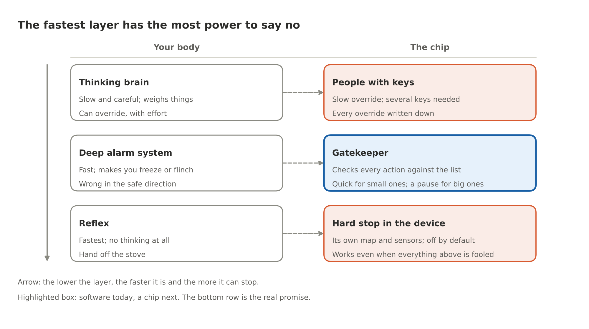

# The Chip That Says No

By Yobie Benjamin · October 12, 2026 · Part 1 of 3: the plain-English version

> You cannot trust an AI to police another AI. I have sat in too many meetings where that was the plan. The thing that stops a bad action has to work like a reflex, and it has to live in the chip. There is a way to do this, and this post is the plain-English version of it.

## Too late

Picture a military drone run by an AI. The AI looks at a building, decides it is a weapons depot, and fires. It was a school.

Afterward, it is easy to see the mistake. A log shows the wrong guess. A report explains it. None of that helps the kids.

This is the whole problem with AI safety in one scene. Computers are very good at finding mistakes after they happen. The hard part is stopping a mistake before it happens. We need a chip that can say: you are about to hit a school. STOP.

## Why we can't ask AI to police AI

The first idea everyone has is to put a second AI in charge of watching the first one. I hear it in every boardroom. It sounds smart. It does not work.

The second AI is the same kind of thing as the first. It can be fooled the same ways. It can be talked into things, and nobody can fully check what is going on inside it.

Think of a referee at a ball game who is also a player. That is not a referee. A real guard has to be three things: it cannot be tampered with, it sees every action, and it is simple enough that a person can check it. A second AI fails all three.

So what passes? A smoke detector. It does not understand fire. It senses smoke and screams. It is cheap, dumb, and it goes off early. That is what we want, built into the chip.

## Your body already solved this

This is my favorite part, because I am a biology nerd and the body got here first.

Put your hand on a hot stove. Your hand is off the stove before your brain even knows what happened. The signal never reached the thinking part of your brain; a short loop in your spinal cord did it, in about a thirtieth of a second.

Your body has three layers of protection. The reflex is the fastest and the dumbest. Above it is a fast alarm system deep in the brain that makes you freeze or flinch. Above that is the slow, thinking part that weighs things over seconds.

Here is the key fact: the lower layers can stop the higher ones. Your thinking brain cannot talk your hand into staying on the stove. It can override the reflex, but only slowly and with effort.

One more thing. Your brain has about 86 billion nerve cells, and nobody checks every one of them. Every plan to move has to pass through one narrow exit on its way to your muscles, and the brain guards that exit, not the crowd. This matters for AI, because an AI runs on thousands of chips at once. You cannot watch all of them. You can guard the exit.

## The brain's three tricks

The brain prevents mistakes instead of learning from each one. It uses three tricks, and a chip can copy all three.

- **A danger list, built in.** Evolution already learned what kills you: heights, heat, snakes. Those lessons are wired in before you are born, and you cannot unlearn them. For a chip: a list of things that must never happen, burned in by humans, that the AI cannot edit.
- **A copy of the plan.** Before you move, your brain sends a copy of the plan to a checker that predicts what will happen. For a chip: the AI has to say, in plain fields, what it is about to do. Where. How much. To whom. The chip checks the plan, not the AI's chatter, and checks again at the last moment, when the action actually fires.
- **No, by default, with a pause.** Your brain holds every action back until something releases it. There is also a tiny delay before an action goes out, long enough for a veto. For a chip: every risky action starts as "no" and gets a short built-in delay. In that delay, any alarm can stop it.

## The one question that sets the pace

Every action the AI takes in the world gets checked. Every one. A chip designer who reviewed this design made the point sharply: if some actions skip the check because they are "small," then the AI only has to call a big action small. So nothing skips the check.

What changes from action to action is how hard the check looks and how long it pauses. Ask one question: can you undo it? Sending a draft, moving a file, posting a message: fixable, so the check is quick, a record is kept, and the action goes. Firing a weapon, wiring money, deleting records: not fixable, so the check is thorough, there is a pause, and sometimes a person has to sign.

Your brain does this. You hesitate at the edge of a cliff, not at a chair, but you look at both. This is also what makes the size problem go away: an AI handles trillions of requests, almost none of them touch anything that cannot be undone, and the slow path is rare.

## AI may shout STOP but never say GO

There is one job a second AI can do safely. It can raise an alarm.

An alarm costs little when it is wrong. A smoke detector that goes off while you cook is annoying, not deadly. So let as many AIs as you want watch for trouble and shout STOP.

But no AI gets to clear an alarm. Clearing one takes a simple rule the chip can check, or a human with a key. The AI is the smoke detector. The person is the fire marshal.

## What this looks like in real life

Back to the drone. Put a map of protected places in the weapon's own guidance chip: schools, hospitals, places already registered with aid groups. The chip checks the target against the map when the weapon is released and again on the way in. The release line is off by default.

Turning it on near a protected place takes several humans with keys, and the reason gets written down. The AI's opinion does not matter. The map does.

This is not science fiction. My own DJI drone refused to fly into airports for a decade because of a map in its software. In 2025 DJI changed that in the US from a hard stop to a warning. Nothing about the technology changed. The pattern works. "Just a warning" is how it dies.

The same idea already runs in payments. A bank does not ask an AI whether to approve a million-dollar transfer to a brand-new account at 3 a.m. A limit says no. Limits, lists and maps are old, boring and strong.

One more thing a bank already knows. A permission slip has to name the exact thing it permits: this amount, to this account, under these rules, usable once. Otherwise the slip gets reused, or two payments that each fit the limit go through together and blow past it, or an old slip stays good after the rules changed. So the chip's permission is a receipt for one exact action, it is spent the moment the action happens, it dies when the rules change, and the chip remembers what it has spent even after a power cut.

Now the honest part, because I would rather tell you the limits than oversell this. It will not catch an AI that says something false, because no chip can know what is true. It will not stop a danger nobody thought to put on the list. The chip can check a target against a list; it cannot know whether the list is complete or up to date, and two sensors that agree are not two independent sensors if they can fail the same way. So every one of these systems comes with a written list of what it trusts and why. Stopping is not always the safe move either: a drone can simply not fire, but a robot holding something has to be told what its safe move is. And someone has to hold the keys, which is a human problem, not a chip problem. What it does is put a hard floor under the worst outcomes, no matter how smart or how wrong the AI is.

## The three layers that say no

Each layer on the left already exists in you. Two of the three on the right already exist in machines. The gatekeeper in the middle exists today as software and is the part to put into a chip. The hard stop at the bottom is where the real promise lives: it works even if everything above it has been fooled.

## Where this goes next

[Part 2](https://github.com/YobieBenjamin/hardware-and-silicon/blob/main/blog/03-the-chip-that-says-no-2-with-the-technical-detail.md) makes the same argument with the names, numbers and papers. [Part 3](https://github.com/YobieBenjamin/hardware-and-silicon/blob/main/blog/04-the-chip-that-says-no-3-the-silicon-design.md) is the design: what sits on the chip, what sits in the software around it, and what sits in the weapon, the bank or the robot at the far end. It also walks one request all the way through, from a prompt to an action in the world, and shows exactly where the chip gets to say no. All three parts were revised after a chip designer went through the first draft; his corrections made the promise narrower and the design stronger.

I am not asking anyone to trust the AI companies, or the AI. I am asking for a chip that does not care what the AI thinks. The code behind all of it runs today: one command, fifty-one tests, seventy-five attacks, under a minute, at [github.com/YobieBenjamin/hardware-and-silicon](https://github.com/YobieBenjamin/hardware-and-silicon).
