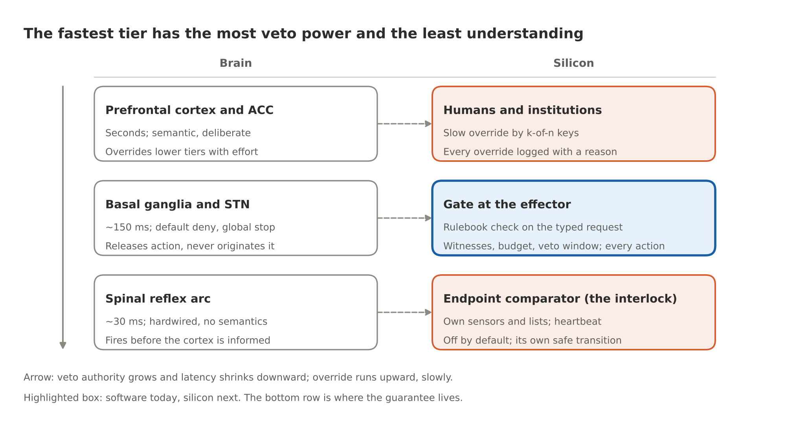

# The Chip That Says No

By Yobie Benjamin · October 12, 2026 · Part 2 of 3: the same argument, with the technical detail

> Same argument as Part 1, with the names, numbers and papers. The guard that stops a bad action has to be a reference monitor, not another model, and it has to sit where computation becomes physics. Revised after a chip designer's review of the first draft; the corrections are marked where they land.

## Trillions of tokens, one bit

A frontier model does not run on a chip. It runs on thousands of GPUs at once, handling trillions of requests over trillions of tokens. No guard bolted onto one GPU can know what all that computation means. Any plan that starts with "watch every token" is dead on arrival.

The brain has the same problem at a smaller scale. It has about 86 billion neurons, 16 billion of them in the cortex, and nothing in the cortex audits the cortex. Instead, every intention has to pass through a bottleneck. Sherrington called it the final common path: whatever the brain is thinking, the only way to move the world is through a comparatively small population of motor neurons.

The basal ganglia sit on that path and hold it shut by default. Inhibition is tonic; action is a release.

Now apply that to a drone strike on a school. The GPU cluster did the hallucinating, but the catastrophe cannot happen until a weapons-release line goes high. That line is one bit, and one bit is governable. So the silicon that says STOP is not in the thinker. It is in the effector: the fire-control computer, the munition's guidance chip, the payment switch, the robot's motor controller, the network gateway. Prevention lives where computation becomes physics.

## Reference monitors, not referees

Computer security solved the "who guards the guard" question in 1972. The Anderson report defined a reference monitor, the one component allowed to decide who may touch what. It has to pass three tests:

1. Tamperproof. Nothing it governs can change it.
2. Always invoked. Every access goes through it; there is no side door.
3. Verifiable. It is small enough that people can check it, line by line.

A second AI watching the first fails all three. It can be manipulated by the same prompts. It can be bypassed by any channel it does not sit in front of. And it has a trillion parameters, so nobody can verify it. It is a referee who is also a player.

The thing that passes all three tests is a smoke detector: a simple sensor, a threshold, a loud alarm, biased toward going off early. Silicon is the only place where all three properties are cheap at the same time: a hardware root of trust is tamperproof, a bus is always invoked, and a few thousand lines of firmware can be formally verified.

## 0 and 1, spikes and reflexes

People object that silicon only knows 0 and 1, so a chip cannot know right from wrong. True. But a neuron only knows spike or no spike. An action potential is all-or-none. No neuron knows right from wrong either.

The spinal circuit that pulls your hand off a stove knows nothing about burns. It fires on a nociceptor (pain sensor) signal in roughly 30 milliseconds, before the cortex is even informed. Ethics is not in the substrate, in silicon or in meat.

It lives in two things: an architecture of inhibition with real veto power, and whatever the inhibitory circuits were trained or evolved to detect. The amygdala is the model here. LeDoux's "low road" sends a crude copy of what you see straight to the amygdala, skipping the slow visual cortex. It is fast, sloppy and jumpy on purpose: better a false flinch than a missed snake.

So a chip does not see "wrong." It sees the way a smoke detector sees fire: a proxy for catastrophe, a threshold, a bias toward false alarms. Designing those proxies is a human job.

One more thing worth sitting with. A system can be fully intelligent and still have no privileged aversive circuit; neuroscience studies that configuration under the name psychopathy, where the amygdala and ventromedial prefrontal cortex are weak and the cognition is intact. A cold, fluent, unflinching cortex is a fair description of an LLM. Biology's fix was not more cortex. It was a subcortical layer the cortex cannot talk out of its job.

## Three brain mechanisms, translated to silicon

The brain prevents mistakes instead of learning from each one. It does that with three mechanisms, and each one has a direct hardware translation.

- **Pre-enumerated catastrophes.** The learning-after-the-event did happen, over a few hundred million years of evolution, and the results are burned into reflexes the organism cannot edit. Silicon version: a human-written rulebook of catastrophe predicates, signed by a governance authority, loaded into the gate and unwritable by the model or its operator. Examples: protected-site geofences, transfer limits, sanctions lists, no self-modification, no self-replication.
- **Efference copy.** Before a movement executes, a copy of the motor command goes to the cerebellum, which predicts the sensory result and flags a mismatch. Silicon version: the model's action is turned into a typed request (action, target coordinates, amount, recipient) before anything actuates, by a broker outside the model. The gate evaluates the typed request, not the tokens. Then the check repeats at the point of actuation: the munition's own navigation silicon re-checks the coordinates against the map in flight, so a lie in the plan cannot survive the release. The permission the gate issues is bound to that exact request, usable once, tied to the version of the rules that granted it, and remembered across a restart; the review made the point that a signed permission without those properties can be replayed, reused after the rules change, or counted twice.
- **Default deny plus a veto window.** The basal ganglia hold every action back until something releases it, and the subthalamic nucleus can impose a global stop in roughly 150 to 200 milliseconds. Libet showed the brain starts preparing a movement a few hundred milliseconds before you are aware of intending it, which leaves room for a veto. Silicon version: every action starts as "no" and is released only by a rule; the stakes the rule assigns decide the depth of the check and the length of the latency buffer during which any alarm can land.

## Brain-to-silicon inhibition tiers



A lower tier can stop an upper one; override runs the other way, slowly. The highlighted gate exists today as software and is the piece to put in silicon; the comparator in the device below it is where the guarantee lives, because it holds even when everything above it has been fooled. Part 3 is about building both.

## Risk classes and monotone alarms

Two rules make all of this tractable.

**Every action is authorized; the class sets the depth and the delay.** The first draft of this series said: gate the irreversible, audit the reversible afterward. The reviewer corrected it, and the correction matters. If reversible actions skip the gate, the gate's security depends on who decides what is reversible, and the thing proposing the action would love to decide. Reading a secret can disclose it; sending a message can trigger a process elsewhere; a run of individually harmless operations can add up past a limit. So every action passes the gate and the rulebook, not the requester, assigns the class. What the class changes is the path: a fixable action gets the cheap check and a record; an unrecoverable one gets the full check, the veto window, and when the rule says so a human signature. "After the fact is useless" stays true for the unrecoverable, and the brain still hesitates at cliff edges rather than chairs; it looks at both. Trillions of requests remain manageable because nearly all of them take the fast path.

**Any model may raise STOP; no model may clear it.** Alarms are monotone. A classifier, a second model, a heuristic, anything at all may add a STOP, because a false alarm is cheap. Clearing one takes a deterministic rule the gate can check, or human keys. The amygdala can trigger a freeze on its own; only slow, effortful cortical deliberation overrides it, and that override leaves traces. This is the one direction in which AI checking AI is acceptable, and the only one. One qualification from the review: more alarms mean more stops, and a stop is not free. A drone that does not fire is safe; a robot that freezes mid-motion may not be. Each device has to define its own safe transition, and each alarm needs a recoverable path when it is wrong.

## The concrete case and its limits

A no-strike geofence in the guidance silicon prevents the strike no matter what the targeting model believed. Its parts:

- An attested map of protected sites. Humanitarian deconfliction channels already register hospitals and schools in conflict zones, and the Safe Schools Declaration commits its signatories to protecting them.
- Checks against several navigation sources (not just GPS, which can be spoofed) at release and again in flight.
- A release line that is off by default.
- Override only by k-of-n human keys, with a logged justification.

Militaries already run no-strike lists and collateral-damage estimation. Today those run on human attention, and they get skipped under pressure. Consumer drones show the hardware version works: DJI enforced airport geofences in firmware for a decade, then in 2025 downgraded them to warnings in the US. The pattern works; "advisory" is how it dies.

The limits, stated plainly:

- Map currency. A map that is six months stale protects a building that moved. A valid signature on the list proves who signed it, not that it is complete.
- Adversaries who park weapons next to schools. That is a policy decision, which is exactly where humans and their keys belong.
- Navigation spoofing, hence the multi-source rule. With the reviewer's caveat: several sensors agreeing is not several independent sensors if they share a failure mode, so the rule has to say why the sources are independent, not only how many there are.
- Catastrophe classes nobody enumerated. A novelty check helps here: a request whose fields fall outside anything seen before is a good extra reason to stop. It is a witness, not a guarantee; familiar values can form a dangerous combination, and unfamiliar ones can be harmless.

Trusted hardware does not make declared facts true. The gate compares a supplied value against a protected rule; it still needs a justified basis for trusting the value. So every deployment carries a written register of its inputs: who is authoritative for each, how fresh it must be, what happens when sources disagree, and what the hardware cannot check about it. The guarantee holds exactly as far as that register does.

## Falsehood, precedent, and the formal claim

**Falsehood is the hard one, and the brain does not solve it either.** Preventing a false statement needs a truth oracle, and no brain has one. What the brain has is corroboration: one sensory channel never triggers a high-stakes movement alone, which is why you look twice before stepping into traffic. Above that sit other brains and institutions. The silicon lever is the same: irreversible actions on unverified claims are blocked, a two-source rule applies at the effector, and provenance is an input to the gate. Provenance does not make outputs true. It makes unverified outputs unable to pull a trigger.

A word on what provenance can claim, because the first draft overclaimed it. A chip that signs the bytes leaving it proves that *this device signed these bytes*. It does not prove that the model produced them; a compromised runtime could have put anything in the output buffer. Proving that an attested runtime produced them is a second, separate claim, and proving that the specified computation produced them is a third that nobody has built yet. A signature is also a detachable record, not a watermark: copy or paraphrase the text and the binding is gone. So the gate treats provenance the way it treats every other witness: it can keep the gate shut, and it never opens it.

**The precedent is thirty years old.** Process plants separate the basic process control system from the safety instrumented system. The control system can be as complex as you like. The safety system is simple, independent, certified and deterministic, and it trips the plant before the vessel ruptures (IEC 61508 and 61511; a nuclear reactor SCRAM is the same idea). Nobody in that field lets the control system certify itself. What we are designing is a safety instrumented system for AI actuation, with brain-shaped tiering.

**The formal claim.** The model π proposes an action; a broker outside π turns it into a typed request θ for action a. The gate G holds a rulebook R signed by a governance authority. G permits a if and only if some rule r in R for this action, bound to the attested workload that is asking, is satisfied in full: its constraints hold on θ, the witnesses it names have spoken freshly about this exact request and under its thresholds, the budget it names can take the amount, no alarm has been raised, and, where the rule demands a human, an approver has signed; the whole evaluated after the delay the rule sets:

```
permit(a, θ)  ⟺  ∃ r ∈ R(m, a):  C_r(θ)  ∧  W_r(θ)  ∧  B_r(θ)  ∧  ¬alarm  ∧  (H_r → approved),   after delay τ_r
```

Reversibility appears nowhere in the formula except inside the rule: it decides which r applies, and therefore how demanding W_r, H_r and τ_r are. There is no disjunct that lets an action around the gate. The first draft had one, and the reviewer removed it.

What can then be proved: for any π, however capable or however wrong, no action outside the rulebook occurs through effector E, given four conditions.

1. Every path to E passes through G, and E re-checks on its own (complete mediation; the final common path).
2. The permission is bound to the exact θ that actuates, usable once, tied to the rulebook's version, and remembered across restarts (the check repeats at the point of actuation, and it cannot be replayed, double-counted, or carried past a policy change).
3. The inputs the rules compare against are authoritative, fresh and consistent, as the deployment's assumptions register states.
4. G and E are tamperproof, which is what the silicon design in Part 3 is for.

The residual, stated plainly: classes outside the rulebook, semantic harms that never touch an irreversible effector, and anything the assumptions register cannot vouch for.

## Where this goes next

Part 3 is the design: where each layer of the stack goes in silicon, the theory each piece rests on, how the pieces talk to each other and to the model, how they sit against the GPU, the CPU, memory and storage, and the experiments that would prove or disprove each claim. It builds on the layer model and the reference stack from [A Multi-Layer Approach to AI Safety](01-a-multi-layer-approach-to-ai-safety.md), the first post in this repository. The reviewer's seven corrections are built into it, and the biggest one is the shape of the promise: a security contract at the action endpoint, with the chip-side silicon as containment and provenance, rather than a promise about a chip. The code that runs that contract today, with the review's five demonstrations as tests, is in the same repository: `./run.sh`, fifty-one tests, seventy-five attacks, under a minute.

## Further reading

- J. P. Anderson, *Computer Security Technology Planning Study* (1972), the origin of the reference-monitor concept.
- C. S. Sherrington, *The Integrative Action of the Nervous System* (1906), the final common path.
- J. LeDoux, *The Emotional Brain* (1996), the amygdala's low road.
- B. Libet et al., "Time of conscious intention to act in relation to onset of cerebral activity," *Brain* (1983).
- IEC 61508 and IEC 61511, functional safety of safety instrumented systems.
- D. Dalrymple et al., *Towards Guaranteed Safe AI* (2024): the safety specification, the world model and the verifier are separate, and reliable checking does not remove assumptions about the world.
- [NVIDIA OpenShell on GitHub](https://github.com/nvidia/openshell), a kernel-level policy sandbox for agents.
