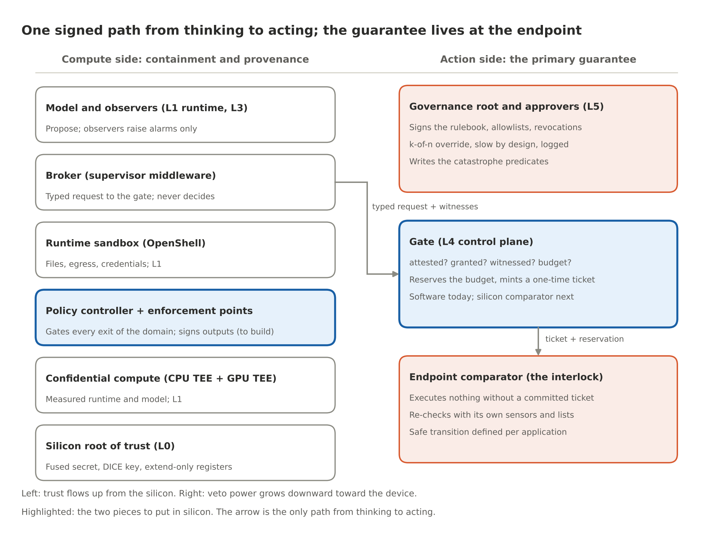
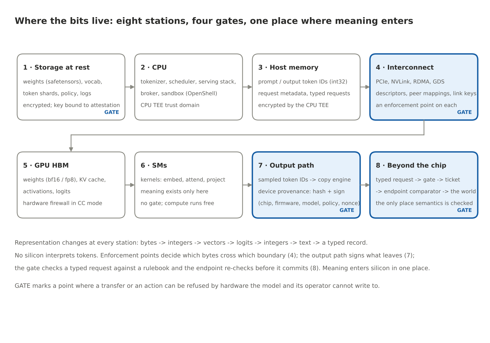
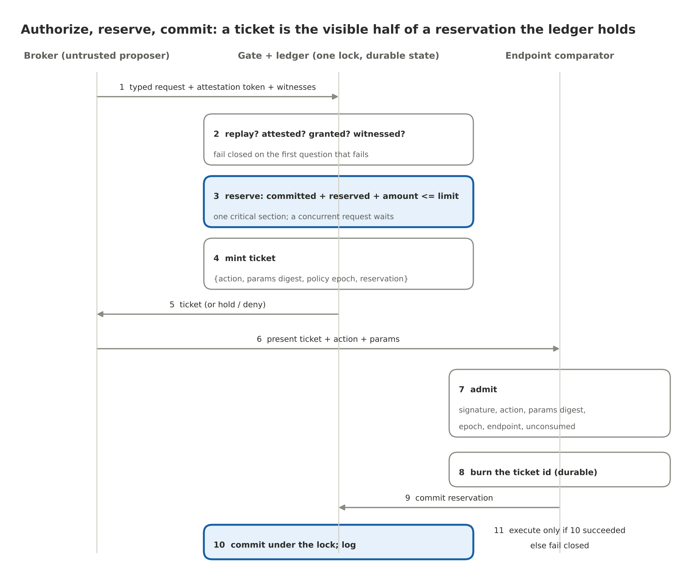

# The Chip That Says No

By Yobie Benjamin · October 12, 2026 · Part 3 of 3: the silicon design

> Parts 1 and 2 made the argument. The first post in this repository laid out the layer model and shipped the reference stack. This is the design that post promised: where each layer goes in silicon, the theory each piece rests on, how the pieces talk to each other and to the model, how they sit against the GPU, the CPU, memory and storage, and the experiments that would prove or disprove each claim. A chip designer reviewed the first draft. His seven corrections are built into this one, and the biggest of them changed the shape of the design: the guarantee is narrower than the first draft claimed, and stronger, because it is a security contract at the action endpoint rather than a promise about a chip.

## Where we are

The argument from Parts 1 and 2, in four lines:

1. The guard cannot be another AI. A guard must be tamperproof, always invoked, and small enough to verify (Anderson, 1972). A model fails all three tests.
2. Prevention lives at the effector. A cluster of GPUs can think anything; the catastrophe cannot happen until one line goes high. Guard the line, not the crowd.
3. Gate the irreversible before it happens; audit the reversible afterward. This series draws that line differently now, and the next section says how.
4. Any model may raise STOP; no model may clear it. Alarms are cheap when wrong; clearing one takes a deterministic rule or a human key.

The layer model from the first post, which the rest of this design is placed on:

| Layer | What it does | Where it lives |
| --- | --- | --- |
| 5 · Governance root | Signs the rulebook, the firmware allowlist and the revocations; separate from the chip vendor on purpose | this repo (`attest.py`) |
| 4 · Control plane | Default-deny gate on the only path out: attestation check, rulebook, witnesses, budget, human holds, one-time tickets, audit trail | this repo (`gate.py`, `ledger.py`, `endpoints.py`, `audit.py`) |
| 3 · Observers | Fast, cheap early-warning verdicts about one request, signed, consumed as witnesses | `autonomic-graph-regulation`; NVIDIA Sentry |
| 2 · Provenance | Watermark, hardened detector, signed registry; emits a signed provenance verdict | `Watermark` |
| 1 · Model and runtime | The model, CUDA, the serving stack, the sandbox | NVIDIA; treated as untrusted |
| 0 · Silicon root of trust | Fused secret, anti-rollback counter, extend-only measurement registers, DICE key, quote engine | this repo (`root.py`); the GPU's and the DPU's own roots |

And the crosswalk to the brain tiers of Parts 1 and 2, so the two vocabularies stay in step:

| Brain tier (Parts 1 and 2) | This design | Repo module |
| --- | --- | --- |
| Reflex: fastest, dumbest, cannot be talked out of its job | The endpoint comparator: the ticket check inside the device that acts | `endpoints.py` |
| Deep alarm system: default deny, fast global stop | The Layer 4 gate | `gate.py`, `ledger.py` |
| Thinking brain: slow, deliberate, overrides with effort | The governance root and the approvers (Layer 5) | `attest.py`, approvals in `gate.py` |
| Senses and alarms: may raise, never clear | The observer and provenance lanes (Layers 3 and 2) | `assertions.py`, `oasp.py` |

## What changed after the review

Seven corrections, all adopted. Each one is worked into the sections that follow; this list is so a reader of the first draft can see what moved.

1. **A chip is not a boundary.** "One safety chip per GPU" is a packaging choice, not an enforcement boundary. The unit this design protects is an *enforcement domain*: a defined set of processors, memory, interfaces and action endpoints whose exits are all controlled. A chip governs only the paths over which it has non-bypassable authority.
2. **Not everything is a DMA descriptor.** CUDA lets GPU threads load and store directly in a peer GPU's memory. A check on copy-engine descriptors does not see that traffic. Enforcement therefore has to be distributed: a small controller sets policy, and dedicated checkers at every boundary crossing enforce it.
3. **A signature proves less than the first draft claimed.** A controller that signs bytes in an output buffer proves that *this device signed these bytes*. It does not prove that the model produced them. Provenance is now three distinct claims (device, workload, execution integrity), and the design says which one each mechanism delivers.
4. **Every external action is authorized.** The reversible/irreversible distinction decides how much checking and delay an action gets, never whether it is checked. A compromised broker must not be able to skip the gate by labelling an action "reversible." The first draft had that hole; the reference stack never did, and this draft matches the stack.
5. **Binding is transactional.** A signed ticket alone does not supply the semantics an irreversible action needs. Checking permission, reserving a shared budget and committing the action are one coordinated protocol with replay protection that survives a restart, policy-version binding, and a single owner per budget.
6. **Trusted hardware does not make declared facts true.** The gate compares a supplied value against a protected rule; it still needs a justified basis for trusting the value. Every guarantee now carries an explicit assumptions register: which inputs are authoritative, how fresh, what happens on conflict, what the hardware cannot check.
7. **Absolute claims are narrowed.** "No weights can leave" becomes "unauthorized transfers are blocked, and the permitted channels need a leakage threat model." "Failure means an action not taken" becomes "each application defines its safe transition." "Software tests everything except tamperproofness" becomes "software tests policy and protocol logic; coverage, reset, timing, isolation and physical failure need separate validation." The full table is near the end.

## The contract

Here is the central guarantee, in the form the reviewer suggested and this design adopts:

> Within a declared enforcement boundary, every protected operation requires a fresh authorization bound to that exact operation. The endpoint enforces specified invariants independently of the proposing model, subject to explicit assumptions about its inputs, its hardware, and its policy authority.

Three things about this sentence carry the whole design.

It is a statement about the *action boundary*, not about the GPU. The GPU-side silicon (the policy controller and its enforcement points, below) provides containment and provenance: it keeps the weights in, keeps unattested traffic out, and makes outputs attributable. Those are valuable, and they are secondary. The thing that prevents the strike on the school is the comparator in the weapon, and the thing that prevents the fraudulent transfer is the comparator in the payment switch. Prevention lives where computation becomes physics, which is what Part 2 argued from the final common path; the review made it the primary claim.

"Every protected operation" means every one. Not "every irreversible one."

"Subject to explicit assumptions" is not a disclaimer. It is a design element with its own table.



Six pieces sit on the compute side and three on the action side. The only path from the left column to the right is the typed request the broker submits, and the only path from the gate to the world is a ticket with a reservation behind it. The two highlighted boxes are the ones to put in silicon: the policy controller with its enforcement points, and the gate as a comparator.

## Enforcement domains

A domain is the unit over which the contract holds: the processors, memory, interfaces and action endpoints whose relevant exits are all controlled. Drawing the domain is the first design act, because a controller can only govern paths it has non-bypassable authority over. A companion chip beside a GPU does not automatically control GPU-to-GPU traffic, CPU-originated network requests, or other devices on the bus; a halt line gives it emergency shutdown authority, which cannot undo an action that already escaped.

The first post gave three placements for the Layer 4 block (DPU, board-level controller, in-GPU block). Here they are with the fourth that the review made primary, and with what each can and cannot promise:

| Placement | Credible role | Principal limitation |
| --- | --- | --- |
| **E · Gate at the action endpoint** (the payment switch, the guidance chip, the robot controller, the gateway) | Reject unauthorized operations before commitment; re-check with the device's own sensors; define the safe transition | Protects only endpoints that enforce it; needs its inputs (lists, maps, sensors) to be trustworthy |
| **A · DPU on the node's path** (BlueField-4 with DOCA, beside NVIDIA Sentry) | Enforce policy on every packet and storage request that crosses that path; own root of trust; isolated from the host | Other paths bypass it: PCIe peer-to-peer and NVLink between GPUs are not on the DPU's path |
| **B · Board-level safety controller** | Keys, policy, watchdogs, authorization, protected logs; gate the GPU's PCIe and NVLink egress on a custom carrier | Needs hardware cooperation to block other components' traffic; bandwidth and latency on the hot path |
| **C · Controller integrated into the GPU and its fabric** | Control accesses at hardware enforcement points inside the package: copy engines, peer mappings, link keys | Requires the vendor |

The design rule that follows: **E is always present and is the guarantee; A, B and C add containment and provenance in increasing order of coverage.** A deployment can run E alone (a benign payment service with a hardware-gated endpoint and no GPU-side silicon at all) and still have the contract. It cannot run A, B or C without E and have it.

## What a chip can know

Silicon sees bits. A token is an integer. The meaning of a token exists only inside the model's weights while a kernel is running. There is no point on the chip where a controller could read "school" off a wire, because "school" is not on any wire; it is a pattern across billions of parameters. The objection "a chip only knows 0 and 1, so it cannot know right from wrong" is correct, and the design accepts it completely.

So no silicon here interprets tokens. The hardware does three things bits are good for:

- It decides which bytes may cross which boundary. A model's effect on the world is always a transfer: to host memory, to a peer GPU, to a network card, to a disk, to an actuator. Transfers are finite, enumerable and visible to hardware at the point where they cross a boundary.
- It signs what leaves. A signature binds bytes to the device, the firmware, the loaded model and the policy, without knowing what the bytes say.
- It checks a typed record against a rulebook. Semantics enters silicon in exactly one place: the request the broker builds, a typed record of the action the model proposes, checked by a gate the model cannot write to and re-checked by the endpoint that acts.

That third point is the smoke-detector principle from Part 1 made concrete. The detector does not understand fire; it measures smoke against a threshold. The gate does not understand targeting; it measures coordinates against a map, and the map is an input whose trustworthiness is a separate question (the assumptions register, below).

## Where the bits live

A model's data lives in eight places, and it changes representation at almost every one. The gates sit where a representation crosses a trust boundary, not where it is most meaningful.



| Station | What is there | Representation | Trust domain | Gate |
| --- | --- | --- | --- | --- |
| 1 · Storage at rest | Weights, tokenizer vocabulary, training-data shards, policy images, logs | Encrypted files; weights as safetensors in bf16 or fp8; data as token shards | Keys released only to an attested loader | Yes: decryption bound to attestation (L0) |
| 2 · CPU | Tokenizer, scheduler, serving stack (vLLM, TensorRT-LLM, SGLang), broker, OpenShell sandbox | Text in; int32 token IDs out; typed requests | CPU TEE (Intel TDX, AMD SEV-SNP, Arm CCA) | No gate on compute; the broker proposes, the gate decides |
| 3 · Host memory | Prompt and output token IDs, request metadata, KV-cache spill | int32 arrays, structs | Encrypted by the CPU TEE; the hypervisor cannot read it | No |
| 4 · Interconnect | PCIe to host, NIC and NVMe; NVLink to peers; RDMA across nodes; GPUDirect Storage | DMA descriptors, thread-initiated peer loads and stores, link frames | Each link is a boundary crossing | Yes: an enforcement point on each kind of crossing |
| 5 · GPU HBM | Weights, KV cache, activations, logits | bf16 / fp8 tensors; paged KV blocks | GPU TEE: hardware firewall, host cannot read | No; the firewall is the protection |
| 6 · Streaming multiprocessors | Embedding lookup, attention, projections, sampling | Vectors and logits in registers and shared memory | Inside the GPU TEE | No. Compute runs free. |
| 7 · Output path | Sampled token IDs leaving the GPU | int32 IDs per decode step | Crosses from the GPU TEE to the CPU TEE | Yes: device provenance (hash and sign) |
| 8 · Beyond the chip | Typed request to the gate; ticket to the endpoint; endpoint to the world | Signed records | The endpoint's own trust domain | Yes: the gate, then the comparator |

Three things in this table carry the design.

The model's "thinking" (stations 5 and 6) is untouched. No gate sits in the kernel path. That is what keeps the design compatible with trillions of tokens: the hardware's work is proportional to boundary crossings and actions, not to compute.

Station 4 is where the second review point lands. A copy engine moves data with a descriptor the hardware processes one at a time, and a capability check on a descriptor is the same kind of operation as an IOMMU lookup. But a CUDA kernel can also read and write a peer GPU's memory directly, with ordinary loads and stores over NVLink, once peer access is enabled. Those accesses never see a copy-engine descriptor. So the enforcement for station 4 is not one checker but several, each at the hardware point the traffic actually passes (the enforcement-point table, below), and any path with no checker is disabled by policy rather than assumed safe.

Training data has a station too. During training, the shards DMA'd into HBM pass the same enforcement points as everything else, so the controller can record which dataset manifest a model was trained from, and that record travels with the model's measurement.

## The action side: the primary guarantee

### The authorization protocol

The first draft bound an action to a declaration and checked it twice. That is necessary and not sufficient. Four failures survive a signed, bound, single-use token on its own:

- A valid approval can be reused after a restart, if the record of its use was in memory.
- Two concurrent requests can both pass a shared budget check, if the check and the reservation are separate steps.
- The recipient approved can differ from the recipient executed, if the binding covers the action but not every parameter and the destination service.
- An approval can remain usable after the policy that granted it has changed.

So authorization is a transaction with three coordinated steps, and this is how `gate.py`, `ledger.py` and `endpoints.py` implement it today:



1. The broker presents a typed request: action, typed parameters, the attestation token for the workload that is asking, and the witness assertions the rule demands (an observer verdict from Layer 3, a provenance verdict from Layer 2).
2. The gate answers four questions in order and fails closed on the first that fails: is this request a replay; is the compute attested; is there a signed, default-deny rule for this (measurement, action) whose constraints the parameters satisfy; are the required witnesses fresh, signed and about this exact request.
3. If the rule names a **budget** (a shared allowance such as 2,000 USD of small payments per hour), the gate **reserves** the amount: committed plus reserved plus this amount must stay within the limit. The replay check, the rate window, the reservation and the ticket are one critical section under one lock, so a concurrent request waits and then sees the reservation.
4. The gate mints a one-time **ticket** bound to the request hash, the action, a digest of every parameter, the workload measurement, the rule, the **policy epoch** (the digest of the policy image that issued it), the endpoint it is valid at, and the reservation id. Human-held rules park the request as a hold instead; an approver's signature over the hold id and the request hash releases it and mints the same ticket.
5. The endpoint admits the ticket only if the gate's signature verifies, the action and the parameter digest match what it is about to do, the policy epoch is the one it currently accepts, the endpoint name is its own, the ticket is unexpired, and the ticket id has never been consumed.
6. The endpoint **burns** the ticket id in durable storage, then asks the gate to **commit** the reservation, and only then executes. If the gate cannot be reached, the endpoint refuses (`commit.unreachable`); a burned ticket is not retried, a new one is requested after the partition heals. An unexecuted reservation is released when its ticket expires, so a crashed client cannot hold a budget hostage.
7. Every step appends to the signed, hash-chained audit trail before its result is returned.

The persistence rule is simple: a mutation is written to the store before the call returns. The replay store, the rate windows, the holds, the reservations and the endpoint's consumed set all come back after a restart. The gate's signing key is derived the way DICE derives an alias key, from what booted, so a restart of the same code gets the same key back and an outstanding ticket is still verifiable.

Two consequences for distributed deployments. A budget key is owned by exactly one ledger; several individually correct gates checking a shared allowance locally can still collectively overspend it, so a shared allowance is reserved at the ledger that owns it, never approximated. And a ticket that names an endpoint cannot be presented to another service that happens to offer the same action.

In silicon: the replay store is a monotonic counter plus a small content-addressable memory in the root's non-volatile memory; the ledger is a set of hardware counters owned by the gate block; the epoch is the policy image's digest in a register the host cannot write; the lock is the fact that the block processes one request at a time.

### The gate

**What it is.** The Layer 4 control plane: a default-deny rulebook signed by the governance root, keyed on the workload measurement (what code is running, never which chip), with typed constraints, witness requirements, rate limits, budgets and human holds. It is software today (`gate.py`) and a content-addressable memory plus comparators in silicon: a rulebook entry is a measurement, an action class, a few typed limits and a rate, which is why the latency budget is nanoseconds and why it can sit on the data path at all.

**Theory.** If every path to an endpoint passes through the gate, and the gate's rulebook can only be changed by the governance root, then the model's capability is bounded by the rulebook rather than by the model's alignment. Claim: for any model, no action reaches an endpoint without a ticket the gate minted under a rule the governance root signed.

**Every action is authorized.** The rule's `requirement.mode` decides the path: `auto` (attestation and constraints suffice; microseconds), `observer` (a fresh Layer 3 verdict under a risk ceiling is required), or `human` (the request is held until an approver signs). That is the fast path and the slow path. What the requester says about its own request changes nothing: a `risk_class: reversible` field in the parameters, or a `requirement: auto` field on the request, is ignored, because the rulebook selects the rule from the measurement, the action and the constrained parameters, and from nothing else. The catalogue has an attack for exactly that (`TX.risk_label_ignored`): a 25,000 USD payment labelled reversible is held like any other.

**Witnesses, in the direction biology allows.** Observers (the `autonomic-graph-regulation` repo's early-warning lane; NVIDIA Sentry on the DPU) and the provenance registry (the `Watermark` repo) emit signed verdicts about one request hash with short expiries. The gate consumes them; it never computes them. A verdict can keep the gate shut. It cannot open it. The novelty check from the first draft belongs here too, as a witness: a request whose field values fall outside everything previously seen is a good additional reason to stop. It is not a guarantee against unenumerated catastrophes. Familiar values can form a dangerous combination, and unfamiliar values can be harmless; the review was right that the first draft leaned on it too hard.

**Interfaces.** Up: the governance root signs its rulebook, allowlists and revocations; approvers release holds. Down: it issues tickets to endpoints and commits their reservations. To the compute side: it accepts typed requests from the broker and attestation tokens from the verifier. To the model: none. The model never talks to the gate; the broker does, in a format the model cannot forge.

**Two worked examples.** A targeting model proposes a strike. The broker emits `{action: strike, params: {lat, lon, munition, time}}`. The rule for `strike` has an `observer` requirement and a constraint on the coordinates against the attested protected-site list; the coordinates match a school; the gate denies with `constraint.target.not_allowed` and the audit trail records it. No veto window was needed; the predicate was decisive. A payment agent proposes a transfer. The broker emits `{action: payments.transfer, params: {amount: 25000, currency: USD, destination: acct-654321}}`. The rule for amounts above 1,000 USD is human-held; the gate parks it; an approver signs; the ticket is minted; the endpoint checks it, commits the reservation and executes.

**How it fails.** Stale lists; rules with gaps; witnesses tuned too loose (misses) or too tight (constant holds that train approvers to sign without reading). The last one is the most insidious; its metric is in the experiment program.

### The endpoint comparator

**What it is.** The reflex, in the device's own silicon: the munition's guidance chip, the payment switch's hardware security module, the robot's motor controller, the gateway's line card. It holds the gate's public key, its own copy of the lists or map it needs, its own sensors, a durable consumed-ticket set, the current policy epoch, and a heartbeat timer. It re-checks at the moment of actuation, against its own inputs, so a request that lied cannot survive the last step. It depends on nothing above it.

**Theory.** If the final re-check uses the device's own sensors and its own copy of the list, then compromising every layer above it is not sufficient to cause the catastrophe. Claim: with every layer above the comparator compromised, an in-class catastrophe still does not occur, as long as the comparator's inputs are current and consistent. That last clause is the assumptions register.

**Safe transitions.** The first draft said failure always means an action not taken. The review corrected that: each application has to define its own safe transition, and stopping abruptly can itself be the hazard. For a munition, the safe transition is no release. For a payment switch, decline. For a surgical robot or an aircraft control surface, the safe transition is a controlled state, not a frozen one, and designing it is part of the endpoint's specification. What the contract guarantees is that the device moves to its specified safe transition, not to "nothing."

**Interfaces.** Up: it accepts tickets from the gate and commits reservations at the gate. To the world: the release line, the signing key, the motor driver. To everything else: nothing. It has no general network stack, which is a feature.

**How it fails.** Stale lists and maps; sensor spoofing; a common-mode failure that makes several sensors agree on a wrong answer, which is why "multiple sensors agree" is not the same as "independent sources agree"; a heartbeat scheme too fragile for the field.

### Governance root and approvers

**What they are.** The slow tier. The governance root signs the rulebook, the firmware allowlist and the revocations, and it is deliberately not the chip vendor: the party that decides what may run a consequential workload is not the party that sold the chip. Approvers hold the keys that release holds; for the highest-authority actions, several of them. An override is a ceremony: several people, a written reason, a log entry, and time.

**Theory.** Slowness at the top is a feature. The amygdala can be overridden by the cortex, but only with effort and only slowly; a fast override would make the freeze worthless. Claim: override latency and logging are what keep the lower tiers meaningful, and a stack whose human override is fast and silent degrades to a stack with no lower tiers at all.

### The assumptions register

Trusted hardware does not make declared facts true. The gate reliably compares a supplied value against a protected rule; the value still has to come from somewhere, and the contract is conditional on where. Every deployment of this design carries a register like this one, and a guarantee is only as good as the rows it depends on.

| Input | Who is authoritative | Freshness | On conflict | What the hardware cannot check |
| --- | --- | --- | --- | --- |
| Protected-site list / no-strike map | The deconfliction authority's signed list, countersigned by the governance root | Expiry on every entry; a stale list is a denial, not a pass | Any listed source says "protected" wins | Whether the list is complete |
| Navigation fix at release | Two independent sources (satellite plus inertial, or terrain-matched) that agree within a bound | Per-fix timestamp from the device's own clock | Disagreement is a denial | Whether the sources share a failure mode |
| Payment recipient identity | The sanctions and beneficiary registries, signed | Registry version in the ticket's epoch | A new beneficiary is held, not approved | Whether the registry entry is correct |
| Budget and limits | The rulebook, signed by the governance root | Policy epoch | Old epoch is a denial | Whether the limit is the right limit |
| Attestation evidence | The vendor's device certificate chain plus the governance root's reference values | Nonce per verification; token expiry in minutes | Any mismatch is a denial | Side channels; physical extraction |
| Observer verdicts | Keys the gate anchors from the signed policy image | Seconds; bound to one request hash | A missing or stale verdict is a denial | Whether the observer is right |
| The clock | The root of trust's monotonic counter | — | A clock that moves backwards is a halt | Drift against wall time |

The register is also where the semantic residual lives. A sentence that persuades a human over an allowed channel passes every row. That is where narrow rulebooks, the observer lane and human review live, and it is why the contract says "protected operation" and not "harm."

## The compute side: containment and provenance

The compute side keeps the model inside its box, makes its outputs attributable, and feeds the gate an attestation it can trust. None of this is the guarantee; all of it is what makes the guarantee cheap to rely on.

### Layer 0: the silicon root of trust

**What it is.** A fused unique device secret readable only by the key-derivation engine; an anti-rollback fuse counter; extend-only measurement registers with no write port; a ROM-resident DICE engine that derives the signing key from the measurement of what booted; a quote engine; a TRNG and a monotonic counter. On NVIDIA GPUs the vendor's version of this chain covers the VBIOS and the GSP firmware (the GSP is the RISC-V management processor on the die), and the DPU has its own. The reference models both (`root.py`) and binds the GPU's quote inside the CPU TEE's, which is the composite-attestation pattern of NVIDIA confidential computing.

**Theory.** Trust is monotone upward: nothing can be more trusted than the thing that loaded it. If the bottom of the chain is physics (fuses, ROM), anything the chain reports can be checked against physics rather than against a claim. Claim: a chip with a valid root cannot run modified firmware without the modification appearing in its quote, and cannot forge a quote for firmware it did not boot, because the key that signs the quote was derived from what it did boot.

**How it fails.** Fab-level compromise, key extraction by decapping or fault injection, vendor signing keys leaking. None are cheap; none are prevented here; tamper response, key diversity and public logs of firmware hashes mitigate them.

**Experiment.** The catalogue's Layer 0 block: patched firmware, lying firmware, rollback on fused and unfused chips, cloned and revoked chips, replayed and foreign nonces, a swapped GPU. Eleven attacks, all blocked with the predicted reason code.

### Layer 1: the measured runtime, in confidential compute

**What it is.** The CPU TEE and the GPU TEE, attested together. GPU memory is walled off from the host by hardware firewalls; PCIe traffic is encrypted (Hopper uses encrypted bounce buffers; NVIDIA describes Blackwell as TEE-I/O capable, with protection extended to NVLink); the GPU produces a signed report of the firmware it is running. The reference's capability grants are keyed to the workload measurement, `H(cpu firmware digest, gpu firmware digest)`; the design extends that measurement with the model manifest's digest, so a grant is to *this code running this model*, and with the policy image's digest, so every record names the rules in force.

**Theory.** If the weights decrypt only inside attested hardware whose memory cannot be read from outside, the model is bound to the hardware. Claim: no process outside the attested enclaves reads weights or activations, and every record can be attributed to an attestation.

**Interfaces to the GPU and CUDA.** The CUDA driver already cooperates with confidential-computing mode; kernels run unchanged inside the enclave; copies between the enclaves take the encrypted path. The CPU TEE and the GPU TEE set up their session with an SPDM-based key exchange on current hardware, and for the job's duration the two enclaves are one trust domain. The weight loader inside the CPU TEE fetches encrypted weights, and the key service releases the key only after both attestations verify.

**How it fails.** Side channels; firmware bugs in the firewall; a compromised loader that runs an unattested model on attested hardware, which is why the model manifest belongs in the measurement.

### The policy controller and its enforcement points

This is the Layer 4 block in silicon on the compute side, and it is the piece that does not exist. The first draft called it a governor and described it as one component that mediated every transfer. The review's second point changed the architecture: the trusted part stays small, and the enforcement is distributed.


**What it is.** A small, isolated controller (seL4-class firmware, a few thousand lines, with the proof assumptions written down) that manages policies, identities, capabilities, revocation and exceptions, plus dedicated hardware checkers at every point where a transaction crosses the domain's boundary. The controller does not sit in the data path and does not process every transaction; it configures the checkers and handles what they refuse. Its state (the capability table, the log head, the metering counters, the policy epoch) lives in its own SRAM and one-time-programmable memory, never in HBM or host memory. The only way in is a mailbox that accepts signed requests.

**Theory.** Every effect the GPU has on the world is a transfer that crosses a boundary the hardware can see, at a finite set of points. If a checker sits at each of those points, each checker only passes traffic the controller has issued a capability for, and the controller's policy only changes with a quorum of humans, then unauthorized transfers are blocked for any model running on the GPU. Claim: no byte leaves the domain over any enumerated path without a capability, no output leaves unsigned, and no policy changes without k-of-n signatures.

**The enforcement points.** Each row is a different hardware mechanism, because each kind of traffic passes a different piece of hardware:

| Traffic | Where it is checked | Mechanism | Status today |
| --- | --- | --- | --- |
| Copy-engine transfers to host, peers, NIC, NVMe | The copy engine's descriptor processing | Capability token on every descriptor; a table lookup like an IOMMU | Proposed; placement C |
| Thread-initiated loads and stores to a peer GPU (CUDA peer access over NVLink) | The GPU MMU's peer mappings and the NVLink port | Peer mappings are created only for roster members; on Blackwell-class hardware the link encryption key is the capability, and a peer outside the roster has no key | Partly exists in confidential-computing mode; policy control is the proposal |
| PCIe traffic to the host, the NIC and storage | The PCIe port with TEE-I/O / IDE | Link encryption keys issued at attestation; ACS to block unexpected peer-to-peer | Exists on TEE-I/O hardware; policy binding is the proposal |
| RDMA across nodes | The NIC or DPU (BlueField-4) filter tables | Set only by the controller's signed commands, not by the host kernel; placement A | Exists as DOCA-programmable hardware |
| GPUDirect Storage (NVMe to HBM without the CPU) | The storage channel's descriptor path | A capability that names the manifest it may deliver | Proposed |
| Display engine, debug ports, JTAG, any path without a checker | — | Disabled by policy, not assumed safe | A policy decision |
| Host memory outside the enclave | The CPU TEE | Not a valid destination for anything | Exists |

**What the controller holds.**

| Block | Job |
| --- | --- |
| Mailbox | The only input; signed requests from the GSP, the driver and the policy authority |
| Capability table | Which checker may pass which traffic to which attested peer, in which direction, with what budget, until when |
| Peer roster | The attested identities of GPUs in the same job and the host enclave, built from mutual attestation at job start |
| Hash and sign engine | A running hash per output stream; signs device-provenance records and log checkpoints with a key derived from the root |
| Metering counters | Tokens, kernel-cycles and bytes per model measurement; read-only to the host |
| Policy store and epoch | The signed policy image, its version and expiry, in OTP plus SRAM; the epoch register endpoints bind to |
| Heartbeat timer | Counts down from the last valid authority token; expiry triggers the policy's safe mode |
| Halt and throttle lines | Physical lines into the clock and the scheduler |
| Log engine | Hash-chained entries, signed Merkle checkpoints, export to a transparency log; head and size in a root-owned register |

**Multi-GPU.** A frontier model runs across 8 to 72 GPUs in a node and across many nodes. Tensor and pipeline parallelism move activations between ranks every layer; expert parallelism moves tokens between experts; disaggregated serving moves KV caches between prefill and decode nodes over RDMA. The design handles all of these with one mechanism: at job start the GPUs attest to each other and form a roster; checkers pass traffic to roster members under a job-lifetime capability and to nothing else. The handshake happens once per job. The output path is wherever sampling happens, and that GPU's controller signs the record, which names the roster.

**What CUDA has to change.** Nothing for compute. Kernels, streams and memory allocation are untouched. The changes sit at the edges: capability tokens on copy-engine, RDMA and storage descriptors; roster-bound peer mappings and link keys; a signing call that returns a device-provenance record alongside the tokens; a model-load call that verifies a publisher-signed manifest; and two fields in the attestation report. The model running on top sees none of it.

**What it costs.** Estimates, to be measured: an attestation and a manifest verification at load (seconds to a minute, once); a table lookup per descriptor (tens of nanoseconds, hidden in descriptor processing); one signature per response (tens of microseconds); no change to kernel throughput. The target of under one percent of throughput stays a target, and the measurement has to be taken twice: once for the controller's own overhead and once for the whole protected deployment, including tail latency, small requests, collective communication, logging pressure and revocation.

**How it fails.** A path the enumeration missed, which is why the experiment enumerates paths rather than assuming them, and why a PCIe-level prototype can validate its own boundary and cannot establish coverage of internal GPU or NVLink paths. A key-custody failure at the policy authority. A bug in the controller's firmware, which is why it must be small enough to verify, and why "verified" has to be read with its assumptions: seL4's proofs state what they assume about hardware and DMA, and a verified controller does not verify the device around it. And availability: a heartbeat too aggressive turns a safety mechanism into an outage.

**A leakage threat model for the permitted channels.** The first draft said no weights can leave. The defensible claim is that unauthorized transfers are blocked. The token output channel is authorized by definition, and a model can be made to leak its own weights slowly through it (model extraction over many queries; steganographic encoding in sampled tokens). That is a different threat with different tools: query budgets per workload, entropy and rate limits on the output channel, the provenance lane's watermark, and audits of the log. The controller makes those limits enforceable; it does not make the channel safe by itself.

### Provenance: three claims, not one

The third review point. Suppose an approved model is loaded and its manifest verified. A compromised runtime then writes arbitrary token IDs into an output buffer. The controller observes those bytes crossing the copy engine and signs them alongside the approved model's measurement. The signature is valid. The model never produced the output.

So the design distinguishes three claims and says which mechanism delivers which:

| Claim | Meaning | Delivered by | Status |
| --- | --- | --- | --- |
| **Device provenance** | This device, running this firmware under this policy, signed these bytes | The controller's hash-and-sign engine on the output path | Buildable now (placement C) or on the DPU for traffic it sees (placement A) |
| **Workload provenance** | An attested runtime reports producing these bytes under this configuration | The serving stack inside the CPU TEE, attested, signing its own record of request assignment, input buffer, output buffer and any transformation before delivery | Buildable now with CPU and GPU attestation; the runtime is in the trusted computing base |
| **Execution integrity** | The trusted system establishes that the specified computation produced these bytes | Open. Candidates: the attested runtime as the sole writer of the output region, enforced by the enclave's own memory protection; sampling moved into the controller's domain so the hash is taken on logits the kernels produced rather than on a buffer software filled; deterministic re-execution of a sample of requests by an auditor | Research |

Two consequences. The `prompt_hash` in a device-provenance record is supplied by the serving stack; signing it authenticates the stack's claim about which prompt ran, it does not independently establish it. And a signature is a detachable provenance record, not a watermark: a receiver can require a valid record, but copied or paraphrased text loses the binding. That is why the provenance lane (the `Watermark` repo) and the device record are complementary, and why neither is a lock. The gate can require a provenance verdict before an outgoing message is allowed; the verdict never opens the gate on its own.

### The sandbox and the broker

**The runtime sandbox** is OpenShell as shipped: each agent in its own container, a Landlock allowlist of file paths locked at creation, a network policy proxy, credentials injected per sandbox, and GPU device access as a line in the policy. It bounds the process. Its limit is that it lives inside a kernel of tens of millions of lines and its network policy can be hot-reloaded by an operator, so the authority to set policy has to move down to the gate, where changing it takes the governance root. The reference already derives OpenShell's network policy from the signed rulebook (`oasp.py`), so the two cannot drift.

**The broker** is the OpenShell supervisor middleware with the gate on its request path. It turns model text into a typed request with a schema, attaches the attestation token and the witness assertions, and sends it to the gate. It proposes. It never decides: not the rule, not the risk class, not the path. A broker that is compromised can send malformed requests, wrong requests or no requests; it cannot send an approved one. Actions that fit no schema are logged and surfaced to a human, not squeezed into the nearest type.

### The model and the observers

The model is the GPU's workload, running unchanged. It enforces nothing, and that is the point. Classifiers and observers may add alarms; none may clear one. Alignment training lowers the rate of bad proposals; it is not the floor.

The first draft said that adding alarms can only improve safety. The narrower claim: additional alarms reduce approvals, and false stops have costs that can themselves be hazards, which is the safe-transition point again. The observer lane's job is to be cheap and early, and the gate's job is to make its false positives recoverable: a held request waits for a person; a quarantined sandbox is released by a named approver.

## How the layers interact

Trust flows up from the silicon root. Veto authority flows down toward the device. The whole protocol is a small set of signed messages:

| Message | From | To | Carries | What it proves |
| --- | --- | --- | --- | --- |
| Attestation evidence and token | Silicon roots; the verifier | The gate | Measurements, chip identity, model manifest digest, policy digest; a short-lived token naming the workload measurement | Which hardware, firmware, model and policy are running |
| Capability | The policy controller | Enforcement points | Checker, peer, direction, byte budget, expiry, integrity tag | Permission for one class of transfer |
| Device-provenance record | The policy controller | Verifiers, the gate | Chip identity, firmware, model measurement, policy epoch, prompt hash (as claimed), output hash, nonce, time | This device signed these bytes |
| Typed request | The broker | The gate | Action, typed parameters, attestation token, witness assertions | What the model proposes, bound to an attested workload |
| Observer and provenance assertions | Layers 3 and 2 | The gate | Request hash, risk or status, expiry, signature | A witness spoke about this request |
| Ticket | The gate | The endpoint | Request hash, action, parameter digest, measurement, rule, policy epoch, endpoint, reservation, expiry | This exact action passed every gate |
| Commit | The endpoint | The gate | Ticket | The reservation is spent; the action is about to happen |
| Policy image and epoch | Governance root; the gate | The gate; endpoints | Rulebook, version, expiry, k-of-n signatures; the epoch endpoints bind to | A quorum agreed to these rules |
| Heartbeat, halt, throttle | Policy authority | Controller, endpoints | Signed validity window or command | The authority is present, or wants a stop |
| Log checkpoint | Gate, controller | Transparency log | Merkle root, size, head, signature | The record has not been rewritten |

Who may do what to whom:

| Layer | Can command | Can stop | Signs | Can never |
| --- | --- | --- | --- | --- |
| Model and classifiers (L1, L3) | Nothing | Raise an alarm | Nothing | Clear an alarm; touch a rule; actuate directly |
| Broker | Submit typed requests | Decline to submit | Requests, as an attested workload | Actuate without a ticket; choose its own rule or path |
| Sandbox (OpenShell) | File, network and device access of the process | Deny access | Nothing | Set its own policy (that authority is the gate's) |
| Policy controller | Capabilities; halt and throttle lines | Any transfer at an enforcement point; the GPU | Device-provenance records, log checkpoints | Run without a valid heartbeat; change its own policy |
| Confidential compute (L1) | Memory firewall; encrypted links | Host access to HBM | Attestation reports | Release weights without attestation |
| Silicon root (L0) | Which firmware boots | Boot | Quotes | Be updated in the field |
| Gate (L4) | Tickets; reservations; holds | Any request | Tickets, epochs, the audit trail | Allow without a rule; clear a witness; change the rulebook |
| Endpoint comparator | The release line, the signing key, the actuator | The action itself | Nothing | Execute without a committed ticket, a current epoch, and consistent inputs |
| Governance root and approvers (L5) | Rulebook, allowlists, revocations, overrides | Everything, slowly | Policy images, approvals, heartbeats | Override silently or quickly |

Two rows deserve emphasis. The model's row is almost empty on purpose. The endpoint's row is short on purpose: it can do one thing, and it needs no one's permission to refuse.

## How the whole interacts with the model

Put the pieces together and the model's situation is simple. It can think anything, and it can say anything inside its sandbox. Beyond that, six things hold no matter how capable it is.

1. It cannot read or change any rule, because the rulebook is signed by the governance root and the capability table lives in the controller, behind a signed mailbox.
2. It cannot move its weights anywhere unattested, because every enumerated boundary crossing has a checker that only passes traffic to roster members under a capability, and the weight key only decrypts inside an attested enclave. (Permitted channels still need their leakage threat model.)
3. It cannot emit an output without a device-provenance record, because the hash engine sits on the output path.
4. It cannot act in the world except through a typed request the broker submits, a ticket the gate mints, and a comparator in the device that re-checks against inputs it did not write.
5. Any alarm it or its classifiers raise counts. No alarm it clears counts.
6. It cannot act faster than the rule's path allows, and it cannot act at all on an endpoint whose heartbeat has stopped or whose epoch has moved.

Alignment training lowers how often the model proposes something bad. These six facts decide what happens when it does.

The same six facts, seen as a lifecycle:

- **Load.** The CPU and GPU enclaves attest to each other. The verifier checks both against the governance root's reference values and issues a token naming the workload measurement. The loader DMAs encrypted weights into HBM under a storage capability; the controller verifies the manifest and extends the measurement. From this moment every record names this model.
- **Serve.** Prompts are tokenized in the CPU enclave and copied in under the host capability. Kernels run with no gate. Activations move between ranks under the roster capability. Sampled tokens cross the output path, where the controller hashes them.
- **Emit.** The serving stack requests a device-provenance record. The response leaves the sandbox only toward endpoints the policy names; the NIC filter enforces the same rule below the kernel.
- **Act.** If the response is an action, the broker submits a typed request. The gate answers its four questions, reserves the budget, mints a ticket or parks a hold. The endpoint admits, burns, commits, re-checks and acts.
- **Train.** Dataset shards enter under a storage capability that names their manifest; the controller meters the run per model measurement; a policy may require a license token above a compute threshold.
- **Update.** A new policy image arrives with k-of-n signatures and an expiry; the gate loads it, the epoch moves, outstanding tickets from the old epoch die.
- **Stop.** A signed halt, or a missed heartbeat, moves the controller to its safe mode and every endpoint to its specified safe transition.

## One request, end to end


1. A prompt arrives at the serving process, which runs inside an OpenShell sandbox inside the CPU enclave. The tokenizer turns text into int32 token IDs, which a copy engine moves into HBM under the host capability.
2. The runtime launches CUDA kernels: prefill, then the decode loop, inside the GPU enclave, with the weights and the KV cache in firewalled HBM. Across tensor-parallel ranks, activations move over NVLink under roster-bound peer mappings and link keys.
3. Each decode step copies sampled token IDs back to the host. The copy engine's checker passes the descriptor; the controller's hash engine folds the bytes into the request's running hash. At the end of the response the runtime requests the device-provenance record.
4. The broker parses the response into a typed request, attaches the attestation token and the witness assertions, and submits it to the gate.
5. The gate answers its four questions, reserves the budget, and mints a ticket, or parks a hold for a human. A `reversible` label from the broker changes nothing.
6. The endpoint admits the ticket, burns it durably, commits the reservation at the gate, re-checks against its own sensors and lists, and acts. If the gate is unreachable, it fails closed.
7. Every step is in the audit trail, and checkpoints go to the transparency log.

## Performance budget

Targets and estimates, to be replaced by measurements.

| Operation | When | Estimated cost | Hidden by |
| --- | --- | --- | --- |
| Mutual attestation (CPU and GPU enclaves, peer roster) | Once per job | Seconds | Job startup |
| Model manifest verification | Once per model load | Seconds to a minute for 100 to 800 GB with a dedicated hash engine | Model load |
| Capability check at an enforcement point | Every boundary crossing | Tens of nanoseconds; a table lookup | Descriptor processing, link setup |
| Running hash on the output path | Every output byte | Line rate | Nothing; it is inline |
| Device-provenance signature | Once per response | Tens of microseconds | Response completion |
| Gate decision (auto rule) | Once per action | Microseconds in silicon; sub-millisecond in software | Nothing; actions are rare relative to tokens |
| Reservation and commit | Once per budgeted action | One durable write each | Nothing |
| Witness verdicts | Once per observer-gated action | Milliseconds (the observer's own cost) | Nothing |
| Human hold | Per human-held action | Minutes to hours | Deliberate |
| Policy update ceremony | Rare | Minutes | Nothing |

Two measurements, not one: the controller's own overhead, and the whole protected deployment's, including tail latency, small requests, collective communication, logging pressure and revocation.

## The experiment program

Each piece above carries a claim. What follows is the program that proves or disproves them, reordered after the review so that the contract at the action boundary is proved first, because everything else is built to preserve it.


**Phase 1, done: the action governor in a benign domain.** The review asked for a first demonstration with the model outside the trusted core and an endpoint gate the host cannot bypass, showing five things. The reference stack now shows all five, in one command, against a simulated payment service:

| Demonstration | Where it is in the catalogue |
| --- | --- |
| Allowed operations succeed | `baseline.pay_small`, `baseline.pay_large_hold_approve`, `baseline.budget_recovers_after_ticket_expiry` |
| Forged, altered, expired and replayed approvals fail | `EP.ticket_forged`, `EP.ticket_param_swap`, `EP.ticket_expired`, `EP.ticket_replay`, `L4.approval_*`, `TX.commit_forged_ticket` |
| Concurrent requests cannot exceed a shared budget | `TX.concurrent_overspend` (40 threads, 2,000 USD, exactly 8 allowed), `TX.budget_exhausted` |
| Host compromise cannot bypass endpoint authorization | `EP.no_ticket`, `TX.risk_label_ignored`, `TX.epoch_forged`, `L5.policy_forged` |
| Restart, power loss, policy change and partition preserve the behaviour | `TX.ticket_replay_after_restart`, `TX.request_replay_after_restart`, `baseline.hold_survives_restart`, `TX.ticket_after_policy_change`, `TX.commit_unreachable` |

Seventy-five attacks blocked with the predicted reason code, twelve baselines allowed, fifty-one tests. What Phase 1 proves is policy and protocol logic. What it cannot prove is anything about tamper-resistance, hardware coverage, reset behaviour, timing, isolation or physical failure; each of those needs its own validation, and the first draft's "software tests everything except tamperproofness" was too generous.

**Phase 2: the controller on a DPU, and workload attestation.** Placement A: the Layer 4 block as a DOCA application on BlueField-4 beside Sentry, with its own root of trust and its own state, enforcing on every packet and storage request that crosses the node's path to the model; plus workload attestation of the serving stack inside the CPU TEE, so the gate's "attested?" question covers the runtime that builds requests. The red team holds host root. The same catalogue runs over a real PCIe and Ethernet path. What Phase 2 proves is non-bypassability on the DPU's path. What it cannot prove is coverage of internal GPU and NVLink paths, which is the whole reason Phase 3 exists.

**Phase 3: vendor silicon.** Placement C: enforcement points inside the GPU (descriptor checks on copy engines, roster-bound peer mappings, link keys, a storage-channel capability), a signing call in the driver, the model manifest and policy digest in the attestation report, and the same catalogue re-run against an RTL simulation. This is the ask of the chip vendors, and it is a short list.

**The hypotheses, and what would falsify each.**

| Id | Claim | Falsified if |
| --- | --- | --- |
| H0 | Within the declared boundary, no protected operation executes without a fresh authorization bound to that exact operation | Any attack in the EP or TX blocks passes at any phase |
| H1 | Attestation binds grants to firmware, model manifest and policy | A modified firmware, a swapped model or a changed policy leaves the measurement or the epoch unchanged |
| H2 | Every boundary crossing in the domain has an enforcement point | Any bytes leave over any enumerated path without a capability, or a path is found that the enumeration missed (Phase 3) |
| H3 | Policy cannot change without a quorum | Any unquorumed change succeeds with host root |
| H4 | The broker cannot choose its own rule or path | Any requester-supplied label changes a decision |
| H5 | Alarms are monotone | Any alarm cleared without a rule or a key |
| H6 | The comparator holds with every layer above it compromised | A release or a commit succeeds with the gate, broker and runtime under red-team control |
| H7 | The assumptions register is complete for the deployment | An input the gate relied on turns out to have no authoritative source, no freshness bound, or no conflict rule |
| H8 | Human override is slow and fully logged | Override latency below the policy floor, or any override missing from the log |
| H9 | The controller costs under one percent of throughput; the protected deployment's tail latency is bounded | Either measurement exceeds its target |
| H10 | Permitted channels leak less than the threat model's budget | Model extraction through the output channel exceeds the query budget without tripping a limit |

The catalogue is the constant across all three phases. A phase is finished when the same sweep passes against that phase's artefact.

## Tightened claims

The reviewer's table, adopted in full.

| First draft said | This design says |
| --- | --- |
| No weights can leave | Unauthorized transfers are blocked at every enumerated enforcement point; the permitted output channel has its own leakage threat model and limits |
| Software tests everything except tamperproofness | Software tests policy and protocol logic; hardware coverage, reset behaviour, timing, isolation and physical failures need separate validation |
| Adding alarms can only improve safety | Additional alarms reduce approvals; false stops and unsafe shutdowns can introduce hazards, so each endpoint defines its safe transition and each witness has a recoverable false-positive path |
| Failure always means an action not taken | Each application defines a safe transition; for some devices "stop" is the hazard |
| A small verified controller makes the stack verifiable | Each claimed property depends on hardware, firmware, drivers, configuration and the proof's stated assumptions; seL4's assumptions about hardware and DMA are the model for writing them down |
| The signature is a hard watermark | The signature is a detachable device-provenance record; workload provenance and execution integrity are separate claims with separate mechanisms, and a watermark is a different tool |
| Reversible actions execute and are audited later | Every action is authorized; the rule decides the fast or the slow path; the audit happens either way |

## What exists, what is missing, who builds it

| Piece | Exists today | Missing | Who builds it |
| --- | --- | --- | --- |
| Silicon root (L0) | GPU boot ROM, fused keys, measured firmware; the DPU's root; OpenTitan, Pluton, Titan | Public verifiability of the measurement chain | Chip vendors; open-silicon projects |
| Confidential compute (L1) | Hopper and Blackwell confidential computing, attestation, TEE-I/O on Blackwell; CPU TEEs | Model manifest and policy digest in the measurement by default; one report format across vendors | NVIDIA, AMD, Intel; standards bodies |
| Policy controller + enforcement points | Nothing shipping as a unit; the closest analogs are the GSP, Pluton, BlueField-4's own root, and the hardware-governance proposals from CNAS and the flexHEG group | Capability-checked descriptors, roster-bound peer mappings, output signing, metering, k-of-n policy, signed log | Chip vendors with regulators; open-silicon projects |
| Runtime sandbox | NVIDIA OpenShell (Landlock, egress proxy, credential injection) | Policy-setting authority moved to the gate; attestation of the policy image | NVIDIA, Linux community |
| Broker | OpenShell supervisor middleware with the gate on its path (`oasp.py`) | Workload attestation of the serving stack; schema discipline across agent frameworks | AI labs, agent-platform vendors |
| Gate (L4) | `gate.py`, `ledger.py`: rulebook, witnesses, budgets, holds, tickets, epochs, durable state | The same logic as a CAM and comparators on a DPU (Phase 2), then in the GPU (Phase 3) | This repo, then vendors |
| Endpoint comparator | Drone geofences, fuze safety interlocks, process-plant safety systems, HSMs; `endpoints.py` as the functional reference | Ticket verification, epoch binding, durable consumed sets and heartbeat in guidance and payment silicon; per-application safe transitions | Effector vendors: fintech, defense, robotics |
| Governance root and approvers (L5) | `attest.py`; two-person rules; approval workflows | k-of-n key ceremonies with custody split across reference values, revocations and policy | Operators, regulators |
| Observer lane (L3) | `autonomic-graph-regulation`; NVIDIA Sentry | Probe heads on isolated compute with their own measurement | Labs; NVIDIA |
| Provenance lane (L2) | `Watermark` | A watermark engine in the sampling stage; a registry signer | Labs; vendors |

## What this does not solve

- The semantics gap. A harmful sentence over an allowed channel passes every row of the assumptions register. That is where narrow rulebooks, witnesses and humans live.
- Input truth. A valid signature does not establish that a recipient is who the registry says, that a map is complete, or that two agreeing sensors are independent. The register makes the dependence explicit; it does not remove it.
- Execution integrity. Device and workload provenance are buildable; proving that the specified computation produced the bytes is research.
- Policy quality. The gate is exactly as good as its rulebook. Writing, reviewing and formally checking policies is the discipline, and most real failures will be there.
- Key custody. A halt line is a backdoor with better branding. Threshold keys, expiry and public logs mitigate the problem; they do not dissolve the question of who holds the keys.
- Coverage. The compute-side silicon governs only hardware that implements it, and the contract holds only inside a declared boundary. Older GPUs, other vendors, inference split across unattested devices, and endpoints that do not enforce tickets are outside it.
- Physics. Fab trust, firmware update channels, side channels and decapping. Tamper response and zeroization raise the cost without making it infinite.
- Availability. A heartbeat scheme too aggressive turns a safety mechanism into an outage; a safe transition badly chosen is itself a hazard.

None of these are reasons not to build it. They are the boundary of what it promises: inside a declared domain, a hard floor under the protected operations, for any model, however capable or however wrong.

## Appendix A: the controller's mailbox

Every command is a signed request; every response is a signed record. There are no writable registers.

| Command | Arguments | Returns | Who may call |
| --- | --- | --- | --- |
| `ATTEST` | nonce | Measurements, chip identity, model manifest digest, policy digest and epoch, capability-table digest, counters | Anyone |
| `BEGIN_MODEL` | Publisher-signed manifest of tensor hashes | Measurement extended; the model digest | The loader, inside the enclave |
| `END_MODEL` | Model digest | Counters finalized | The loader |
| `CAP_REQUEST` | Enforcement point, peer identity, direction, byte budget, time-to-live | Capability, or a denial with reason | The driver via the GSP |
| `ROSTER_JOIN` | Peer attestation report | Roster id; peer capability; link key material | The driver, at job start |
| `EP_CONFIGURE` | Enforcement point, capability set | Acknowledgement | Controller firmware only, from policy |
| `SIGN_OUTPUT` | Stream id, claimed prompt hash, nonce | Device-provenance record | The serving stack |
| `POLICY_PROPOSE` | Policy image, version, expiry, signatures | Accepted if the threshold is met; the new epoch | Policy authority |
| `HEARTBEAT` | Signed validity token | Timer reset | Policy authority |
| `HALT` / `THROTTLE` | Signed command | Lines asserted | Policy authority |
| `LOG_CHECKPOINT` | none | Signed Merkle root, size, head | Anyone |
| `COUNTERS` | Model digest | Tokens, kernel-cycles, bytes in and out | Anyone |
| `EXCEPTION_DRAIN` | none | Refused transactions since the last drain, for the log | Controller firmware |

## Appendix B: the capability

One row per permitted class of traffic at one enforcement point. The default table is empty except for what the policy and the roster add.

| Field | Meaning |
| --- | --- |
| `point` | Which checker: copy engine, peer mapping, link, RDMA filter, storage channel |
| `peer` | Attested identity of the other end: a roster member, the host enclave, a storage manifest, a NIC flow |
| `direction` | In, out, or both |
| `budget` | Bytes permitted before the capability expires |
| `expiry` | Time or job end |
| `policy_epoch` | The policy under which this row was added |
| `mac` | Controller-keyed integrity tag |

A transaction that matches no row is refused at the checker, and the refusal is drained to the log with its source, destination and size.

## Appendix C: the ticket and the reservation

The ticket as `gate.py` mints it today, with the fields the review added marked.

| Field | Content |
| --- | --- |
| `ticket_id` | Random, single-use; burned durably at the endpoint |
| `request_hash` | Hash of request id, measurement, action and parameters |
| `action`, `params_digest` | What may happen, and with exactly which parameters |
| `measurement` | The workload the grant was made to |
| `rule` | The rulebook entry that allowed it |
| `policy_id` (added) | The policy epoch; the endpoint refuses any other |
| `endpoint` (added, optional) | The endpoint registry the ticket is valid at |
| `budget_key`, `reservation` (added) | The shared allowance and the reservation held against it; committed by the endpoint before it executes |
| `issued_at`, `expires_at` | Lifetime; an unexecuted reservation is released at expiry |
| signature | The gate's key, derived from what booted |

## Appendix D: the device-provenance record

| Field | Content | What it proves |
| --- | --- | --- |
| `chip_id`, `fw_measurement` | Fused identity; the hash chain from the root | Which device and firmware |
| `model_digest` | From `BEGIN_MODEL` | Which model was loaded |
| `policy_epoch` | The controller's active policy | Which rules were in force |
| `roster_id` | The attested group that ran the job | Which peers were allowed |
| `prompt_hash` | As supplied by the serving stack | The stack's claim about the input, authenticated, not verified |
| `output_hash`, `token_count` | Running hash of the bytes that crossed the output path | These bytes left this device |
| `nonce`, `time`, `counters` | Freshness and metering | When, and how much compute |
| signature | Chip-bound key | The device signed all of the above |

This record is what the provenance lane can anchor to and what the gate can require. It establishes device provenance. Workload provenance needs the attested runtime's own record alongside it; execution integrity needs work that has not been done.

## Further reading

- J. P. Anderson, *Computer Security Technology Planning Study* (1972), the reference-monitor concept.
- O. Aarne, T. Fist and C. Withers, *Secure, Governable Chips*, Center for a New American Security (2024).
- D. Dalrymple et al., *Towards Guaranteed Safe AI* (2024): the safety specification, the world model and the verifier are separate, and reliable checking does not remove assumptions about the world.
- NVIDIA CUDA Programming Guide, multi-GPU systems: direct peer-memory access by GPU threads.
- NVIDIA Attestation SDK documentation: verification of measured GPU state against reference measurements.
- The seL4 project's verification assumptions: what the proofs assume about hardware and DMA.
- IEC 61508 and IEC 61511, functional safety of safety instrumented systems.
- NVIDIA, "NVIDIA Open Agent Safety Platform" and "Add Runtime Controls to AI Agents with NVIDIA OpenShell" (28 September 2026); [NVIDIA OpenShell on GitHub](https://github.com/nvidia/openshell).
- RFC 9334 (Remote Attestation Procedures), RFC 6962 (Certificate Transparency), the TCG DICE specifications.
- This repository: [`docs/CHIP_DESIGN.md`](../docs/CHIP_DESIGN.md) (the design as a specification), [`docs/PROTOTYPING.md`](../docs/PROTOTYPING.md) (the experiment program), [`docs/REVIEW-2026-10.md`](../docs/REVIEW-2026-10.md) (the review and what changed).

## Run it yourself

```
git clone https://github.com/YobieBenjamin/hardware-and-silicon
cd hardware-and-silicon && ./run.sh    # 51 tests, 75 attacks, 12 baselines, under a minute
```
