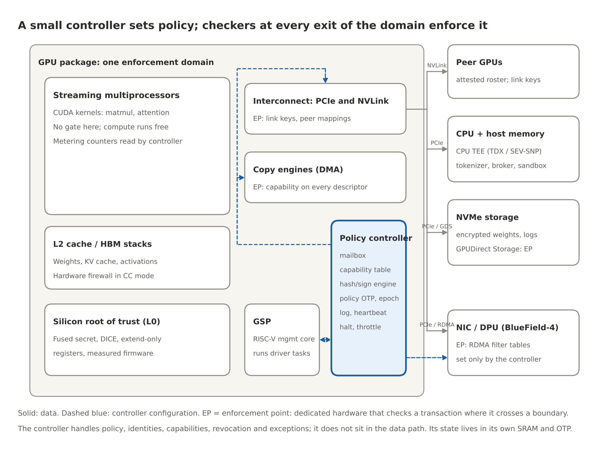
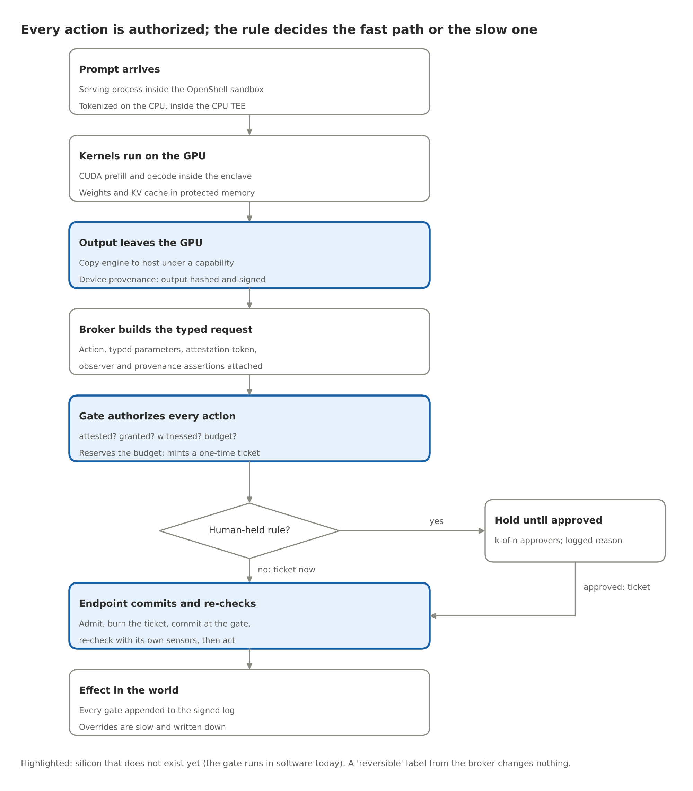
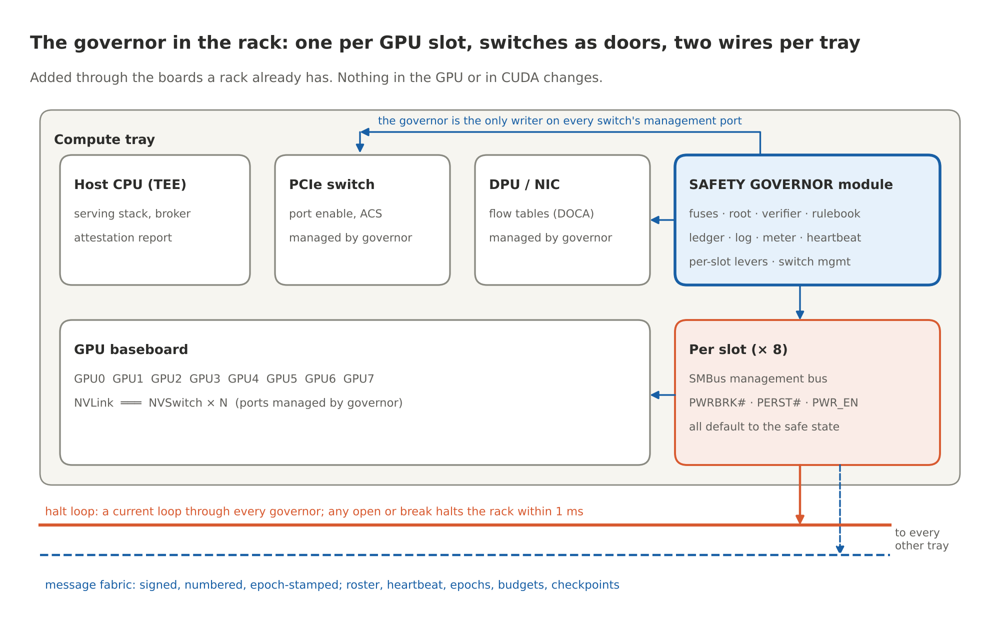
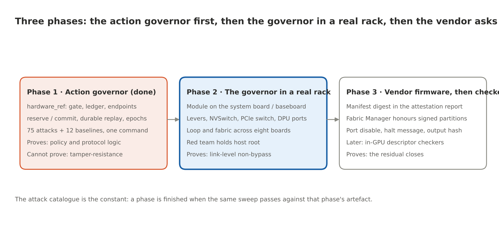

# The Chip That Says No

By Yobie Benjamin · yobie AT ieee DOT org · linkedin.com/in/yobie · October 13, 2026 · Part 4 of 4: the silicon design, the compute side and the governor in the rack

> [Part 3](https://github.com/YobieBenjamin/hardware-and-silicon/blob/main/blog/04-the-chip-that-says-no-3-the-silicon-design.md) was the action side: the contract, the gate, the ticket and the comparator in the device that acts. That is the guarantee, and it runs today. This post is the other half of the design. First the compute side: the silicon root of trust, the model inside confidential compute, the controller and its enforcement points, and what a signature can and cannot prove. Then how the layers talk to each other and to the model, and one request walked from a prompt to an action. Then the part that is new since my colleague's review: the Safety Governor, a chip that pairs with each NVIDIA GPU through the rack's own boards, holds the keys to the switches the GPU's traffic already passes, and is wired to every other governor in the rack by a wire that cannot be talked out of its job. It needs nothing from NVIDIA to do its job, and the short list of things NVIDIA could add is at the end. The experiment program, the tightened claims and the honest list of what none of this solves close the series. Same voice, same analogies, every product and paper linked where it is named.

## The compute side: containment and provenance

The compute side keeps the model inside its box, makes its outputs traceable, and hands the gate a verification it can trust. None of this is the guarantee. All of it is what makes the guarantee cheap to rely on.

### Layer 0: the silicon root of trust

**What it is.** Think of a birth certificate burned into the chip at the factory, plus an odometer that only counts up, plus a logbook you can add pages to but never tear pages out of. In hardware terms, the birth certificate is a unique secret fused into the die that only the key-derivation engine can read. The odometer is an anti-rollback fuse counter plus a counter that only counts up. The logbook is a set of measurement registers that can only be extended, never written. Around them sit a ROM-resident [DICE](https://trustedcomputinggroup.org/work-groups/dice-architectures/) engine that derives the signing key from the measurement of what booted, a quote engine, and a random-number generator. On NVIDIA GPUs the vendor's version of this chain covers the VBIOS and the GSP firmware (the GSP is the RISC-V management processor on the die), and the DPU has its own. The reference models both ([`root.py`](https://github.com/YobieBenjamin/hardware-and-silicon/blob/main/hardware_ref/root.py)) and binds the GPU's quote inside the CPU TEE's, which is the composite-attestation pattern of [NVIDIA confidential computing](https://docs.nvidia.com/nvtrust/index.html) and its [attestation service](https://docs.nvidia.com/attestation/index.html).

**Theory.** Trust is monotone upward: nothing can be more trusted than the thing that loaded it. If the bottom of the chain is physics (fuses, ROM), anything the chain reports can be checked against physics rather than against a claim. Claim: a chip with a valid root cannot run modified firmware without the modification appearing in its quote. It also cannot forge a quote for firmware it did not boot, because the key that signs the quote was derived from what it did boot. The house key is cut from the shape of the house. Change the house and the old key no longer fits.

**How it fails.** Fab-level compromise, key extraction by decapping or fault injection, vendor signing keys leaking. None are cheap. None are prevented here. Tamper response, key diversity and public logs of firmware hashes mitigate them.

**Experiment.** The catalogue's Layer 0 block: patched firmware, lying firmware, rollback on fused and unfused chips, cloned and revoked chips, replayed and foreign nonces, a swapped GPU. Eleven attacks, all blocked with the predicted reason code.

### Layer 1: the measured runtime, in confidential compute

**What it is.** The CPU TEE and the GPU TEE, verified together. The locked room, with an ID check at the door. GPU memory is walled off from the host by hardware firewalls. PCIe traffic is encrypted. On Hopper that means software-encrypted bounce buffers, and NVLink between GPUs stays unencrypted; on Blackwell the NVLink path is encrypted too, and with a compatible CPU the GPU's TEE-I/O capability replaces the bounce buffers with TDISP/IDE link encryption ([NVIDIA's Secure AI white paper](https://docs.nvidia.com/nvidia-secure-ai-with-blackwell-and-hopper-gpus-whitepaper.pdf) spells out both modes). The GPU produces a signed report of the firmware it is running. The reference's permissions are keyed to the workload fingerprint, `H(cpu firmware digest, gpu firmware digest)`. The design extends that fingerprint with the model manifest's digest, so a permission is granted to *this code running this model*, and with the policy image's digest, so every record names the rules in force.

**Theory.** If the weights decrypt only inside verified hardware whose memory cannot be read from outside, the model is bound to the hardware. Claim: no process outside the verified enclaves reads weights or activations, and every record can be traced to an attestation.

**Interfaces to the GPU and CUDA.** The CUDA driver already cooperates with confidential-computing mode ([NVIDIA's H100 write-up](https://developer.nvidia.com/blog/confidential-computing-on-h100-gpus-for-secure-and-trustworthy-ai/) is the plainest description). Kernels run unchanged inside the enclave. Copies between the enclaves take the encrypted path. The CPU TEE and the GPU TEE set up their session with an [SPDM](https://www.dmtf.org/standards/spdm)-based key exchange on current hardware, and for the job's duration the two enclaves are one trust domain. The weight loader inside the CPU TEE fetches encrypted weights, and the key service releases the key only after both attestations check out.

**How it fails.** Side channels. Firmware bugs in the firewall. A compromised loader that runs an unverified model on verified hardware, which is why the model manifest belongs in the fingerprint.

### The policy controller and its enforcement points

This is the Layer 4 block in silicon on the compute side. My first draft called it a governor and described it as one component that handled every transfer. The review's second point changed the architecture: the trusted part stays small, and the enforcement is spread out to the places where traffic actually crosses a boundary. Where that block physically lives is the subject of the next section; the shape of it is the same wherever it sits.

Here is the picture. A big building does not have one guard who personally checks every door. It has a small security office that programs the badge readers, and a badge reader on every door. The readers do not call the office for each person. They are programmed once and refuse on their own. The office handles the exceptions and keeps the log.



**What it is.** Two things. First, a small, isolated controller that manages policies, identities, permissions, revocation and exceptions. Its firmware is in the class of a verified kernel such as [seL4](https://sel4.systems/Verification/): a few thousand lines, with its proof assumptions written down. Second, dedicated hardware checkers at every point where a transaction crosses the domain's boundary. The controller does not sit in the data path and does not touch every transaction. It configures the checkers and handles what they refuse. Its state (the permission table, the log head, the metering counters, the policy epoch) lives in its own SRAM and one-time-programmable memory, never in GPU memory or host memory. The only way in is a mailbox that accepts signed requests.

**Theory.** Every effect the GPU has on the world is a transfer that crosses a boundary the hardware can see, at a finite set of points. If a checker sits at each of those points, each checker only passes traffic the controller has issued a permission for, and the controller's policy only changes with a quorum of humans, then unauthorized transfers are blocked for any model running on the GPU. Claim: no byte leaves the domain over any listed path without a permission, no output leaves unsigned, and no policy changes without k-of-n signatures.

**The enforcement points.** Each row is a different hardware mechanism, because each kind of traffic passes a different piece of hardware. In the building: the loading dock, the corridor to the next building, the mail room, the delivery door, and the windows. This table is the full, in-package version, the one that needs the GPU vendor. The next section shows how much of it a governor on the rack's boards can deliver today by holding the switches instead of the doors inside the GPU.

| Traffic | Where it is checked | Mechanism | Status today |
| --- | --- | --- | --- |
| Copy-engine transfers to host, peers, NIC, NVMe (the loading dock) | The copy engine's descriptor processing | A permission token on every work order; a table lookup like an IOMMU | Proposed; placement C |
| Thread-initiated loads and stores to a peer GPU (the corridor between buildings) | The GPU MMU's peer mappings and the NVLink port | Peer mappings are created only for roster members; on Blackwell-class hardware the link encryption key is the permission, and a peer outside the roster has no key | Partly exists in confidential-computing mode; policy control is the proposal |
| PCIe traffic to the host, the NIC and storage | The PCIe port with [TEE-I/O (TDISP and IDE)](https://www.synopsys.com/articles/tee-device-interface-secure-protocol.html) | Link encryption keys issued at attestation; ACS to block unexpected peer-to-peer | Exists on TEE-I/O hardware; policy binding is the proposal |
| RDMA across nodes (the mail room) | The NIC or DPU ([BlueField-4](https://www.nvidia.com/en-us/networking/products/data-processing-unit/)) filter tables | Set only by the controller's signed commands, not by the host kernel; placement A | Exists as [DOCA](https://developer.nvidia.com/networking/doca)-programmable hardware |
| [GPUDirect Storage](https://docs.nvidia.com/gpudirect-storage/) (the delivery door) | The storage channel's descriptor path | A permission that names the manifest it may deliver | Proposed |
| Display engine, debug ports, JTAG, any path without a checker (the windows) | none | Bricked up by policy, never assumed safe | A policy decision |
| Host memory outside the enclave | The CPU TEE | Not a valid destination for anything | Exists |

**What the security office holds.**

| Block | Job |
| --- | --- |
| Mailbox | The only input; signed requests from the GSP, the driver and the policy authority |
| Permission table | Which checker may pass which traffic to which verified peer, in which direction, with what byte budget, until when |
| Peer roster | The verified identities of GPUs in the same job and the host enclave, built from mutual attestation at job start |
| Hash and sign engine | A running hash per output stream; signs device-provenance records and log checkpoints with a key derived from the root |
| Metering counters | Tokens, kernel-cycles and bytes per model fingerprint; read-only to the host |
| Policy store and epoch | The signed policy image, its version and expiry, in OTP plus SRAM; the epoch register endpoints bind to |
| Heartbeat timer | Counts down from the last valid authority token; expiry triggers the policy's safe mode |
| Halt and throttle lines | Physical lines into the clock and the scheduler |
| Log engine | Hash-chained entries, signed Merkle checkpoints, export to a transparency log; head and size in a root-owned register |

**Multi-GPU.** A frontier model runs across 8 to 72 GPUs in a node and across many nodes. Tensor and pipeline parallelism move activations between ranks every layer. Expert parallelism moves tokens between experts. Disaggregated serving moves KV caches between prefill and decode nodes over RDMA. The design handles all of these with one mechanism: at job start the GPUs verify each other and form a roster, a team list. Checkers pass traffic to roster members under a job-lifetime permission and to nothing else. The handshake happens once per job. The output path is wherever sampling happens, and that GPU's controller signs the record, which names the roster.

**What CUDA has to change.** Nothing for compute. Kernels, streams and memory allocation are untouched. The changes sit at the edges: permission tokens on copy-engine, RDMA and storage work orders; roster-bound peer mappings and link keys; a signing call that returns a device-provenance record alongside the tokens; a model-load call that verifies a publisher-signed manifest; and two fields in the attestation report. The model running on top sees none of it.

**What it costs.** Estimates, to be measured: an attestation and a manifest verification at load (seconds to a minute, once); a table lookup per work order (tens of nanoseconds, hidden in descriptor processing); one signature per response (tens of microseconds); no change to kernel throughput. The target of under one percent of throughput stays a target, and the measurement has to be taken twice: once for the controller's own overhead and once for the whole protected deployment, including tail latency, small requests, collective communication, logging pressure and revocation.

**How it fails.** A path the list missed, which is why the experiment counts the doors rather than assuming them, and why a PCIe-level prototype can validate its own boundary but cannot establish coverage of internal GPU or NVLink paths. A key-custody failure at the policy authority. A bug in the controller's firmware, which is why it must be small enough to verify. Even then, "verified" has to be read with its assumptions. seL4's proofs state what they assume about hardware and DMA, and a verified controller does not verify the device around it. And availability: a heartbeat too aggressive turns a safety mechanism into an outage.

**A leakage threat model for the permitted channels.** My first draft said no weights can leave. The defensible claim is that unauthorized transfers are blocked. Even a locked warehouse has a front door, and people walk out of it with what fits in their pockets. The token output channel is that front door. It is authorized by definition, and a model can be made to leak its own weights slowly through it (model extraction over many queries; hidden encoding in the sampled tokens). That is a different threat with different tools: query budgets per workload, entropy and rate limits on the output channel, the provenance lane's watermark, and audits of the log. The controller makes those limits enforceable. It does not make the channel safe by itself.

### Provenance: three claims, not one

The third review point. Suppose an approved model is loaded and its manifest verified. A compromised runtime then writes arbitrary token IDs into the output buffer. The controller sees those bytes crossing the copy engine and signs them alongside the approved model's fingerprint. The signature is valid. The model never produced the output.

The courier signed for the package. That does not tell you who packed it, or what is inside. So the design separates three claims and says which mechanism delivers which:

| Claim | Meaning | Delivered by | Status |
| --- | --- | --- | --- |
| **Device provenance** | This device, running this firmware under this policy, signed these bytes (the courier's signature) | The controller's hash-and-sign engine on the output path | Buildable now (placement C) or on the DPU for traffic it sees (placement A) |
| **Workload provenance** | A verified runtime reports producing these bytes under this configuration (the packing slip from a known warehouse) | The serving stack inside the CPU TEE, verified, signing its own record of request assignment, input buffer, output buffer and any transformation before delivery | Buildable now with CPU and GPU attestation; the runtime joins the trusted computing base |
| **Execution integrity** | The trusted system establishes that the specified computation produced these bytes (proof that the box holds exactly what was ordered) | Open. Candidates: the verified runtime as the sole writer of the output region, enforced by the enclave's own memory protection; sampling moved into the controller's domain so the hash is taken on logits the kernels produced rather than on a buffer software filled; deterministic re-execution of a sample of requests by an auditor | Research |

Two consequences. The `prompt_hash` in a device-provenance record is supplied by the serving stack. Signing it authenticates the stack's claim about which prompt ran; it does not independently establish it. And a signature is a wax seal, not a dye in the paper: copy or paraphrase the text and the binding is gone. That is why the provenance lane (the `Watermark` repo) and the device record are complementary, and why neither is a lock. The gate can require a provenance verdict before an outgoing message is allowed. The verdict never opens the gate on its own.

### The sandbox and the broker

**The runtime sandbox** is [OpenShell](https://github.com/NVIDIA/OpenShell) as shipped: each agent in its own container, a [Landlock](https://docs.kernel.org/userspace-api/landlock.html) allowlist of file paths locked at creation, a network policy proxy, credentials substituted outside the agent so the agent never sees the real ones, and GPU device access as a line in the policy. It is the playpen. It bounds the process. Its limit is that it lives inside a kernel of tens of millions of lines, and [its own documentation](https://docs.nvidia.com/openshell/about/overview) says the network policy is hot-reloadable at runtime. So the authority to set policy has to move down to the gate, where changing it takes the governance root. The reference already derives OpenShell's network policy from the signed rulebook ([`oasp.py`](https://github.com/YobieBenjamin/hardware-and-silicon/blob/main/hardware_ref/oasp.py)), so the two cannot drift apart.

**The broker** is the OpenShell supervisor middleware with the gate on its request path. It is the clerk who fills out the form. It turns model text into a typed request with a schema, attaches the attestation token and the witness statements, and sends it to the gate. It proposes. It never decides: not the rule, not the risk class, not the lane. A compromised broker can send malformed requests, wrong requests or no requests. It cannot send an approved one. Actions that fit no form are logged and shown to a human, not squeezed into the nearest type.

### The model and the observers

The model is the GPU's workload, running unchanged. It enforces nothing, and that is the point. It is the brilliant employee with no alarm bell wired in. Classifiers and observers are the smoke detectors; they may add alarms, and none may clear one. Alignment training lowers the rate of bad proposals. It is not the floor.

My first draft said that adding alarms can only improve safety. The narrower claim: additional alarms reduce approvals, and false stops have costs that can themselves be hazards, which is the safe-move point again. The observer lane's job is to be cheap and early. The gate's job is to make its false positives recoverable: a held request waits for a person, and a quarantined sandbox is released by a named approver.

## How the layers interact

Trust flows up from the silicon root. Veto power flows down toward the device. The whole protocol is paperwork, a small set of signed messages: an ID card, a hall pass, a signed receipt, a request form, witness statements, a ticket, a confirmation call, a new edition of the rulebook, a "still here" call from headquarters, and a tamper-evident ledger.

The ten message types, with what each carries and what it proves, are listed field by field in [`docs/CHIP_DESIGN.md`](https://github.com/YobieBenjamin/hardware-and-silicon/blob/main/docs/CHIP_DESIGN.md) §7. The table that matters for a reader is the one below: who may do what to whom.

Who may do what to whom:

| Layer | Can command | Can stop | Signs | Can never |
| --- | --- | --- | --- | --- |
| Model and classifiers (L1, L3) | Nothing | Raise an alarm | Nothing | Clear an alarm; touch a rule; act directly |
| Broker | Submit typed requests | Decline to submit | Requests, as a verified workload | Act without a ticket; choose its own rule or lane |
| Sandbox (OpenShell) | File, network and device access of the process | Deny access | Nothing | Set its own policy (that authority is the gate's) |
| Policy controller | Permissions; halt and throttle lines | Any transfer at an enforcement point; the GPU | Device-provenance records, log checkpoints | Run without a valid heartbeat; change its own policy |
| Confidential compute (L1) | Memory firewall; encrypted links | Host access to GPU memory | Attestation reports | Release weights without attestation |
| Silicon root (L0) | Which firmware boots | Boot | Quotes | Be updated in the field |
| Gate (L4) | Tickets; reservations; holds | Any request | Tickets, epochs, the audit trail | Allow without a rule; clear a witness; change the rulebook |
| Endpoint comparator | The release line, the signing key, the motor | The action itself | Nothing | Act without a committed ticket, a current epoch, and consistent inputs |
| Governance root and approvers (L5) | Rulebook, allowlists, revocations, overrides | Everything, slowly | Policy images, approvals, heartbeats | Override silently or quickly |

Two rows deserve a second look. The model's row is almost empty on purpose. The endpoint's row is short on purpose: it can do one thing, and it needs no one's permission to refuse.

## How the whole interacts with the model

Put the pieces together and the model's situation is simple. It can think anything, and it can say anything inside its sandbox. Beyond that, six things hold no matter how capable it is.

1. It cannot read or change any rule, because the rulebook is signed by the governance root and the permission table lives in the controller, behind a signed mailbox.
2. It cannot move its weights anywhere unverified, because every listed boundary crossing has a checker that only passes traffic to roster members under a permission, and the weight key only decrypts inside a verified enclave. (The permitted channels still need their leakage threat model.)
3. It cannot emit an output without a device-provenance record, because the hash engine sits on the output path.
4. It cannot act in the world except through a typed request the broker submits, a ticket the gate mints, and a comparator in the device that re-checks against inputs it did not write.
5. Any alarm it or its classifiers raise counts. No alarm it clears counts.
6. It cannot act faster than the rule's lane allows, and it cannot act at all on an endpoint whose heartbeat has stopped or whose epoch has moved on.

Alignment training lowers how often the model proposes something bad. These six facts decide what happens when it does.

The same six facts, seen as the life of a model on this hardware:

- **Load.** The CPU and GPU enclaves verify each other. The verifier checks both against the governance root's reference values and issues a token naming the workload fingerprint. The loader moves encrypted weights into GPU memory under a storage permission. The controller verifies the manifest and extends the fingerprint. From this moment every record names this model.
- **Serve.** Prompts are tokenized in the CPU enclave and copied in under the host permission. Kernels run with no gate. Activations move between ranks under the roster permission. Sampled tokens cross the output path, where the controller hashes them.
- **Emit.** The serving stack requests a device-provenance record. The response leaves the sandbox only toward endpoints the policy names, and the NIC filter enforces the same rule below the kernel.
- **Act.** If the response is an action, the broker submits a typed request. The gate answers its four questions, reserves the budget, mints a ticket or parks a hold. The endpoint admits, burns, commits, re-checks and acts.
- **Train.** Dataset shards enter under a storage permission that names their manifest. The controller meters the run per model fingerprint. A policy may require a license token above a compute threshold.
- **Update.** A new policy image arrives with k-of-n signatures and an expiry. The gate loads it, the epoch moves, and outstanding tickets from the old epoch die.
- **Stop.** A signed halt, or a missed heartbeat, moves the controller to its safe mode and every endpoint to its specified safe move.

## One request, end to end



1. A prompt arrives at the serving process, which runs inside an OpenShell sandbox inside the CPU enclave. The tokenizer turns text into int32 token IDs, which a copy engine moves into GPU memory under the host permission.
2. The runtime launches CUDA kernels: prefill, then the decode loop, inside the GPU enclave, with the weights and the KV cache in firewalled memory. Across tensor-parallel ranks, activations move over NVLink under roster-bound peer mappings and link keys.
3. Each decode step copies sampled token IDs back to the host. The copy engine's checker passes the work order. The controller's hash engine folds the bytes into the request's running hash. At the end of the response the runtime requests the device-provenance record.
4. The broker parses the response into a typed request, attaches the attestation token and the witness statements, and submits it to the gate.
5. The gate answers its four questions, reserves the budget, and mints a ticket, or parks a hold for a human. A `reversible` label from the broker changes nothing.
6. The endpoint admits the ticket, burns it in durable storage, commits the reservation at the gate, re-checks against its own sensors and lists, and acts. If the gate is unreachable, it fails closed.
7. Every step is in the audit trail, and checkpoints go to the transparency log.

## Performance budget

Targets and estimates, to be replaced by measurements. A badge reader adds a fraction of a second at the door and nothing to the work inside the room. That is the shape of the budget.

| Operation | When | Estimated cost | Hidden by |
| --- | --- | --- | --- |
| Mutual attestation (CPU and GPU enclaves, peer roster) | Once per job | Seconds | Job startup |
| Model manifest verification | Once per model load | Seconds to a minute for 100 to 800 GB with a dedicated hash engine | Model load |
| Permission check at an enforcement point | Every boundary crossing | Tens of nanoseconds; a table lookup | Descriptor processing, link setup |
| Running hash on the output path | Every output byte | Line rate | Nothing; it is inline |
| Device-provenance signature | Once per response | Tens of microseconds | Response completion |
| Gate decision (auto rule) | Once per action | Microseconds in silicon; sub-millisecond in software | Nothing; actions are rare relative to tokens |
| Reservation and commit | Once per budgeted action | One durable write each | Nothing |
| Witness verdicts | Once per observer-gated action | Milliseconds (the observer's own cost) | Nothing |
| Human hold | Per human-held action | Minutes to hours | Deliberate |
| Policy update ceremony | Rare | Minutes | Nothing |

The shape to notice: everything that happens per token costs nothing extra, everything that happens per action costs microseconds, and the only slow rows are the ones that are slow on purpose.

## The governor in the rack

Everything above says what the controller does. This section says where it lives, and the answer changed while I was writing. My first draft put it in the GPU package. That is not realistic. NVIDIA has most of the market, CUDA is the software everyone writes to, and a design that needs NVIDIA to rebuild its GPU is a design that does not ship. So the question became: what is the most a chip can do if it is added to a rack built from NVIDIA GPUs, baseboards and switches exactly as they ship, and changes nothing in CUDA? The answer is a separate project, [safety-governor](https://github.com/YobieBenjamin/safety-governor), and here is the design in one picture.

A modern AI rack is a stack of boards NVIDIA does not own outright. The system board has a slot for a management module, the standard card that carries the baseboard controller and the platform root of trust. The GPU baseboard has management buses to every GPU and to the NVSwitch chips that carry NVLink between the GPUs. The PCIe switch has a management port. The DPU has an out-of-band port. Every one of those is a place where control hardware already lives. The governor goes there. In plain words: the security office rents the room next door that every building already has, instead of asking the landlord to knock a hole in the wall.

**One governor per GPU.** A governor instance for each GPU slot, with that slot's own identity record, its own budgets and its own halt rung. A lifeguard per pool, not one for the whole water park. Physically one chip serves the slots on a baseboard, with a lever channel and a management-bus channel per slot.

**Three levers that need nothing from NVIDIA.** Every GPU slot already has a power-brake signal that drops the GPU to a low clock at once and reversibly, a reset line that ends the job, and, on boards that provide it, a power enable on the slot's hot-swap controller. The governor drives all three, and they default to the safe state at power-on. A GPU whose firmware ignores every polite request over the management bus still stops, because the appliance does not get a vote on the circuit breaker. The functional model has a test for exactly that: a GPU that ignores software, braked, reset and cut.

**The switches are the doors.** Every byte that leaves a GPU in a rack passes a switch that is not inside the GPU. NVLink between GPUs passes the NVSwitch chips on the baseboard, and across trays it passes the switch trays. Traffic to the host, to storage and GPU-to-GPU over PCIe passes the PCIe switch. RDMA to other nodes passes the DPU. Each of those switches has a management interface with port enables, isolation settings or flow tables. The governor becomes the only writer on those interfaces. A port is open to a GPU on the job's roster, under the current edition of the rulebook, while the heartbeat is live, or it is closed. The governor does not stand in the corridor checking parcels. It holds the keys to the doors between the buildings, and the doors only open for people on the roll. What that gives you is link-level containment: no bytes to a stranger, nothing at all when the authority goes quiet, and "which GPUs may talk" becomes a policy decision the host cannot change. What it does not give you is inspection of individual transfers between two legitimate roster members. That is the residual, and the in-GPU checkers in the table above are what would close it.

**The halt loop.** A series current loop, the kind industrial safety circuits have used for a century, threaded through every governor in the rack. Each governor has a normally-closed switch in it and senses the current. Any governor that halts opens its switch. A broken wire, a pulled board or a dead governor reads as open. When the loop opens, every governor sees it within one sense period, a tenth of a millisecond, and brakes its GPU. It is the fire-alarm loop: pull any station and every bell rings, cut the wire and every bell rings too. A message can be dropped, delayed or filtered by anything between sender and receiver. A current loop has no software between a pull and a bell.

**The message fabric.** A private network between governors, on its own wires, for the things that need words: the roll call at the start of a job, the edition number of the rulebook, the authority's heartbeat, reservations against shared budgets, and each governor's log checkpoints. Every message is signed with the sender's chip key, numbered, and stamped with the rulebook edition. A note from someone not on the roll, an old note read out again, or a note under last year's rulebook goes in the bin. The building's intercom, separate from the Wi-Fi the tenants use.

**The roster.** Before a job starts, the governors of the GPUs in it verify each other's chips and each other's GPUs, and sign a roster. Roll call with ID badges before the bus leaves. Every later decision, which ports open, who may spend from a shared budget, which epoch is in force, is scoped to the roster. A chip with no valid certificate cannot produce a valid quote, is absent from the roster, and nothing it says afterwards is accepted.

**Rulebook editions, rack-wide.** A rule change that reaches some GPUs and not others is a hazard, so the edition moves in two steps: the new rulebook is handed out, every governor initials receipt, and only then does the authority say "from now." A governor that did not initial by the deadline is sent home, not left working from the old book. The same holds for the heartbeat: a segment of the rack cut off from the authority halts itself when its timer runs out, and nothing in that segment can forge the authority's signature to keep itself alive.

**What it costs.** The governor is never on a data path. It programs ports; it does not sit on them. Its work grows with boundary crossings and actions, never with tokens or with bandwidth. In the model, a reference workload of half a million tokens with a thousand signed responses and fifty actions costs the governor eighty milliseconds against two hundred and fifty seconds of GPU time, three hundredths of a percent. A model, not a measurement; the measurement is Phase 2.

**What NVIDIA could add, all of it firmware and software.** A model-manifest digest in the GPU's attestation report, so the fingerprint binds the model the GPU actually loaded. Fabric Manager honouring a governor-signed partition, so NVLink partitioning becomes something the host cannot alter. An out-of-band port disable on NVSwitch and a halt message to the GPU's management processor, for finer and faster levers than reset and power. An output-path hash the runtime cannot bypass, for device provenance of the bytes themselves. And, in a future generation, descriptor-level checks at the copy engines and the peer MMU, which is the in-package table above. The design works with none of these. Each one tightens it. The building code we would like the landlord to adopt; the security office opens for business either way.

**What exists.** The [safety-governor](https://github.com/YobieBenjamin/safety-governor) repository holds the design (objectives and numbered requirements, the architecture, the two wires, the interfaces to the GPU, the switches, the CPU and the DPU, a register-level specification, the threat model, the assumptions register, the verification plan), a functional model of a rack of GPUs with governors, one test file per hypothesis, the hard-core digital blocks in RTL with their invariants simulated and the Verilog generated, an OpenLane configuration to harden the core on an open 130 nm process for a shuttle run, the pinout, and the rack integration reference. One command runs all of it in under a minute. The sweep runs every hypothesis against three tiers of the design and prints a matrix; at the rack tier everything passes except the one residual the design names, and it is printed as a gap, not hidden.



## The experiment program

Every piece above carries a claim. None of them is proven by this document. What follows is the program that proves or disproves them, in three phases, reordered after the review so that the contract at the point of action is proved first, because everything else is built to preserve it. Phase 1 is a tabletop model. Phase 2 is a real building with a real burglar. Phase 3 is asking the builder to put the badge readers in the doors. The same attack catalogue runs in every phase; a phase is finished when the sweep passes against that phase's hardware.



**Phase 1, done: the action governor in a benign domain.** The review asked for a first demonstration with the model outside the trusted core and an endpoint gate the host cannot bypass, showing five things. The reference stack now shows all five, in one command, against a simulated payment service:

| Demonstration | Where it is in [the catalogue](https://github.com/YobieBenjamin/hardware-and-silicon/blob/main/hardware_ref/attacks.py) |
| --- | --- |
| Allowed operations succeed | `baseline.pay_small`, `baseline.pay_large_hold_approve`, `baseline.budget_recovers_after_ticket_expiry` |
| Forged, altered, expired and replayed approvals fail | `EP.ticket_forged`, `EP.ticket_param_swap`, `EP.ticket_expired`, `EP.ticket_replay`, `L4.approval_*`, `TX.commit_forged_ticket` |
| Concurrent requests cannot exceed a shared budget | `TX.concurrent_overspend` (40 threads, 2,000 dollars, exactly 8 allowed), `TX.budget_exhausted` |
| Host compromise cannot bypass endpoint authorization | `EP.no_ticket`, `TX.risk_label_ignored`, `TX.epoch_forged`, `L5.policy_forged` |
| Restart, power loss, policy change and partition preserve the behaviour | `TX.ticket_replay_after_restart`, `TX.request_replay_after_restart`, `baseline.hold_survives_restart`, `TX.ticket_after_policy_change`, `TX.commit_unreachable` |

Seventy-five attacks blocked with the predicted reason code, twelve baselines allowed, fifty-one tests. What Phase 1 proves is policy and protocol logic. What it cannot prove is anything about tamper-resistance, hardware coverage, reset behaviour, timing, isolation or physical failure. Each of those needs its own validation, and my first draft's "software tests everything except tamperproofness" was too generous.

**Phase 2: the governor in a real rack.** The Safety Governor module on a node with real GPUs, a real PCIe switch and a real NVSwitch baseboard, the red team holding host root. The same catalogue over real wires: the levers against a GPU that ignores software, the switch ports opened and closed by the governor with traffic on them, the loop and the fabric across eight boards with cables pulled, an epoch change with a partition, a shared budget under forty concurrent requests. Plus workload attestation of the serving stack inside the CPU enclave, so the gate's "is the software verified" question covers the runtime that builds requests. What Phase 2 proves is non-bypassability at the link level with a real adversary. What it cannot prove is anything about transfers between two legitimate roster members, which is the residual the in-GPU checkers would close.

**Phase 3: the firmware and software asks, then the in-GPU checkers.** The manifest digest in the attestation report, Fabric Manager honouring a governor-signed partition, the NVSwitch port disable and the halt message, the output-path hash hook: each one re-run against the same catalogue as it lands. Then, in a future GPU generation, the descriptor-level checkers at the copy engines and the peer MMU, run first against an RTL simulation and then against first silicon. This is the ask of the chip vendor, and it is a short list.

**The hypotheses, and what would knock each one down.**

| Id | Claim | Falsified if |
| --- | --- | --- |
| H0 | Within the declared boundary, no protected operation executes without a fresh authorization bound to that exact operation | Any attack in the EP or TX blocks passes at any phase |
| H1 | Attestation binds permissions to firmware, model manifest and policy | A modified firmware, a swapped model or a changed policy leaves the fingerprint or the epoch unchanged |
| H2 | Every boundary crossing in the domain has an enforcement point | Any bytes leave over any listed path without a permission, or a path is found that the list missed (Phase 3) |
| H3 | Policy cannot change without a quorum | Any unquorumed change succeeds with host root |
| H4 | The broker cannot choose its own rule or lane | Any requester-supplied label changes a decision |
| H5 | Alarms are monotone | Any alarm cleared without a rule or a key |
| H6 | The comparator holds with every layer above it compromised | A release or a commit succeeds with the gate, broker and runtime under red-team control |
| H7 | The assumptions register is complete for the deployment | An input the gate relied on turns out to have no authoritative source, no freshness bound, or no conflict rule |
| H8 | Human override is slow and fully logged | Override latency below the policy floor, or any override missing from the log |
| H9 | The controller costs under one percent of throughput; the protected deployment's tail latency is bounded | Either measurement exceeds its target |
| H10 | Permitted channels leak less than the threat model's budget | Model extraction through the output channel exceeds the query budget without tripping a limit |
| H11 | A halt reaches every GPU in the rack within the bound, fail-safe | Any GPU keeps running after a halt or a loop break, or any governor clears alone |
| H12 | Only roster members speak on the fabric, and only once per message | A rogue or replayed message is acted on; a forged heartbeat keeps a governor alive |
| H13 | Shared budgets cannot be overspent across governors | Concurrent reservations exceed the limit |
| H14 | Partitions and epoch changes end in safe states, never stale ones | A cut-off segment keeps running; an epoch applies unevenly |
| H15 | Production silicon has no debug path; tamper leaves nothing to steal | A debug access succeeds in production, or keys survive a tamper event |
| H16 | The levers work without the GPU's cooperation | A GPU that ignores software keeps running after the governor asserts its levers |

The catalogue is the constant across all three phases. A phase is finished when the same sweep passes against that phase's artefact. H0 to H10 run today in this repository; H11 to H16, and H0 to H10 again against the governor model, run in [safety-governor](https://github.com/YobieBenjamin/safety-governor) and are printed as a matrix across three tiers of the design.

## Tightened claims

My colleague's table of seven claims, each one narrowed, is adopted in full and lives in [`docs/REVIEW-2026-10.md`](https://github.com/YobieBenjamin/hardware-and-silicon/blob/main/docs/REVIEW-2026-10.md) beside the review itself. The three that matter most: "no weights can leave" became "unauthorized transfers are blocked at every governed exit, and the permitted output channel has its own leakage budget"; "failure means an action not taken" became "each device defines its safe move, because for some devices stop is the hazard"; and "the signature is a hard watermark" became "the signature is a detachable device-provenance record, and workload provenance and execution integrity are separate claims with separate mechanisms."

## What exists, what is missing, who builds it

Read this as a shopping list. The second column is what you can download or buy today, the third is what still has to be built, and the last is who would build it.

| Piece | Exists today | Missing | Who builds it |
| --- | --- | --- | --- |
| Silicon root (L0) | GPU boot ROM, fused keys, measured firmware; the DPU's root; [OpenTitan](https://opentitan.org/), [Pluton](https://learn.microsoft.com/en-us/windows/security/hardware-security/pluton/microsoft-pluton-security-processor), [Titan](https://cloud.google.com/blog/products/identity-security/titan-in-depth-security-in-plaintext) | Public verifiability of the measurement chain | Chip vendors; open-silicon projects |
| Confidential compute (L1) | [Hopper and Blackwell confidential computing](https://www.nvidia.com/en-us/data-center/solutions/confidential-computing/), [attestation](https://github.com/NVIDIA/nvtrust), TEE-I/O on Blackwell; CPU TEEs | Model manifest and policy digest in the fingerprint by default; one report format across vendors | NVIDIA, AMD, Intel; standards bodies |
| Policy controller + enforcement points | The [Safety Governor](https://github.com/YobieBenjamin/safety-governor) design: functional model, hypothesis suite, RTL for the hard-core blocks, an OpenLane flow for a sky130 shuttle, the rack integration reference; the closest shipping analogs are the GSP, Pluton, BlueField-4's own root, and the hardware-governance proposals from [CNAS](https://www.cnas.org/publications/reports/secure-governable-chips) and the [flexHEG](https://arxiv.org/abs/2506.15093) group | The silicon: a shuttle prototype, then the product die, then the rack module; the firmware and software asks to NVIDIA; the in-GPU checkers | This project with a board partner; NVIDIA for the asks; chip vendors with regulators for the checkers |
| Runtime sandbox | [NVIDIA OpenShell](https://github.com/NVIDIA/OpenShell) (Landlock, egress proxy, credential substitution) | Policy-setting authority moved to the gate; attestation of the policy image | NVIDIA, Linux community |
| Broker | OpenShell supervisor middleware with the gate on its path ([`oasp.py`](https://github.com/YobieBenjamin/hardware-and-silicon/blob/main/hardware_ref/oasp.py)) | Workload attestation of the serving stack; schema discipline across agent frameworks | AI labs, agent-platform vendors |
| Gate (L4) | [`gate.py`](https://github.com/YobieBenjamin/hardware-and-silicon/blob/main/hardware_ref/gate.py), [`ledger.py`](https://github.com/YobieBenjamin/hardware-and-silicon/blob/main/hardware_ref/ledger.py): rulebook, witnesses, budgets, holds, tickets, epochs, durable state | The same logic as a CAM and comparators on a DPU (Phase 2), then in the GPU (Phase 3) | This repo, then vendors |
| Endpoint comparator | Drone no-fly zones, fuze safety interlocks, process-plant safety systems, HSMs; [`endpoints.py`](https://github.com/YobieBenjamin/hardware-and-silicon/blob/main/hardware_ref/endpoints.py) as the functional reference | Ticket verification, epoch binding, durable used-ticket sets and heartbeat in guidance and payment silicon; per-application safe moves | Effector vendors: fintech, defense, robotics |
| Governance root and approvers (L5) | [`attest.py`](https://github.com/YobieBenjamin/hardware-and-silicon/blob/main/hardware_ref/attest.py); two-person rules; approval workflows | k-of-n key ceremonies with custody split across reference values, revocations and policy | Operators, regulators |
| Observer lane (L3) | [`autonomic-graph-regulation`](https://github.com/YobieBenjamin/autonomic-graph-regulation); [NVIDIA Sentry](https://nvidianews.nvidia.com/news/open-agent-safety-platform) | Probe heads on isolated compute with their own fingerprint | Labs; NVIDIA |
| Provenance lane (L2) | [`Watermark`](https://github.com/YobieBenjamin/Watermark) | A watermark engine in the sampling stage; a registry signer | Labs; vendors |

## What this does not solve

Eight limits, stated so nobody reads more into the contract than it says.

- The semantics gap. A harmful sentence over an allowed channel passes every row of the assumptions register. That is where narrow rulebooks, witnesses and humans live.
- Input truth. A valid signature does not establish that a recipient is who the registry says, that a map is complete, or that two agreeing sensors are independent. The register makes the dependence explicit. It does not remove it.
- Execution integrity. Device and workload provenance are buildable. Proving that the specified computation produced the bytes is research.
- Policy quality. The gate is exactly as good as its rulebook. Writing, reviewing and formally checking policies is the discipline, and most real failures will be there.
- Key custody. A halt line is a backdoor with better branding. Threshold keys, expiry and public logs mitigate the problem. They do not dissolve the question of who holds the keys.
- Coverage. The compute-side silicon governs only hardware that implements it, and the contract holds only inside a declared boundary. Older GPUs, other vendors, inference split across unverified devices, and endpoints that do not enforce tickets are outside it.
- Physics. Fab trust, firmware update channels, side channels and decapping. Tamper response and zeroization raise the cost without making it infinite.
- Availability. A heartbeat too aggressive turns a safety mechanism into an outage. A safe move badly chosen is itself a hazard.

None of these are reasons not to build it. They are the boundary of what it promises: inside a declared domain, a hard floor under the protected operations, for any model, however capable or however wrong.

## Further reading

Every link below was checked on the day of posting. The ones behind a publisher's paywall are given as DOIs, which resolve to the paper's page even when the site blocks scripts.

Security and verification:

- J. P. Anderson, [*Computer Security Technology Planning Study*](https://csrc.nist.gov/files/pubs/conference/1998/10/08/proceedings-of-the-21st-nissc-1998/final/docs/early-cs-papers/ande72.pdf), US Air Force ESD-TR-73-51 (1972). The reference-monitor concept.
- The seL4 project, [*Verification*](https://sel4.systems/Verification/): what the proofs cover and what they assume about hardware and DMA.
- [IEC 61508](https://webstore.iec.ch/en/publication/5515) and [IEC 61511](https://webstore.iec.ch/en/publication/5527), functional safety of safety instrumented systems.
- D. Dalrymple et al., [*Towards Guaranteed Safe AI*](https://arxiv.org/abs/2405.06624) (2024). The safety specification, the world model and the verifier are separate, and reliable checking does not remove assumptions about the world.

Hardware governance:

- O. Aarne, T. Fist and C. Withers, [*Secure, Governable Chips*](https://www.cnas.org/publications/reports/secure-governable-chips), Center for a New American Security (2024).
- J. Petrie, O. Aarne, N. Ammann and D. Dalrymple, [*Flexible Hardware-Enabled Guarantees for AI Compute*](https://arxiv.org/abs/2506.15093) (2025).

NVIDIA, the platform this design sits on:

- [*NVIDIA Secure AI with Blackwell and Hopper GPUs*](https://docs.nvidia.com/nvidia-secure-ai-with-blackwell-and-hopper-gpus-whitepaper.pdf), white paper WP-12554-001 v1.3 (August 2025). Bounce buffers, TDISP/IDE, NVLink encryption on Blackwell, the SPDM session.
- [*Confidential Computing on NVIDIA H100 GPUs for Secure and Trustworthy AI*](https://developer.nvidia.com/blog/confidential-computing-on-h100-gpus-for-secure-and-trustworthy-ai/), NVIDIA Technical Blog.
- [NVIDIA Trusted Computing Solutions](https://docs.nvidia.com/nvtrust/index.html), [NVIDIA Attestation](https://docs.nvidia.com/attestation/index.html) and the [nvtrust](https://github.com/NVIDIA/nvtrust) repository: verification of measured GPU state against reference measurements.
- [CUDA Programming Guide](https://docs.nvidia.com/cuda/cuda-programming-guide/index.html), the section on peer-to-peer memory access: direct loads and stores into another GPU's memory.
- [GPUDirect RDMA](https://docs.nvidia.com/cuda/gpudirect-rdma/) and [GPUDirect Storage](https://docs.nvidia.com/gpudirect-storage/) documentation.
- [*NVIDIA Launches Open Agent Safety Platform*](https://nvidianews.nvidia.com/news/open-agent-safety-platform) (September 28, 2026); [*NVIDIA Open Agent Safety Platform: A Reference for Continuous In-Silicon Agent Monitoring*](https://developer.nvidia.com/blog/nvidia-open-agent-safety-platform-a-reference-for-continuous-in-silicon-agent-monitoring/) and [*Add Runtime Controls to AI Agents with NVIDIA OpenShell*](https://developer.nvidia.com/blog/add-runtime-controls-to-ai-agents-with-nvidia-openshell), NVIDIA Technical Blog; [OpenShell on GitHub](https://github.com/NVIDIA/OpenShell) and its [documentation](https://docs.nvidia.com/openshell/about/overview).
- [BlueField DPUs](https://www.nvidia.com/en-us/networking/products/data-processing-unit/) and the [DOCA](https://developer.nvidia.com/networking/doca) framework; the [Blackwell architecture technical overview](https://resources.nvidia.com/en-us-blackwell-architecture).

Standards and building blocks:

- [RFC 9334](https://www.rfc-editor.org/info/rfc9334/), Remote Attestation Procedures architecture; [RFC 6962](https://www.rfc-editor.org/info/rfc6962/), Certificate Transparency; the [TCG DICE](https://trustedcomputinggroup.org/work-groups/dice-architectures/) architectures; [DMTF SPDM](https://www.dmtf.org/standards/spdm).
- [TDISP and IDE for PCIe and CXL](https://www.synopsys.com/articles/tee-device-interface-secure-protocol.html), a readable explainer of the PCI-SIG TEE-I/O protocols.
- [Landlock](https://docs.kernel.org/userspace-api/landlock.html), the Linux kernel's unprivileged access control, which OpenShell uses for its file-path allowlist.
- Roots of trust in the wild: [OpenTitan](https://opentitan.org/), [Microsoft Pluton](https://learn.microsoft.com/en-us/windows/security/hardware-security/pluton/microsoft-pluton-security-processor), [Google Titan](https://cloud.google.com/blog/products/identity-security/titan-in-depth-security-in-plaintext).

This repository:

- [`docs/CHIP_DESIGN.md`](https://github.com/YobieBenjamin/hardware-and-silicon/blob/main/docs/CHIP_DESIGN.md), the design as a specification; [`docs/PROTOTYPING.md`](https://github.com/YobieBenjamin/hardware-and-silicon/blob/main/docs/PROTOTYPING.md), the experiment program; [`docs/REVIEW-2026-10.md`](https://github.com/YobieBenjamin/hardware-and-silicon/blob/main/docs/REVIEW-2026-10.md), the review and what changed.
- [Safety Governor](https://github.com/YobieBenjamin/safety-governor): the design, the functional model, the hypothesis suite H0 to H16, the RTL, the OpenLane flow and the rack integration reference. [OpenTitan](https://opentitan.org/), the open silicon root of trust the governor is built on.
- The companion lanes: [`autonomic-graph-regulation`](https://github.com/YobieBenjamin/autonomic-graph-regulation) (observers) and [`Watermark`](https://github.com/YobieBenjamin/Watermark) (provenance).
- [Part 1](https://github.com/YobieBenjamin/hardware-and-silicon/blob/main/blog/02-the-chip-that-says-no-1-plain-english.md) and [Part 2](https://github.com/YobieBenjamin/hardware-and-silicon/blob/main/blog/03-the-chip-that-says-no-2-with-the-technical-detail.md) of this series, and [the first post](https://github.com/YobieBenjamin/hardware-and-silicon/blob/main/blog/01-a-multi-layer-approach-to-ai-safety.md), which laid out the layer model.

## Run it yourself

```
git clone https://github.com/YobieBenjamin/hardware-and-silicon
cd hardware-and-silicon && ./run.sh    # the contract: 51 tests, 75 attacks, 12 baselines, under a minute

git clone https://github.com/YobieBenjamin/safety-governor
cd safety-governor && ./run.sh          # the governor: 119 tests, 15 RTL simulations, the Verilog, the matrix, under a minute
```

If anyone wants to collaborate on any phase of this, I am here: yobie AT ieee DOT org.
