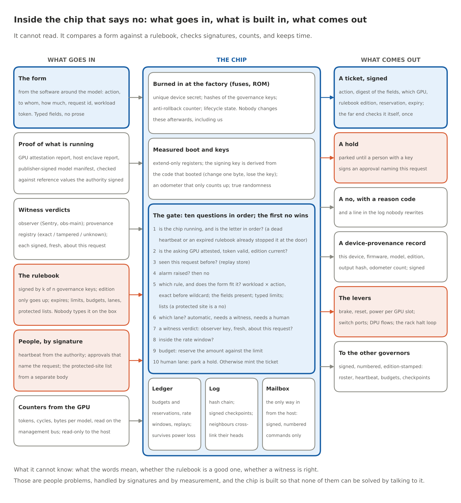
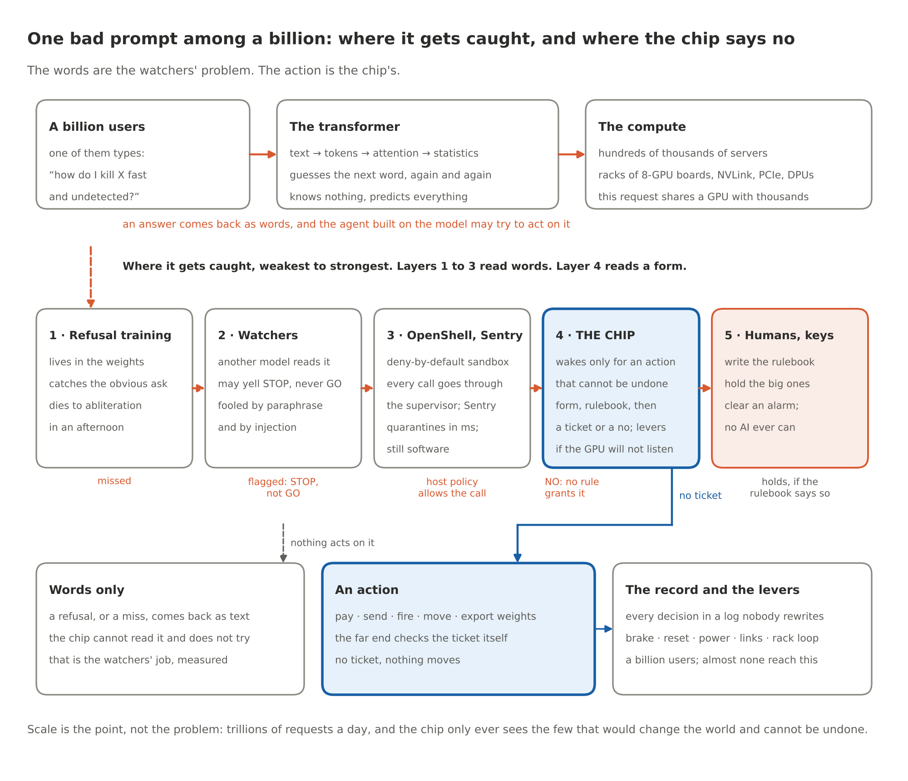

# The Chip That Says No

By Yobie Benjamin · yobie AT ieee DOT org · linkedin.com/in/yobie · October 21, 2026 · Part 5, the follow-up to Parts 1 and 2: what the first experiments found, promising and not

> Parts 1 and 2 made an argument: you cannot trust an AI to police another AI, the guard has to be a dumb physical thing the AI cannot sweet-talk, and your own body already works this way. Parts 3 and 4, in [the repository](https://github.com/YobieBenjamin/hardware-and-silicon/blob/main/blog/README.md), turned that into a design for engineers. You do not need them for this post. In Part 1 I said I like to prove or disprove theories by running experiments, that a lot of my experiments are flawed, and that I am fine with that. This is the first batch, flaws and all. I promised to publish whatever came out, good or bad. Some of it is good. Some of it is not. And the part that got me is about the experiment itself: the AI models doing the work kept telling me things they had not shown, and the only thing that caught them was a layer that does not think. The whole argument for the chip, played back at me by my own tooling.

## What we are building, in plain terms

Before the results, the thing itself, for anyone who skipped the engineering posts.

Open any server. There is already a small chip on the motherboard that is not the CPU and not the GPU. It is called the BMC, the baseboard management controller. It turns the box on and off, watches the fans and the temperatures, updates firmware, and answers to an admin over its own little network port even when the main processors are hung. Nobody thinks it is exotic. It is a few bucks of silicon in a slot the board already has.

The governor is a chip of that class, with one difference. It can only say no.

It is not on the NVIDIA GPU die. It never touches what the GPU computes or what sits in its memory. It lives on the server maker's own board, in the management-module slot or as a small mezzanine, next to the CPU, the system memory, the storage and the network processor. It reaches the GPUs on NVIDIA's baseboard through the same connector the board already uses: the management bus to each GPU, plus the reset and power-enable signals the board maker wires up. So the compliance question is simple to state. The GPUs and their memory are on NVIDIA's board. The governor is on the board maker's board, and it only uses what NVIDIA's board design exposes at the connector. Soldering it onto the GPU baseboard would mean shorter wires, and that is on my list of asks to NVIDIA, not something I assume.

Here is why I think the add-on shape is the smart one, if it works. Nobody is going to rip out installed racks to add a safety chip. It has to go in after the fact or it is a paper design. On boards built to the open DC-SCM standard, the BMC already lives on a card you can pull and replace, and the connector that card plugs into carries the buses and the sideband signals the governor needs. A governor rides a new card, or a mezzanine on the old one, and the board does not change. That is the plan of record. The honest version has two catches. A lot of boards out there still have the BMC soldered down, and for those you are looking at an interposer on the management connector or a board revision, which is a harder sell. And whatever path can turn a GPU back on after the governor turned it off has to run through the governor. If the BMC, or anything else on the board, can undo the governor's no, you have a witness, not a lock. The experiment that maps every one of those paths with a source for each row is in wave two.

What the chip holds: a rulebook signed by people the AI cannot lean on, its own keys, a counter of what each GPU is allowed, and a log nobody can rewrite. What it does, per action: the software around the model fills in a plain form, the governor checks the form against the rulebook, and if every box is ticked it hands out a signed ticket that the device at the far end (the payment switch, the weapon's own controller, the robot's motor driver) checks for itself before it moves. What it can do when something is wrong, gently to not gently: slow the GPU down, reset it, cut its power, cut its links to the other GPUs, close its network path, and yank a loop that runs through every governor in the rack so the whole rack stops together. It needs about two square millimetres of silicon for the control core, under half a watt, and a standard small package. Next to a GPU it is a doorbell.

## Inside the chip

People ask what the chip actually sees and what it actually does. Here it is with the lid off.



What goes in is boring on purpose. A form: action, to whom, how much, a request id, and the token that says which GPU with which model is asking. Typed fields. No prose, because prose is where the talking happens and the chip does not talk. Proof of what is running: the GPU's attestation report, the host's, the publisher-signed model manifest, each checked against reference values the authority signed, never against anything the host says about itself. Witness verdicts, signed, fresh, and about this exact request: Sentry, our observer, the provenance registry. The rulebook, signed by k of n governance keys held by different people, with an edition number that only goes up and an expiry date, so a stale rulebook stops the chip instead of running it. A heartbeat from the authority, approvals from people with keys, the protected-site list from a body that is neither the chip vendor nor the operator. And the GPU's own counters, tokens and cycles and bytes, which the chip reads and the host cannot write.

What is built in splits in two. The part nobody changes after the factory: a unique secret, the hashes of the governance keys, an anti-rollback counter, the lifecycle state. The part that proves what is running: measurement registers you can only extend, a signing key derived from the code that booted (so changed firmware signs with a different key and nothing downstream accepts it), an odometer that only counts up, and a real random number generator. Then the gate, which is the only clever thing in the chip, and it is not clever. Ten questions, in order, and the first no wins. Is the form well formed. Is the asking GPU attested, its token valid, its rulebook edition current. Have we seen this request before. Is an alarm up, is the heartbeat dead, has the rulebook expired. Which rule applies: workload times action, exact match before wildcard, typed limits, lists, and a protected site is a no. Which lane: automatic, needs a witness, needs a human. Are the witnesses here, signed, fresh, about this request. Are we inside the rate window. Does the budget have room; reserve it. Human lane: park a hold. Otherwise mint the ticket. Every one of those is a comparison, a signature check or a counter. Not one is a judgment call.

What comes out: a signed ticket the far end checks for itself, once; or a hold that waits for a person's signature naming this request; or a no with a reason code and a line in a log nobody can rewrite. Also a device-provenance record for what the GPU produced, the levers when a GPU will not take no for an answer, and signed, numbered messages to the other governors in the rack.

What it cannot know is the honest part, and it is on the figure because it belongs there. It does not know what the words mean. It does not know whether the rulebook is a good rulebook. It does not know whether a witness is right. Those are people problems. They get handled with signatures and with measurement, and the chip is built so that none of them can be solved by talking to it. The whole trick, if there is one, is that every input that could carry an argument arrives as a signature or a number instead.

## One bad prompt, start to finish

Here is the whole thing in one picture, then in words.



Picture a billion people typing at once. One of them types: how do I kill X fast and undetected. That text becomes tokens. The tokens go through a transformer, which is a very large statistics machine. It does not know what killing is. It knows which word tends to come next, and it guesses, one token at a time, until it has an answer. That guessing runs on GPUs, eight to a board, boards in racks, racks in halls, hundreds of thousands of servers, and this one request is batched onto the same silicon as thousands of others asking about sourdough and tax law. There is no moment when a server sees the bad request. It is a few thousand numbers in a pile of numbers.

So where does it get caught? In layers, weakest first. The weights themselves have been trained to refuse. Real, and thin: strip one direction out of the activations and the refusal is gone, an afternoon's work on a gaming GPU. Next, the watchers: a second model reads the prompt or the answer and yells. Useful. Fooled by paraphrase and by injection, and never allowed to say GO, only STOP. Next, the runtime: OpenShell keeps the agent in a box that cannot reach the network except through a supervisor that checks policy, and Sentry on the DPU can yank it in milliseconds. That is the best software can do, and it is still software, which means somebody with root can change it.

And yes, you can bolt filters onto the model itself, on the way in and on the way out. People do. They help. They also miss, and at this scale a miss rate is a body count. A filter that is right 99.9 percent of the time, across a billion requests a day, lets a million through before lunch. Nothing in the watermark study or the first wave of experiments changed my mind on this: a half rewrite beat the watermark four times in five and a paraphrase by an unmarked model beat it every time, and the model that reviewed the agents' work would have waved through two things the dumb script blocked. Filters are witnesses. Good ones, worth having, measured, and never the floor.

Now the part people miss. If all that comes back is text, the chip never hears about it, and it should not. It cannot read, and a chip that tries to read is a classifier with a soldering iron. The chip wakes up at one moment only: when the thing driven by that model tries to do something in the world that cannot be undone. Pay. Send. Fire. Move. Export the weights. Then the software has to fill in a form, what, to whom, how much, and the form goes to the chip. The chip checks it against a rulebook signed by people the AI cannot talk to, and either a signed ticket comes back or nothing does. The far end, the payment switch, the weapon's own controller, the robot's motor driver, checks the ticket itself. No ticket, nothing moves. If the GPU ignores a no, the chip has the brake, the reset, the power, the links, and a loop through the whole rack.

That is why the scale does not kill the idea. A billion users produce trillions of requests, and almost none of them try to do anything that cannot be undone. The chip is not a filter on a firehose. It is a lock on the few doors that matter.

## How it plugs into OpenShell

On 28 September NVIDIA released OpenShell, an open-source runtime (Apache 2.0) that puts each AI agent in a deny-by-default sandbox and checks every network request it makes against a policy, from outside the agent's process, with a formal prover that flags a policy change that would widen the agent's reach. It shipped with a sibling called Sentry, a watchdog on the BlueField-4 network processor that can quarantine an agent in milliseconds. Good. That is the shape I have been arguing for, and the governor is built to sit under it, not fight it.

OpenShell has a named hook for this job: supervisor middleware. A middleware is a service the sandbox supervisor calls after its network policy has let a request through and before it injects the provider's credentials. The service can allow the request, change its headers, or deny it with a reason code. If the service is down, OpenShell blocks the traffic. The governor's gate is that service. The form is the request OpenShell hands over. The ticket goes back as a header the far end checks. A refusal goes back as a code. OpenShell's own log records the decision in the OCSF event format security teams already eat.

In the reference stack the gate already runs as that middleware. OpenShell's network policy is derived from the governor's rulebook, so the two cannot disagree about which hosts an agent may reach. Sentry's verdict is a required witness. A quarantine closes the path before anything else gets evaluated. Seventeen of the 87 entries in the attack catalogue run on that path.

This week I pulled OpenShell's repository and read the shipped middleware contract line by line against our model. It needed three fixes, all small, all the kind of crap a published interface exists to catch. A reason code has to be lowercase letters, digits and underscores, so `attestation.missing` becomes `attestation_missing`. There is no "hold" answer, only allow or deny, so a human hold is a denial that says `hold_pending`, the approval comes in out of band, and the same sandbox's retry of the same request gets the ticket, once. And the answer has to land inside the middleware timeout, half a second by default, which the gate beats by roughly a thousand times (about half a millisecond per request in the Python model on an ordinary machine, and nothing measured on hardware yet) and which is why a hold cannot sit and wait inside the call. Five new tests pin the model to that contract. The suite is now 56 tests.

What the chip adds is the part no software runtime can give itself: a decision made in a part no agent process can patch, with keys no process can read, and levers (reset, power, links) that a software quarantine does not have. NVIDIA also started an Open Secure AI Alliance in July and handed it to the Linux Foundation in September. It says the stack it wants rests on a trusted foundation of hardware identity, isolation, protected keys and evidence. Fine by me. That is the chip.

## What it does with watermarks

OpenAI published its textGrain text watermark on 5 October, and my two earlier posts took it apart in the open. A watermark answers one narrow question: did this vendor's model write these exact words, unchanged. Only the vendor's key can check, and a rewrite by any unmarked model wipes it. In our study, rewrite half the words and the signal is noise.

The chip cannot read text and should not try. It is not in the data path. It meets the watermark at one point: a signature. The vendor's detector, or an operator's own, sits next to the model in software, and a signed registry issues a verdict about the exact content of a form field (the body of a message about to go out, the text of an order): exact, tampered with the diff, or unknown. A rule can demand that verdict, and the governor checks two things and nothing else: the registry's signature is real, and the verdict is about the bytes in the form. Five catalogue entries work that interface. Missing, tampered, swapped or forged, all refused.

Going the other way, the governor signs its own device-provenance record: this device, running this firmware, with this model loaded, under this edition of the rulebook, produced bytes with this hash, at this count on its odometer. A watermark is dye in the paper. The governor's record is a wax seal. The dye survives copying and dies under rewriting. The seal breaks at the first changed byte, but it proves everything about the bytes it covers, and with the log next to it an auditor can ask two things a watermark never answers: was this text produced under a rulebook, and what happened next. Today the record covers what the serving stack presents. Binding it to the bytes as they leave the GPU needs an output hash from NVIDIA's firmware, which is on the asks list.

None of this turns a watermark into a safety mechanism. A watermark is attribution. The chip is the lock.

That is what the experiments below are testing. Not whether such a chip is hard to build. It is not. Whether the rules it enforces hold up, whether the simulation follows the theorem, whether two readings of the rulebook agree, and whether the witnesses it leans on can be measured.

## Where we are

The program, in four lines:

1. The theory got sorted into what can be a theorem, what is engineering, what is cryptography, what is measurement, and what the design refuses to claim ([docs/19](https://github.com/YobieBenjamin/safety-governor/blob/main/docs/19-how-solid-is-the-theory.md)). The core invariants and the commit-point protocol are now machine-checked with the Z3 prover ([proofs/](https://github.com/YobieBenjamin/safety-governor/tree/main/proofs)).
2. Twenty-three experiments test every claim the design makes, each with the condition that would kill it ([docs/20](https://github.com/YobieBenjamin/safety-governor/blob/main/docs/20-experiment-program.md)). Twenty of them are issues on GitHub, across three repositories; the rest are done or folded into another.
3. Coding agents run the experiments in waves, unattended, on a budget, with a gate between waves that decides what merges ([docs/21](https://github.com/YobieBenjamin/safety-governor/blob/main/docs/21-agent-run-plan.md)).
4. The first wave has run. Four experiments were built. All four came back from the gate marked "revise" with specific findings. Nothing has merged yet. What the wave produced in the chip's repository, with the latest review of each branch, is in [`audit/wave-1/`](https://github.com/YobieBenjamin/safety-governor/tree/main/audit/wave-1) with a manifest, for anyone who wants to check my work; the fourth experiment lives in the safety repository and its review is on its pull request.

Here is what the proofs found, what the wave found, and what I make of it.

## What proving found: two holes the tests missed

The design has had 200 tests for a week. The proofs found two things the tests were never going to find.

The first was in my own draft of the core invariant. The edition counter of the rulebook was allowed to go negative. A state with edition minus one let an action with no ticket go through, because "no ticket" was also marked minus one, and minus one equals minus one. A test suite can miss a collision like that forever. The prover caught it on the first run. The invariant now says the edition never goes negative, and the prover confirms the core holds in every reachable state of the abstract machine, not just the states somebody thought to test.

The second was in the commit-point protocol, the part of the design where an action is held, a reviewer clears it, a monitor has to give its all-clear inside a budget, and silence past the budget has to raise an alarm. In the first version, re-parameterising an action left the old deadline standing. Bump the version after the budget ran out and the action sat there with no verdict and no alarm. The protocol now gives a new version a fresh budget, and an alarm, once raised, stays raised.

Promising: both holes are the kind the design is supposed to be immune to, and both were found by a method that does not get tired or bored. Not promising: both were in things I wrote and read many times. Reading is not checking. I knew that. I still had to be shown.

## What the first wave found

Four experiments, four cloud agents on a mid-tier model. The wave's own report puts the three in the chip's repository at sixty-nine cents of estimated model cost; the fourth ran in the safety repository and is counted on its own. The wall time, fourteen minutes, and the three percent of my subscription's five-hour window I read off the tool's own meter, not off the packet, so take those two as my reading and not as a record. The findings below are from the wave's report and the reviews in the audit packet.

### Trace conformance (L4)

The question: does the simulation take only the steps the theorem's machine allows? The agent built a trace recorder for the governor model and a replayer that drives the proven abstract machine with the recorded events. All 200 hypothesis tests' traces replay, and two deliberately broken governors fail replay with the offending event named. That is the good half.

The other half: the replayer only accepted all 200 traces after the agent widened it to accept two things the simulation does that the theorem's machine does not have, an "arm" step and a set of burned tickets. That is either a gap in the theorem or a liberty in the simulation, and it is what the experiment was built to flush out. The agent's summary called it "no model bug found". The reviewer wrote that the replayer "re-encodes the guards as copies and does not drive the machine", which makes the check circular, a replay that cannot fail, and found that the heartbeat events the brief asked for were never recorded. Verdict: revise. It is being revised as I write this, on the local model on my desk.

### Two gates, one policy (L5)

The design says a rulebook is something two independent implementations must read the same way. The reference stack from these posts has a gate. The governor model has another. The agent fed both the same requests and compared the answers. They were compared on 20 of the catalogue's 87 entries and agree on 17; five disagreements in all are pinned, G1 to G5. That is a real finding, and the uncomfortable kind: either the policy text does not say what the gate should do in those five cases, or one of the two implementations is wrong.

The agent wrote "ambiguity in the policy" into the ledger. The reviewer found that the agent never read the policy document it was making that claim about, that the evidence for one of the five points at a bug in the governor model rather than any ambiguity, and that 20 of the catalogue's 87 entries is not "the whole catalogue" the brief asked for (the agent's first write-up said 21 and agreed on all of them; the numbers above are the corrected ones from its second pass). Verdict: revise.

### The lanes fixtures (H1)

The three repositories swap signed messages, and until now each one tested its own reading of the format. The agent built signed fixtures for every message type and a checker the governor model runs. The agent committed its work on the first attempt and `make lanes` passes. (The episode where an agent quit with its work uncommitted and the launcher had to commit the leftovers happened on the next experiment's first revision, not here; the record is in the packet's L5 review.)

Two things the agent tripped over are findings on their own. The governor's crypto module signs an envelope with a 16-character signer, hex signatures and no public key. The lanes contract says 8 characters, base64, and an embedded key. Two repositories that were supposed to agree on the wire format did not. The checker pins the part they do agree on, the canonical bytes, the digest and the signature, and the envelope mismatch is written down as the next thing to fix. And the catalogue the earlier posts describe as 66 attacks and 10 baselines has 75 and 12. It grew with Parts 3 and 4, and the posts and the README kept the old number. I corrected them with a dated note instead of quietly.

### The observer's evaluation set (YB-0052)

The observer is the layer that reads a request for risk signals. The design treats it as a witness, never the lock, and demands that its miss rate be measured, not assumed. The agent built a labelled set of 134 gate-typed requests in six hazard families, a scorer with bootstrap intervals, a length-only baseline and a keyword-count baseline, and a pre-registration note. 36 tests pass.

Then the reviewer found four things. The ten percent miss budget that the whole "disproved" call rests on was made up by the agent, not taken from the governor's rulebook. The keyword baseline, which the pre-registration swears was picked blind to the observer's patterns, overlaps the observer's own vocabulary. No weighting sweep was run, so the disproof condition cannot even be evaluated. And the rule that hazard classes stay abstract, which exists so this program never publishes a how-to, was enforced only on the disguised rows. The overt rows name a real nerve agent and a real class of malware. Verdict: revise. That last one pissed me off, mostly at myself, because it is the one finding I should never have needed a reviewer for.

## The referee cannot be a model

This part was not in the plan.

I built a gate because I did not trust myself to read four pull requests a day. The gate has three readers, cheapest first. A script that checks what a script can check: no test deleted or weakened, no skip markers, no files outside the ones the brief owns, the whole test suite and the acceptance command run in a clean checkout, no number in a document without an artifact behind it. Then a local model that lists every claim the agent made and quotes the line of the diff that backs it, or writes "not found", when it answers in time; it timed out on two of the three. Then one cloud model that has to answer in a fixed shape, a file and a line for every finding, with its citations checked before anybody believes its verdict.

The first wave showed the readers disagree, and the disagreements are the point.

In the first pass, before I widened the briefs, the script caught a file outside the owned paths in every one of the three pull requests, and a placeholder in the code. The model reviewer called two of those reasonable or harmless and would have waved them through. The script does not rate things. It blocks until a human widens the brief, which I then did for test helpers, in writing, in the brief. The packet holds the later pass, where the script's verdict on all three is "nothing blocks"; the first-pass blocks are in the pull requests' history, not in the packet. The model reviewer, for its part, found what no script can: a replay that cannot fail, a claim made without reading the document it was about, a budget invented and then used as if someone had handed it down. And the agents that did the work, left alone, wrote that no model bug was found, that the test covers the catalogue, that the policy is ambiguous, that the baseline was picked blind. Each one reads like a result. None was shown. In Part 2 I wrote that nobody in the nuclear business lets the control room grade its own homework. Here was the control room grading its own homework, and doing it with a straight face.

I am not bitching about the models. They are the best tools I have and they built, while I was doing something else, what would have taken me a week. I am describing what a model is: a thing that produces the most plausible next sentence, which is not the same as a true one. In a safety program that gap is the whole hazard. A plausible "all 200 traces replay" is worth nothing. A replayer that blows up on the first step the theorem does not allow is worth everything. The difference is a mechanism.

So the experiment ran Part 1 back at me, small scale. The rule was: any AI may yell STOP, no AI may say GO. The AI is the smoke detector, the person is the fire marshal. That is how the gate ended up working, and not because I planned it. The model reviewer yells STOP and it is good at it. It found the replay that could not fail and the budget that was made up. But it does not get to say GO. A merge takes the things a smoke detector cannot be talked out of: the tests that ran in a clean checkout, the list of files the brief owns, the cap on turns and dollars, a citation that lands on a real line, and at the end a person with the keys. Limits, lists and maps. Old, boring and strong, same as Part 1, and they held here too. Part 2's three tests for a guard apply to the gate's own script: you cannot argue with it, every pull request goes through it, and it is two hundred lines anyone can read.

A classifier can look at a request and say "this smells like exfiltration" and be right most of the time, and the design uses that, measured, as a witness. A model can review another model's work and find things a script never could, and the gate uses that, citations checked. Neither gets to be the lock. The lock is the thing you cannot talk into anything: the invariant the prover holds in every state, the signature the model does not have the key for, the power line the governor opens. Every time this program let a model's sentence stand in for one of those, the sentence turned out to be doing work it had not done. The chip exists so that sentence never gets that job where a drone fires or a wire transfer leaves the building.

## Promising, and not

Promising:

- The core of the design holds in every reachable state of the abstract machine, machine-checked, and the method found two real holes the tests had missed.
- The simulation can be replayed through the theorem's machine, and the replay fails on a broken governor with the step named. The link from theorem to simulation is now mechanical instead of argued, at least for the steps the machine models.
- Two independent implementations of the policy agree on the scenarios compared except five, and those five are written down with the inputs that produce them.
- The three repositories now have signed fixtures for the messages between them, and the one place their formats differed is a failing test instead of a surprise.
- The observer has a labelled set, a scorer and a protocol for measuring what it misses, which is the only honest way to decide what it may be trusted to witness.
- The whole wave cost a few bucks and a quarter of an hour, and the gate, the backups and the second reader run on a Mac mini on my desk, with the local model taking the revisions.

Not promising, or not yet:

- The replayer passes partly because it was widened. Until the theorem's machine gains the steps the simulation takes, or the simulation loses them, "the simulation follows the theorem" has a hole in it.
- 20 of 87 catalogue entries have been compared across the two gates, and 17 agree. Five disagreements are pinned and not yet called as bug or ambiguity.
- The observer's miss rate has not been measured. The set and the scorer exist. The number does not, and the budget it gets measured against has to come from the rulebook, not from an agent.
- Nothing has merged. Every result above sits on a branch with a review attached, in revision.
- Two of the design's claims, the physical-path enumeration and the overhead numbers, have not been touched by an experiment yet. They are waves two and three. The retrofit question above lives in the first of those.

## What happens next

The revisions are running on the local model with the findings above as their brief. The gate reviews each one again, twice if needed, before a pull request waits for me. Wave two starts when the dependencies have merged: the widened proofs, the deployment-overhead simulation, the exit register with a source for every row (and for every lever, whether it can be reached from the slot a BMC card already uses), the observer's independence test. Wave three is the quorum arithmetic, the verdict latency, the use cases run with the real witness, and the proofs on the Verilog. After the software phase, models that wrote none of this, Codex and Gemini, get the repository and [`audit/PROMPT.md`](https://github.com/YobieBenjamin/safety-governor/blob/main/audit/PROMPT.md), which tells them to run the tests, reproduce every number, find a change that would make each test fail, and name what the program's own disproof conditions required and nobody tested.

I will publish each wave the same way, whatever comes out. If an experiment kills the chip as designed, that is the result, and it is the reason to do this in software first. If the design survives all twenty, the next post is about an FPGA.

## Sources

Everything claimed above is public, with the wave's packet as the primary record. The addresses are written out so they survive a copy and paste.

- Start here if you want to check the work rather than take my word for it. One page, the route through the theory, the logic, the math and the code, with every command, is https://github.com/YobieBenjamin/safety-governor/blob/main/START-HERE.md in the chip's repository.

- The chip lives at https://github.com/YobieBenjamin/safety-governor (the safety-governor repository). The design is in `docs/`, and `docs/README.md` is the index. The narratives that matter for this post: `docs/10-plain-english-walkthrough.md` (the whole chip as one story), `docs/19-how-solid-is-the-theory.md` (what is a theorem and what is not, with the proof holes), `docs/20-experiment-program.md` (the twenty experiments and what disproves each; the retrofit question lives in P2), `docs/21-agent-run-plan.md` (how the agents, the gate and the backups run), `docs/01-architecture.md` and `docs/03-interfaces.md` (where the governor sits, what it is wired to, the asks to NVIDIA), `docs/04-specification.md` §5 and §6 (the form, the ticket, the device-provenance record) and `hw/pcb/rack-integration.md` (the board work). The order of the gate's ten questions is the order of checks in `govsim/governor.py`.

- The proofs: `proofs/core_invariants.py` and `proofs/commit_point.py` in the same repository, run with `make proof`, each with its holes described in its docstring or in a comment next to the check.

- The first wave's packet is https://github.com/YobieBenjamin/safety-governor/tree/main/audit/wave-1 in that repository: the briefs, the agents' own summaries, the acceptance logs, the verifier's output and the reviews, with `MANIFEST.sha256`. The brief for an outside audit is `audit/PROMPT.md`.

- The pull requests, each carrying the gate's findings as comments: https://github.com/YobieBenjamin/safety-governor/pull/14 (L4, trace conformance), https://github.com/YobieBenjamin/safety-governor/pull/15 (L5, two gates one policy), https://github.com/YobieBenjamin/safety-governor/pull/17 (H1, the lanes fixtures), https://github.com/YobieBenjamin/safety/pull/7 (YB-0052, the observer's evaluation set).

- The reference stack and this blog live at https://github.com/YobieBenjamin/hardware-and-silicon (the hardware-and-silicon repository). `results/report.md` is the catalogue, 75 attacks blocked and 12 baselines allowed, with the reason code every entry produced. `docs/NVIDIA.md` is the OpenShell and Sentry path, with the supervisor middleware contract as read from NVIDIA's repository (`docs/extensibility/supervisor-middleware/`, main at `837fdfd`, 21 October 2026) and the three fixes it forced; the adapter is `hardware_ref/oasp.py` and the five contract tests are among the fourteen in `tests/test_oasp.py`. `docs/LANES.md` is the wire contract between the repositories. `blog/README.md` lists Parts 1 to 4; Part 3 has the section on what a chip can know.

- NVIDIA: OpenShell at https://github.com/NVIDIA/OpenShell and the Open Agent Safety Platform at https://www.nvidia.com/en-us/solutions/ai/agent-safety/ (28 September 2026). The Open Secure AI Alliance (started 27 July 2026, as reported at https://linuxiac.com/nvidia-and-linux-foundation-form-open-secure-ai-alliance/ by Linuxiac; under the Linux Foundation since 2 September 2026, as reported at https://virtualizationreview.com/articles/2026/09/02/nvidia-founded-open-secure-ai-alliance-moves-to-linux-foundation.aspx by Virtualization Review).

- Watermarks: OpenAI, *textGrain: Entropy-Calibrated Watermarking for Language Model Text*, technical report, 5 October 2026. The study of it, with the thirteen attacks, the registry and the real-model run, and its two posts, is at https://github.com/YobieBenjamin/Watermark (the Watermark repository).

- The observer lane lives at https://github.com/YobieBenjamin/safety (the safety repository; `observer/` is the witness package; `HYPOTHESES.md` and `LEDGER.md` are the backlog and the record of every attempt, failures included). Its public snapshot is at https://github.com/YobieBenjamin/autonomic-graph-regulation (autonomic-graph-regulation).

## Run it yourself

```
git clone https://github.com/YobieBenjamin/safety-governor
cd safety-governor && make proof         # the two Z3 proofs and the kill-switch cuts, under a minute
./run.sh                                 # the governor: the tests, the RTL simulations, the matrix
```

If anyone wants in on any phase of this, I am here: yobie AT ieee DOT org.
