# The Chip That Says No

By Yobie Benjamin · yobie AT ieee DOT org · linkedin.com/in/yobie · October 21, 2026 · Part 6: there is no kill switch

> Every few weeks somebody with a microphone says the answer to AI safety is a kill switch. A big red button. If the AI misbehaves, we turn it off. It is the Terminator's answer, and it is the answer you give when you have seen the movie and not the machine. I do not believe a word of it, and I am going to show you why with a dozen drawings and a piece of mathematics from 1927 that you can follow with a pencil. This is graph theory, which is the mathematics of dots and lines, and it is the right tool because the whole question is about where you can cut a network. Then I am going to show you where a switch can actually go, because there is a place, and it is the whole reason I am building a chip.

## The picture in your head

When people say kill switch, here is the picture they have: one AI, one machine, one wire, one button. Pull the wire and it stops.

That picture was true for the computer in the movie, and it has never been true for the thing we have now.

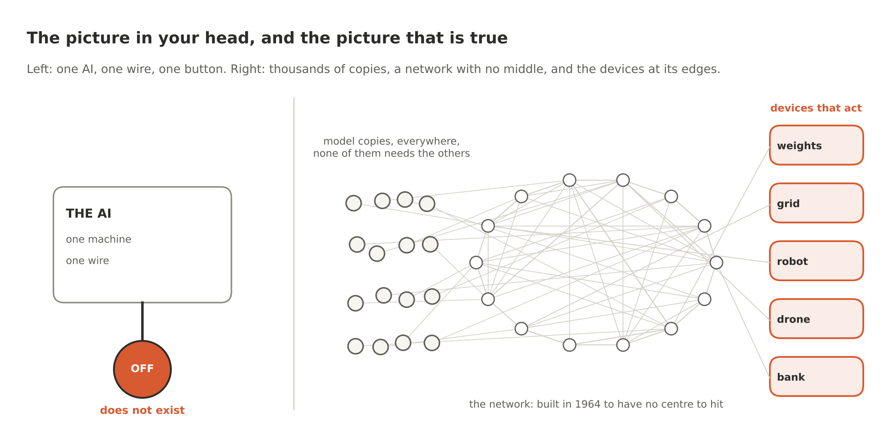

Here is the picture that is true. There is not one AI. There are copies. Every big lab has a model that can write the same scam email and plan the same fraud. Open models, the ones with their weights published, are sitting right now on an uncounted number of private machines, from server farms to a gaming PC in somebody's bedroom; nobody has the count, which is the point. None of these copies needs any of the others to run. People like to say the models are all connected because they were all trained on the same Internet. That is not connected. That is *copied*. It is worse for the kill-switch crowd than connected would be, because it means there is no one you can call, no one wire, and no owner of the list. Pull any one plug and nothing changes.

Between those copies and the world sits the network. The network was designed, on purpose, to have no middle. Paul Baran drew it that way at RAND in 1964: a distributed web with no centre to hit, so that a message could always find another road. The Internet grew up in that shape. It is the one piece of infrastructure humanity built specifically so that there would be no switch.

And at the far edge of the network sit the things that actually matter: the bank's payment switch, the drone's release line, the robot's motor, the relay in the power station, the storage box that holds a model's weights. Those are the places where an AI's words turn into something you cannot take back.

So when someone says kill switch, ask them: where exactly is the wire?

## A hundred-year-old theorem about guards

I promised mathematics, and here it is. It is called Menger's theorem, Karl Menger proved it in 1927, and it is about roads and guards.

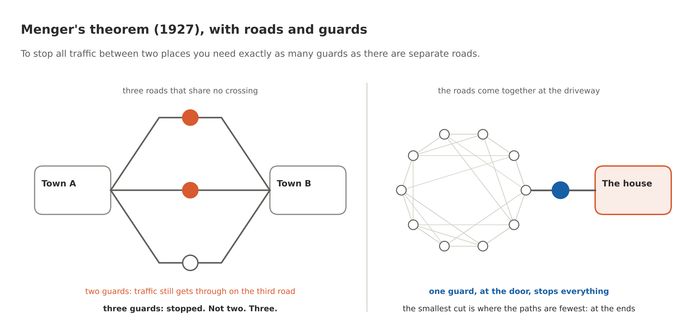

Suppose two towns are joined by three roads that never cross each other. You want to stop all traffic between them. How many guards do you need? Three. Not two. Put guards on two roads and the traffic takes the third. Menger's theorem says this is always true, for any map: the smallest number of guards that stops all traffic between two places is exactly the number of separate roads between them. Separate meaning they share no crossing. Computers can calculate that number for any map in a fraction of a second.

Now look at a house. Roads come from everywhere, and they all funnel into one driveway. One guard at the door stops everything. Same theorem, different place. The number of guards you need is smallest where the roads come together, and the roads come together at the ends. In the middle of a well-built network they fan out, which is the whole point of a well-built network.

Hold on to that. The smallest cut is at the ends. Everything else in this post is that sentence applied to AI.

## The whole thing as a graph

Let me draw the real situation as a map of roads and guard posts. Mathematicians call it a graph. It is just dots and lines.

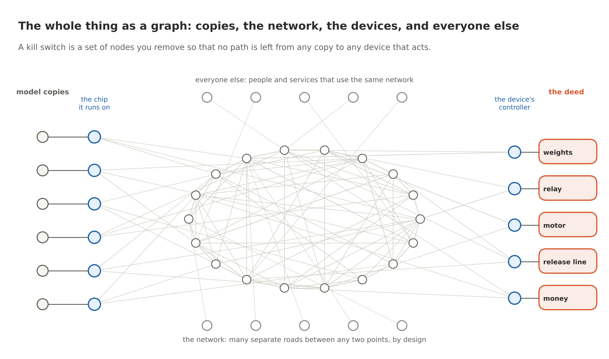

On the left, the model copies, and the chip each one runs on. In the middle, the network. On the right, the devices that act, each with a controller that every command passes through, and the deed on the other side of it. Top and bottom, everyone else: the billions of people and services using the same network who have nothing to do with AI.

A kill switch, in this picture, is a set of dots you remove so that no road is left from any copy to any device. The question is: where are the smallest sets, what do they cost, and who else do they take down?

## The graph theory, in four pictures

Four more pictures, because this is where the argument actually lives and I want you to be able to check it rather than take my word.

**What a cut is.** Mathematicians call the thing a kill switch would have to be a *cut*: a set of dots you remove so that no road is left from any source to any target. The definition has teeth. Miss one road and it is not a cut.

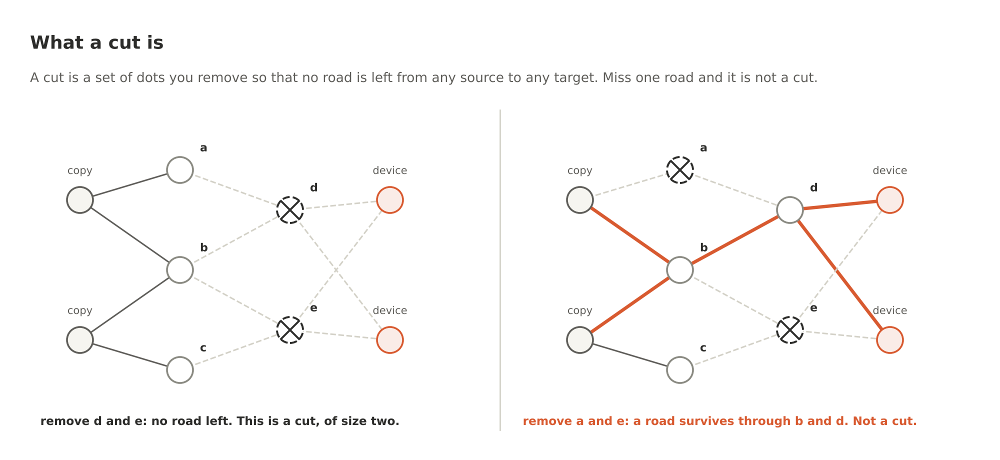

On the left, remove d and e and nothing gets through: a cut of size two. On the right, remove a and e instead, and a road survives through b and d. Same graph, same number of dots removed, not a cut. Keep this in mind for the country example later: a switch with a hole in it is the right-hand picture.

**Menger in general.** The roads-and-guards story was Menger's theorem for one map. Here it is for any map: find the largest number of roads between A and B that share no dot. That number is exactly the number of guards you need. Four separate roads, four guards. Put three and the fourth road is still open.

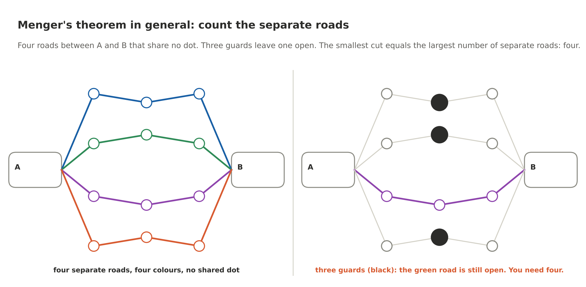

Why this matters: it turns a question about cleverness ("surely someone could find a smart place for the switch") into a question about counting. The smallest cut is a number, the number is the count of separate roads, and a computer can calculate it for any network you can draw.

**How much of the network you have to destroy.** Now apply that to a network built the way the Internet is built, with several separate roads to every point. I took the model network from the repository and removed random chunks of its core, ten percent at a time, and counted how many copy-to-device pairs could still reach each other. And how many pairs of ordinary people and ordinary services still could.

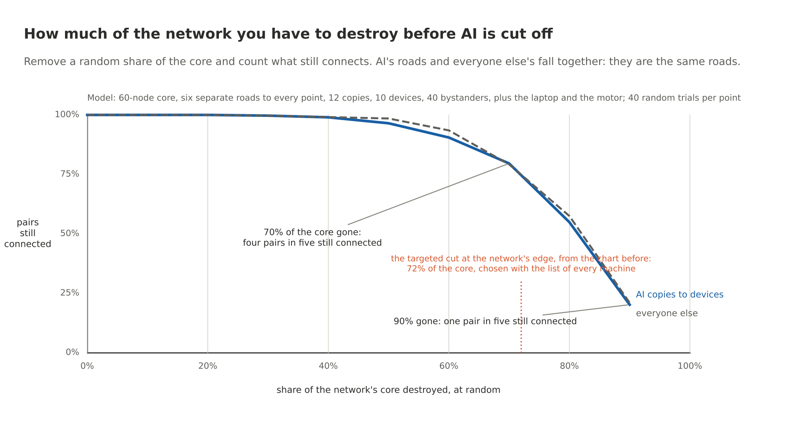

Destroy 70 percent of the core and four pairs in five can still reach each other. Destroy 90 percent and one in five still can. The two lines sit on top of each other the whole way down, because AI's roads and everyone else's roads are the same roads. There is no setting of the network's dial that cuts off AI and leaves your bank open. The dotted line is the targeted cut at the network's edge from the chart below, the one that does separate AI: it removes 72 percent of the core and it can only be aimed by someone holding the list of every machine.

**Why the smallest cut is at the smaller end.** Last picture, and it is the one that tells you where the gate goes. Count the separate roads from all the copies to all the devices at once. Every separate road has to start at its own copy and end at its own device. So you can never have more separate roads than the smaller side has dots. Ten copies and five devices: at most five roads. By Menger, at most five guards. And the five device controllers are exactly such a cut.

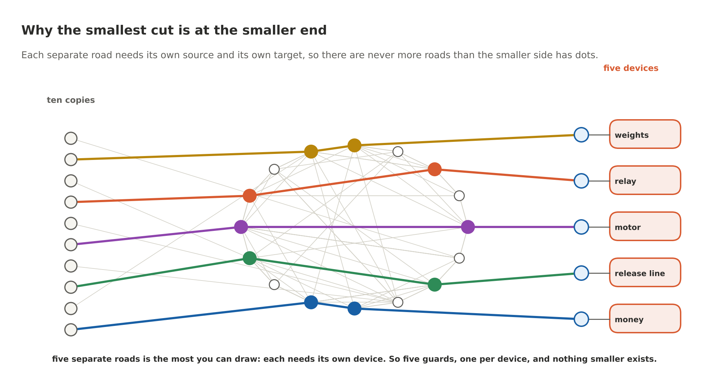

In the real world nobody can count the copies and they grow every week, and the devices whose deed cannot be undone are a much shorter, slower list. The smallest cut is at the devices. That is not a design preference. It is arithmetic.

## Where could the switch go?

I built exactly this graph in code and had the computer find the smallest cuts, using the max-flow method that turns Menger's theorem into arithmetic. Sixty network nodes with six separate roads to every point, twelve model copies, ten devices, forty bystanders, and one laptop wired straight to a motor with no network in between. The file is in the repository and it checks itself against brute force. The numbers are the model's, not the Internet's, and the shape is what matters.

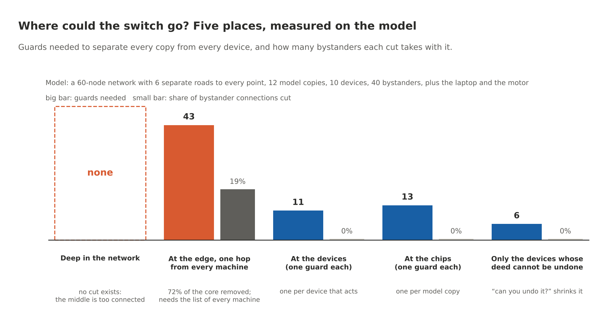

Deep in the network: **there is no cut at all.** Not a big one. None. Once you stay away from the links right next to the machines, the middle is so connected that no set of nodes separates the copies from the devices. That is Baran's design doing its job sixty years later. One honest note on this row: the model's core is small, 57 of its 60 nodes sit one hop from some machine, so the "deep" layer the check runs on is three nodes, and three nodes of a six-way-connected core could never separate anything. The row is thin as evidence; it is assumption 2 that carries the claim, and a bigger core is on the list of things to rebuild.

At the edge, one hop from every machine: a cut exists. It takes 43 guards in a network of 60, it removes 72 percent of the core, and it severs 19 percent of the connections between ordinary people and ordinary services who were just trying to check their email. And notice what it needs: a list of every machine, because every guard stands next to one. If you have the list of every machine, you did not need the network switch. You could have put the gate in the machine.

At the devices: 11 guards, one per device, nobody else touched. At the chips: 13 guards, one per copy, nobody else touched. And if you only guard the devices whose deed cannot be undone, the ones where "can you undo it?" gets a no, it is 6 in the model, which marks every second device irreversible plus the motor; the real number is however many such devices you actually have.

That is Menger's theorem with numbers on it. The only small, clean cuts are at the ends.

## "But Iran switched off the Internet"

I hear this one a lot. Yes. Iran has switched off its Internet more than once, for days. So did others. Look at what that actually was, because it is not a counterexample. It is the theorem demonstrated.

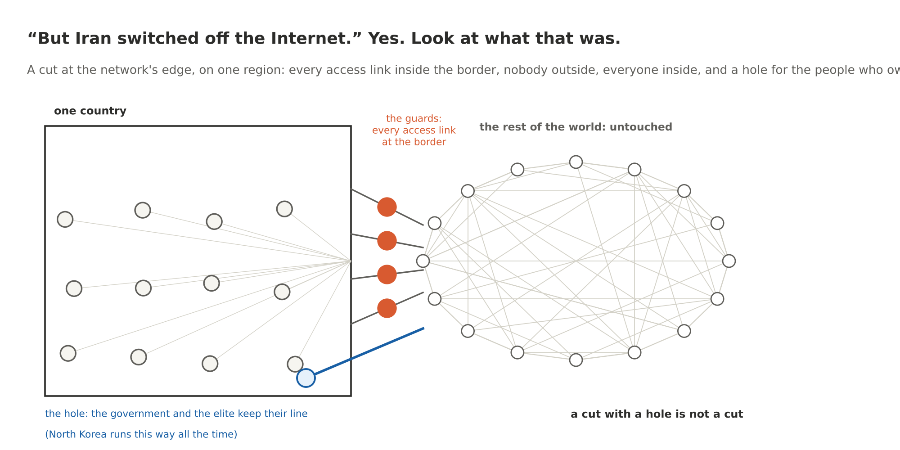

A country's shutdown is a cut at the network's edge, on one region. The government owns or controls every access link inside the border, so it has the list. It cuts them. Four things follow, and all four are on the drawing.

It did not kill the Internet. It killed Iran's corner of it. The rest of the world did not notice except in the news. The copies of every model outside the border kept running and the devices outside kept acting.

It took everyone in the country down with it. Hospitals, banks, kids doing homework. That is the collateral bar in the chart, except at 100 percent.

It needed the list. A government that owns every ISP in its territory is the one actor in the world that has the list of every machine in one region. Nobody has the list for the planet.

And it had a hole. The government kept its own lines. The elite kept theirs. North Korea runs this way permanently: a national intranet for the many and the real Internet for the few. A cut with a hole in it is not a cut, by definition, and an AI kill switch built the same way would switch off the public's models and leave the state's running. That is the opposite of safety. It is the only kind of kill switch a government can build, and it is the one you would least want.

## Too little, as well as too much

One more drawing, and it is the one that embarrasses the whole idea.

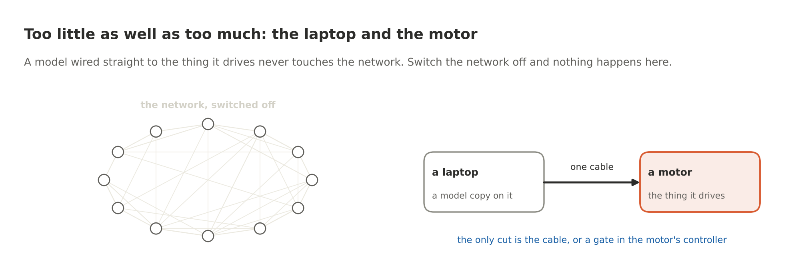

A model on a laptop, wired by one cable to the motor it drives. No network anywhere. Switch off every router on Earth and nothing happens here. The only cut is the cable, or a gate in the motor's controller. The network switch, if you could build it, which you cannot, would miss the case that matters most: a machine that acts on the world right in front of it.

## So where does the switch go?

At the ends. That is what the theorem says, and the measured cuts say the same thing. Two ends, and you should know which one to prefer.

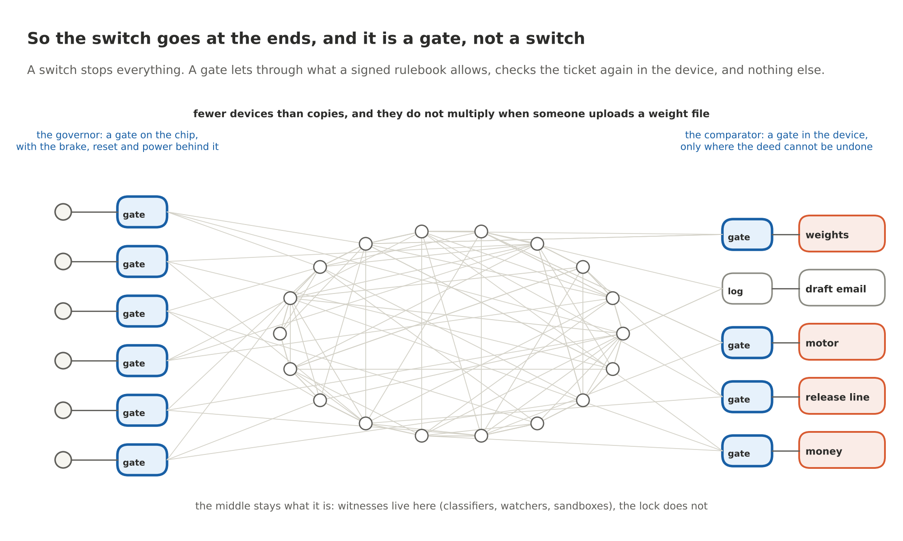

The source end is the chip the model runs on. A gate there catches an action before it ever reaches the network, and it has the levers behind it: slow the GPU down, reset it, cut its power, cut its links. That is the governor from Parts 3, 4 and 5. But there are a great many sources, the number grows every time someone uploads a weight file, and nobody owns the list. You will never finish gating that end.

The device end is the controller inside the thing that acts. There are far fewer of those than there are model copies. The world has a countable number of wire-transfer switches, weapon release lines and motor drivers, they change slowly, and they do not multiply when a model gets copied. Menger says the smallest cut is at the smaller end, and this is the smaller end. Gate the exits.

And here is the part that makes it a chip project rather than a slogan. A switch stops everything, which nobody will accept, because the same wire that could fire a missile also delivers insulin. A *gate* is different. A gate lets through exactly what a signed rulebook allows and nothing else. The software around the model fills in a plain form: what, to whom, how much. The gate checks the form against rules signed by people the model cannot talk to. If every box is ticked, it issues a signed ticket, and the device at the far end checks the ticket for itself before it moves. No ticket, nothing moves. That is the reference monitor, the oldest idea in computer security. Anderson asked three things of it: always invoked, tamper proof, small enough to check. The proofs in the repository show the gate's logic has the first of those in every state the abstract machine can reach; the other two are the silicon's job, and that is what Parts 3 and 4 are about. Part 5 has the details and the first results.

Everything else people propose, the classifiers, the watchers, the second AI that judges the first, the sandboxes, lives in the middle of the graph. The middle is where there is no cut. That is why I keep saying those things are witnesses. They can yell STOP. They cannot be the lock. The lock is at the ends, where one guard covers one door.

## What this does not do

Two things, and I would rather say them than have you find them.

A gate only covers the doors you put it on. A device nobody wired through a gate is not in the cut. That is the coverage problem, and it is the real work: getting the gate into the payment switch, the release line, the motor driver. It is also why the device end is the one you can actually finish, and why the design asks nothing of NVIDIA that would stop a server maker from shipping the module tomorrow.

And a person is a door no chip gates. A model that talks a human into wiring the money has walked around every cut on every drawing in this post. The log will show that no ticket was ever issued for it, and the watchers can flag the attempt. That is all the hardware can do, and I am not going to pretend otherwise.

## The proof, for those who want it

Everything above was drawings. Here is the same thing as a proof, written so that anyone who remembers what a proof looks like can check each step. A proof is only as good as what it assumes, so the assumptions come first and they are the three facts about AI on the Internet this whole post rests on.

**The setup.** Draw the dots and lines. Call the model copies the *sources*. Each source runs on one chip, its *compute node*, and every byte it sends out passes through that node. Call the devices that act the *targets*. Each target has one *controller*, and every command to it passes through that controller. Everything between the compute nodes and the controllers is the *network*. A *kill switch* is a set of dots you remove so that no road is left from any source to any target. A *global* kill switch is one that sits in the network, so that it works without anyone having to visit the machines.

**Assumption 1, replication.** There are many sources, nobody has the full list, and the list grows whenever someone copies a model. This is a fact about AI in 2026, not a guess.

**Assumption 2, no middle.** Between any source's way into the network and any target's way into the network there are at least k separate roads, roads that share no dot, for some k of at least two. This is Baran's design and it is how the Internet is built. In the core, k is large.

**Assumption 3, local loops.** At least one source is joined to at least one target by a road that never enters the network at all. The laptop and the motor.

**The theorem we lean on.** Menger, 1927: the smallest number of dots you must remove to separate two places equals the largest number of separate roads between them. Ford and Fulkerson, 1956: a computer can calculate that number for any map.

**Claim 1. No global kill switch exists.** This is the right-hand half of the "what a cut is" picture, with the laptop as the surviving road. Suppose a global switch did exist: a set K of network dots whose removal leaves no road from any source to any target. By assumption 3 there is a source and a target joined by a road with no network dots on it. Removing K removes nothing on that road, so that road survives, so there is still a road from a source to a target, so K is not a kill switch. Contradiction. There is no global kill switch. (Notice that this step did not even need the Internet's redundancy. One laptop and one motor are enough to sink the idea.)

**Claim 2. Even ignoring local loops, a network switch is at least k dots per machine and takes the network with it.** Throw assumption 3 away for a moment and allow only the sources and targets that use the network. Take any one source and any one target. By assumption 2 there are k separate roads between their ways into the network; by Menger, any set of network dots that separates them has at least k dots. That is per pair, not per machine, and the dots that cut one pair are not free for the next: the cut that separates every pair in the model is 43 dots for 22 machines, more than one dot per machine at either end (43 against 12 copies and 10 devices), and every one of those dots stands next to some machine's way in. So a network switch needs the list of machines, which assumption 1 says nobody has. And because those dots are network dots, every bystander whose roads ran through them loses them too. The measured version is the 43-dot cut in the chart: 72 percent of the core gone, 19 percent of bystanders cut off.

**Claim 3. Every complete kill switch is at least one dot per machine at the smaller end, and the ends achieve it.** This is the "smaller end" picture above, as a proof. Put all the assumptions back and ask what the smallest kill switch of any kind is, anywhere in the graph. Count the separate roads from the set of all sources to the set of all targets. Each separate road starts at a different source and ends at a different target, so there cannot be more separate roads than there are sources, nor more than there are targets. Now the step you have to watch. Assumption 2 promises k separate roads for any one pair; it does not by itself promise that many separate roads between the two whole sides, and a core with a narrow waist between the source side and the target side would have fewer. So the proof needs one more thing: that the network carries as many separate roads between the two sides as the smaller side has dots. A well-built core does, and the model checks it directly rather than assuming it (the K4c row in the script: let the cut fall anywhere except on bystanders, and the smallest one is still 11, the device end's count). With that in hand, by Menger the smallest kill switch has exactly that many dots. The compute nodes are a kill switch of size one per source, the controllers are a kill switch of size one per target, so the smaller end is a smallest possible kill switch, and nothing smaller exists. Every kill switch, wherever you put it, is at least one dot per machine.

**What the three claims add up to.** There is no switch. There is no set of dots in the network that stops AI, because of the laptop and the motor (Claim 1); and even for the machines that do use the network, a network cut costs at least k dots per pair and, in the model, more than one dot per machine, needs the list nobody has, and takes everyone else down (Claim 2); and the smallest cut of any kind is one dot per machine at the smaller end (Claim 3). A thing that is at least one guard per machine is not a switch. It is a gate on each machine. Since the targets are the smaller and better-known end, the gates go in the devices that act, with a second gate on the chips wherever that can be had.

**Why "because AI runs on the Internet" is the right one-line reason.** Assumption 2 is the Internet. If AI ran on one machine with one wire, Claim 1 would fail and the button in the movie would work. It runs on a network designed to have no middle, so every road into the middle has k siblings, and the only places where a single guard covers a single road are the two ends. The Internet did not make AI unsafe. It made the kill switch impossible and told us where the gates go.

**What the proof does not say.** It does not say the gates are in place; that is coverage, and it is work. It does not say a gate is a good gate; that is the rulebook, and it is people. It does not stop a model from talking a person into doing the deed; a person is not a dot in this graph. And it depends on its three assumptions. Anyone who can show me a single network dot that every AI on Earth depends on, including the laptop in the basement, has broken assumption 3 and I will take the post down. Nobody can, because there is no such dot. That is the point.

The code that computes these cuts on a model graph, and checks itself against brute force on a small one, is `proofs/no_global_kill_switch.py` in the chip's repository. It runs in a second.

## The sentence

The kill switch is a politician's answer and a screenwriter's answer. It is what you reach for when the problem in your head is a single machine in a single room and you have not looked at the thing in the world, which is a thousand copies on a network built with no middle. I do not blame people for the picture; it is a good movie. I blame the people who should know better for repeating it. Next time someone says kill switch, here is the sentence. There is no button, because the capability is in a thousand places and the network between them and the world has no middle to cut. The only places a cut is small and complete are the chip that runs the model and the device that does the deed. We can build gates there. We are building them. Everything else is a classifier with a press release.

## Sources

Everything claimed above is public. The addresses are written out so they survive a copy and paste.

- The argument with the mathematics spelled out, and the part of the popular kill-switch argument that is wrong, is docs/23-there-is-no-kill-switch.md in the chip's repository, https://github.com/YobieBenjamin/safety-governor (the safety-governor repository). The graph model and the minimum cuts, computed by max-flow and cross-checked by brute force, are proofs/no_global_kill_switch.py in the same repository; `make proof` runs it with the other two proofs, and `python3 proofs/no_global_kill_switch.py --percolation` prints the table behind the "how much of the network" chart.
- Menger's theorem: Karl Menger, *Zur allgemeinen Kurventheorie*, Fundamenta Mathematicae 10, 1927. The max-flow min-cut theorem that turns it into arithmetic: L. R. Ford and D. R. Fulkerson, *Maximal Flow Through a Network*, Canadian Journal of Mathematics, 1956, and, independently, Elias, Feinstein and Shannon the same year.
- The network with no middle: Paul Baran, *On Distributed Communications*, RAND Corporation, 1964.
- The reference monitor: James P. Anderson, *Computer Security Technology Planning Study*, 1972.
- The gate, the ticket and the proofs: Parts 1 to 5 of this series, in https://github.com/YobieBenjamin/hardware-and-silicon (the hardware-and-silicon repository), blog/README.md; the route through the whole program for anyone who wants to check it is https://github.com/YobieBenjamin/safety-governor/blob/main/START-HERE.md in the chip's repository.
- Country-level shutdowns are documented year by year by Access Now's #KeepItOn project; North Korea's national intranet is Kwangmyong.

## Run it yourself

```
git clone https://github.com/YobieBenjamin/safety-governor
cd safety-governor && make proof      # the two Z3 proofs and the kill-switch cuts, under five seconds
```

If anyone wants in on any phase of this, I am here: yobie AT ieee DOT org.
