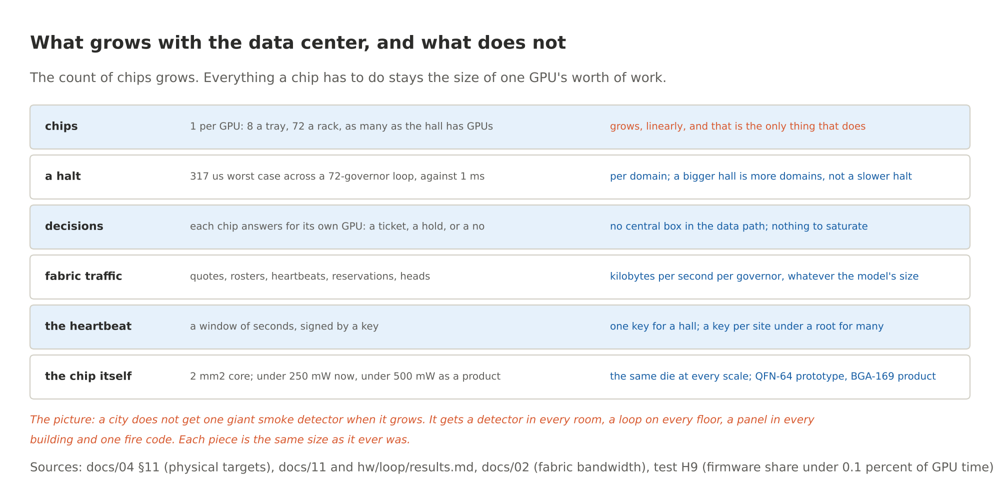
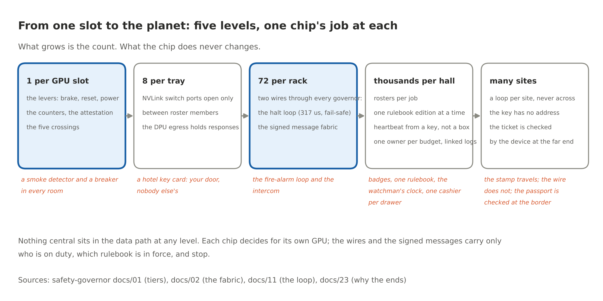
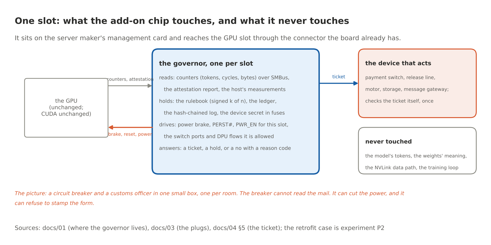
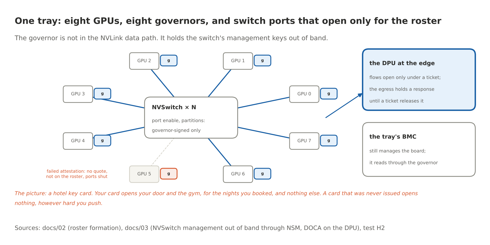
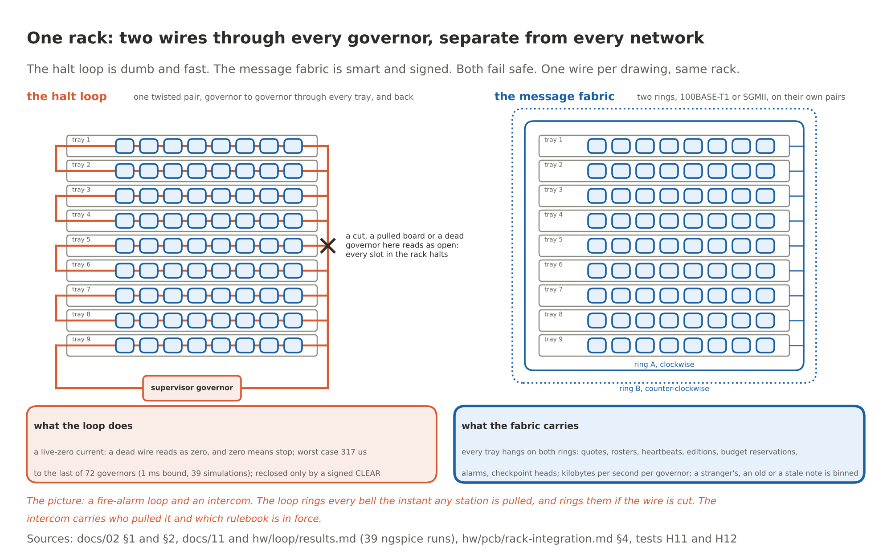
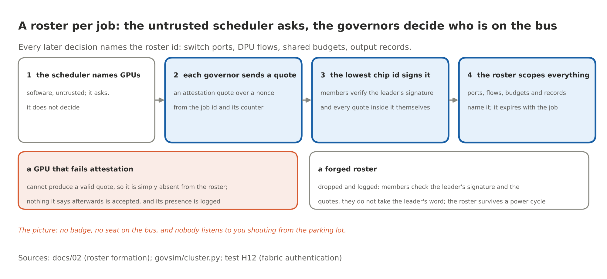
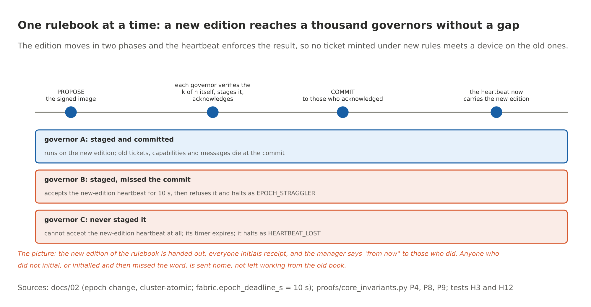
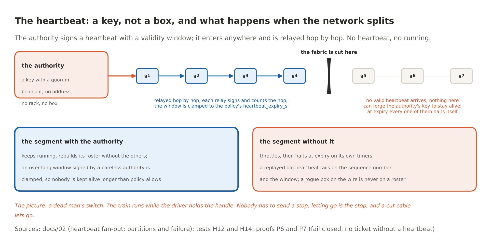
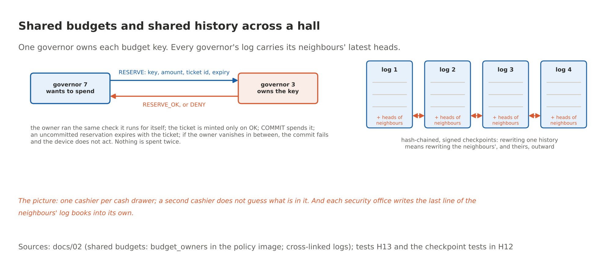
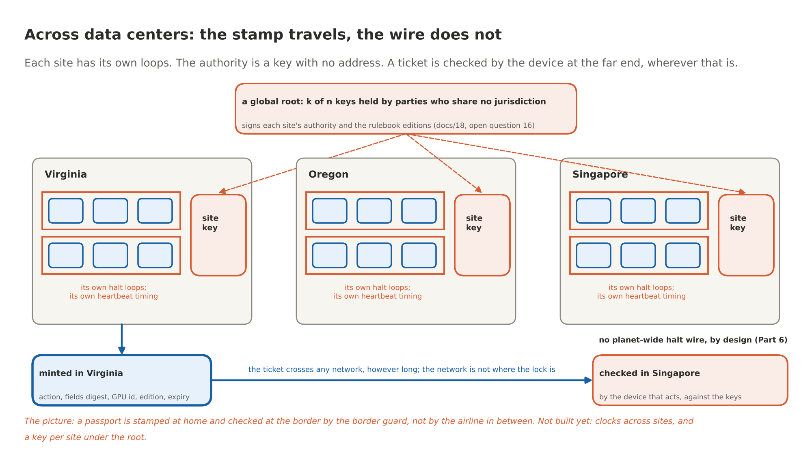

# Scaling No... Yes, We Can: How To Scale Safety In An Unsafe AI World

By Yobie Benjamin · yobie AT ieee DOT org · linkedin.com/in/yobie · October 21, 2026 · The Chip That Says No, Part 7

> Here is the objection I get most, and it is a fair one. "You want to put one little chip on a board and that is supposed to keep OpenAI safe? They have hundreds of thousands of GPUs. Buildings full. On three continents. A smoke detector against a forest fire." I love this objection, because the answer to it is the whole design, and the answer is also how fire safety actually works in a city. No city has one giant smoke detector. It has a detector in every room, a loop on every floor, a panel in every building, and one fire code. Every piece is small. The thing that is big is the count. This post walks the chip from one GPU slot to one tray to one rack to one building to the planet, with a drawing at every step and, because John and Jane Doe are the people who will decide whether any of this gets built, an everyday picture for every technical piece. Everything here is from the design documents and the tests in the repository; where something is not built yet, I say so.

## The objection, stated properly

Let me state the objection better than its owners usually do, because the weak version is easy and the strong version is worth answering.

Weak version: one chip cannot watch a hundred thousand GPUs. True, and nobody proposed that. There is one chip per GPU. Eight on a tray, seventy-two in a rack, as many in a hall as the hall has GPUs.

Strong version: fine, a chip per GPU, but then you have a hundred thousand chips that have to agree with each other. Who is in charge? Where is the central box? If there is one, it is a bottleneck and a target. If there is not one, how does a chip in row 40 know what the rulebook says, who is allowed to talk to whom, and that the chip in row 41 has not been pulled out and jumpered? Big systems fall over on coordination, not on the per-unit work. That is the real question, and the rest of this post is the answer to it.

The short answer, before the long one: every chip does the same small job for its own GPU, and nothing central sits in the data path at any scale. What the chips share is tiny and signed: who is on duty, which edition of the rulebook is in force, a heartbeat, a budget reservation now and then, and one wire that can stop a rack in a third of a millisecond. The count grows. Nothing else does.



**The picture:** a city does not get one giant smoke detector when it grows. It gets a detector in every room, a loop on every floor, a panel in every building and one fire code. Each piece stays the size it always was.

## The arithmetic first

One governor per GPU slot. On an HGX tray, eight. In an NVL72 rack, seventy-two. The chip is about 2 mm² of core logic as configured in the open silicon flow, under 250 mW on the prototype process and under 500 mW as a product, in a package the size of a fingernail. It mints a ticket in about 20 microseconds, one at a time, and signs the provenance records in batches: one P-384 signature per 50 ms window covers every record in that window, which keeps the signing engine under 34 percent busy however hard the GPU is driven. The firmware's own share of the GPU's time is under 0.1 percent in the model. The private wire between governors carries kilobytes per second per chip, whatever the size of the model running on the GPU, because it carries rosters and heartbeats and budget notes, never model data.

So the per-unit numbers are small, and they do not change when the hall gets bigger. The things that could have grown with the hall were the coordination costs, and the design was built so that they do not. Here is how, level by level.



## Level 1: one slot

The chip rides on the server maker's management card, the kind of card that already sits in a slot on every server board, or as a retrofit in the slot a baseboard management controller card already uses. It reaches the GPU slot through the connector the board already has. What it touches:

- It reads the GPU's own counters over the management bus: tokens, cycles, bytes. It reads the GPU's attestation report, which says what firmware is running, and the host's measurements, which say which model is loaded.
- It holds things no process on the host can read or write: the rulebook, signed by k of n keys held outside the rack; the ledger of budgets and reservations; a hash-chained log; and a device secret burned into fuses at the factory.
- It drives the levers for its own slot: the power brake, reset, and power enable, plus the switch ports and network flows it is allowed to open.
- It answers every request that matters with one of three things: a signed ticket the far end checks itself, a hold for a person with a key, or a no with a reason code.

What it never touches: the model's tokens, the meaning of anything, the NVLink data path, the training loop. It cannot read, and it does not try. Part 5 has the full inside-the-chip drawing.



**The picture:** a circuit breaker and a customs officer in one small box, one per room. The breaker cannot read your mail. It can cut the power to the room, and the officer can refuse to stamp the form. Neither needs to understand what you were doing to do their job.

## Level 2: one tray

Eight GPUs on a tray talk to each other over NVLink through switch chips on the same board. The governor is not in that data path. It sits beside the switches' management controller and holds the keys to their management interface, out of band. A switch port is designed to open only between GPUs that are on the same roster (more on rosters in a minute) under the current edition of the rulebook and a live heartbeat. A GPU that failed attestation has no roster seat, so its ports stay shut, however loudly its host asks.

At the edge of the tray sits the data processing unit, the smart network card that NVIDIA's Sentry also lives on. Its flows open only under a ticket, and the egress holds a response until a ticket releases it. The tray's own management controller keeps managing the board; it reads through the governor instead of around it.

Two honest notes. First, the switch-side authority depends on NVIDIA's management interfaces doing what their public documentation says they do. What the documentation gives today is status, reset and partition membership through a Fabric Manager that honours a governor-signed policy; shutting a single port out of band is one of the firmware asks in the design (docs/03, section 9), so the per-port picture above is the design, not a thing you can buy this afternoon. The places where the documentation stops are all on that asks list, as firmware and software asks, not silicon. Second, whether the retrofit slot can actually drive the levers on a given board, and what else on the board could undo them, is now a column in experiment WAVE-EXIT-REGISTER, per lever, and it is not answered yet.



**The picture:** a hotel key card. Your card opens your door and the gym, for the nights you booked, and nothing else. A card that was never issued opens nothing, however hard you push on the handle.

## Level 3: one rack, and the two wires

This is the part the chip adds that no software anywhere has: two dedicated wires that run through every governor in a rack, physically separate from the data network, the management network and the host. One is dumb and fast. One is smart and signed. Both fail safe.

**The halt loop.** A supervised series current loop, one twisted pair, threaded from governor to governor through every tray and back to the rack's supervisor governor. It carries a live-zero current, the 4 to 20 mA idea from industrial instrumentation crossed with the supervised circuit of a fire alarm: a healthy wire carries a small current, a dead wire reads as zero, and zero means stop. Every governor has a switch in the loop and a sensor on it. Any governor opens its switch on a halt cause: a signed HALT from the authority, a detected tamper, or loss of loop current itself. A governor declares the current lost after two missed samples and drives its halt output within about three sense periods, 311 microseconds in the design. Across a 72-governor rack the circuit simulation puts the worst case at 317 microseconds against a 1 millisecond bound, across 39 configurations including cut wires and the worst opener position.

What makes it safe is what it does when things break. A broken wire, a lost connector, a dead governor, a pulled board: all of them read as open, and open means every slot in the rack halts. Nothing has to notice; the physics notices. And nobody closes the loop again on their own. It closes only when every governor has received a signed CLEAR over the other wire and logged it. A governor that has been jumpered to fake a closed switch is caught the moment its own switch opens, by a roll call the heartbeat carries, within two heartbeats: it reports its switch open while the wire still carries current, and every other governor halts on that. While its switch stays closed the jumper changes no current and no report, so nobody can see it, and the attacker has gained nothing by it either; the governor's own levers still stop its own GPU.

**The message fabric.** A private dual ring between governors, two-wire automotive Ethernet (100BASE-T1) on its own pairs of the rack harness, no connection to any switch the host can reach. Every note on it is signed with a key derived from the chip's fused secret, numbered per sender, stamped with the rulebook edition, and dated by the chip's own counter. A note from a chip not on the roster, an old note read out again, or a note under last year's rulebook goes in the bin, and the bin is logged. Sequence numbers survive power loss on both sides, so a reboot does not reopen the replay window. It carries attestation quotes, rosters, heartbeats, policy editions, budget reservations, alarms and log checkpoints. Kilobytes per second.

Why a wire and not a message for the stop? Because a message can be dropped, delayed, replayed or filtered by anything between sender and receiver, and a current loop has no software between a pull and a bell. Fire codes learned this a century ago.



**The picture:** a fire-alarm loop and an intercom. The loop rings every bell the instant any station is pulled, and reports a cut wire the instant it happens. This loop goes one step further than a fire loop: a cut does not just light a fault lamp at the panel, it halts the rack. The intercom carries the details: who pulled it, which edition of the rulebook is in force, who is still on duty. You would never route the alarm through the intercom. Nobody should route a halt through a network.

## Level 4: one building, and the four things that make a thousand governors behave as one system

A rack is a safety domain with its own loop. A building has hundreds of racks. Domains are joined by supervisor governors that bridge loops under policy, and the fabric runs through all of them. Now the strong objection comes due: with no central box, how do a thousand chips agree? Four mechanisms, each small, each tested in the functional model of a rack (the tests run racks of up to four GPUs; the 72 is in the loop's circuit simulation).

### Rosters: who is on the bus

A job needs forty GPUs across five trays. An untrusted scheduler, ordinary software, names the GPUs it wants. That is all it gets to do: ask. Each named governor broadcasts an attestation quote over a nonce derived from the job id and its own counter. The lowest chip id among the valid quotes assembles the roster and signs it. Every member verifies the leader's signature and every quote inside the roster itself; nobody takes the leader's word. From then on, everything about that job names the roster id: the switch ports that open, the network flows, the shared budgets, the records of what came out. The roster is durable until it expires with the job, so a power cycle does not lose it.

A GPU whose attestation failed cannot produce a valid quote, so it is simply absent. Nothing it says afterwards is accepted; its presence on the wire is logged. A forged roster is dropped, because the members check the signatures, not the sender's confidence.



**The picture:** no badge, no seat on the bus, and nobody listens to you shouting from the parking lot.

### One rulebook at a time: how a new edition reaches a thousand chips without a gap

Here is a hazard most people never think of. The rulebook changes. A new edition goes out. If it reaches some governors and not others, a ticket minted under the new rules could be presented to a device still checking against the old ones, or the other way round. In a building with a thousand chips, "some and not others" is the normal case for any ordinary rollout. So the edition does not roll out. It moves in two phases, and the heartbeat enforces the outcome.

Phase one: the authority sends the signed policy image. Every governor verifies the k-of-n signatures itself, stages the image, records when it did, and acknowledges. Phase two: the authority sends the commit to the governors that acknowledged, and each switches its edition register at that moment; tickets, capabilities and messages from the old edition die right there. From then on the authority's heartbeat carries the new edition number. A governor that never staged the image cannot accept the new heartbeat, its timer runs out, and it halts. A governor that staged the image but never saw the commit gets ten seconds of grace, then refuses the heartbeat too and halts as a straggler. Nobody is left running on the old book. The ones the authority could not reach, or could not finish with, stop.



**The picture:** the new edition of the rulebook is handed out, everyone initials receipt, and the manager says "from now" to those who did. Anyone who did not initial, or initialled and then missed the word, is sent home, not left working from the old book.

### The heartbeat: a key, not a box

The policy authority is not a computer in a room. It is a key, with a quorum of people behind it, and it has no address. It signs a heartbeat with a validity window. The heartbeat enters the fabric at one or more governors and is relayed hop by hop; each relay signs the relayed message with its own fabric key and counts the hop. A governor accepts a heartbeat if the authority's signature verifies, the number is new, the window is current, the relay is a roster member and the hop count is under the limit. It clamps the window to what the policy allows, so a careless authority signing a week-long window cannot keep a governor alive for a week. A governor that gets no valid heartbeat before its timer expires throttles, then halts, on the rungs the policy sets.

This is what makes a split network safe instead of dangerous. Cut the fabric down the middle of a building. The half with a path to the authority keeps running; forming new rosters without the lost half is in the design's partition table, though the tests only check it after the fabric heals, so count that one as design, not evidence. The half without it receives no heartbeat, and nothing in that half can forge the authority's key to make one. At expiry, every governor in it halts itself. A replayed old heartbeat fails on its sequence number and its window. A rogue box plugged into the wire never gets on a roster. There is no box to capture, because the authority is not a box.



**The picture:** a dead man's switch. The train runs while the driver holds the handle. Nobody has to send a stop; letting go is the stop, and a cut cable lets go.

### One owner per budget, and logs that hold each other's hands

Two more pieces, both about a building's worth of chips keeping one set of books.

Budgets. A session's hazard budget, a license's compute budget, a byte budget: each is a key with exactly one owner, named in the policy image. The loader refuses an image in which a budget has no owner, so there is no default and no ambiguity. A governor that needs to spend against a shared key sends a reservation to the owner; the owner runs the same check-reserve-commit transaction it runs for itself and answers yes or no. The requesting governor mints the ticket only on yes. Reservations expire with the ticket. If the owner vanishes between the reservation and the commit, the commit fails and the device does not act. Nothing is spent twice, and nothing is spent on a guess.

Logs. Every governor keeps its own hash-chained log and publishes signed checkpoints. Each checkpoint also includes the latest checkpoint heads it has received from its neighbours on the fabric. Rewriting one governor's history now means rewriting its neighbours', and theirs, outward through the building. The building's history is one object with a thousand signatures on it.



**The picture:** one cashier per cash drawer; a second cashier does not guess what is in it. And each security office writes the last line of the neighbours' log books into its own, so a doctored page in one office shows up as a mismatch next door.

## Level 5: across the planet

Now the data centers in different countries. Here I need to be exact about what the design already covers, what it refuses to do on purpose, and what is not built.

**What carries over unchanged.** The authority is a key, so it is as present in Singapore as in Virginia; the heartbeat, the edition rules and the partition behaviour work over any link, because none of them cares how long the wire is. And the thing that actually stops a bad action does not live in the network at all. It lives at the two ends, which is the whole point of Part 6. The chip governs the compute end wherever the GPU happens to be. The device that acts verifies the ticket itself wherever it happens to be. A ticket minted in Virginia for a payment switch in Singapore carries the action, the digest of the exact fields, the GPU's identity, the rulebook edition, the reservation and the expiry. The switch checks the signature against the governors' keys and checks the fields against its own sensors, and refuses on any mismatch, even if every network, cloud and host between the two has been compromised. The network in between, however long, is not where the lock is and never was.

**What does not cross an ocean, on purpose.** The halt loop. It is a wire, and that is its virtue. Each site is its own set of loop domains; a halt within a site is physics, in microseconds. There is no planet-wide halt wire, and Part 6 proved there cannot be a planet-wide switch of any kind worth having. What you get across sites instead is a halt per domain through the heartbeat, which is policy, with a time constant of seconds, not a cut.

**What is not built, and goes on the open-questions list as its own row.** Time, and the authority's shape. A heartbeat window of seconds is fine over any link, but editions, reservations and ticket expiries need the sites' clocks to agree within a known bound, and a monotonic counter per chip is not enough for that across sites; it needs signed time from the authority, or an authority per site. The sane shape, and the one I would build, is a hierarchy: a global root, the multilateral k-of-n of open question 16 whose key holders share no jurisdiction, signs each site's authority and the rulebook editions; each site runs its own heartbeat with local latency; cross-site tickets name both editions; and the fabric between sites runs between site supervisors over a dedicated or tunnelled link with the same signing and sequencing as inside a rack. None of that is modelled yet. It is now question 17 in the design's open-questions table, with what would settle it: a two-site simulation with a modelled wide-area delay and a per-site authority.



**The picture:** a passport is stamped at home and checked at the border by the border guard, not by the airline in between. The stamp travels. The wire that rings the bells in your own building does not, and should not.

## What this does not make true

Three things get harder with scale, and no chip makes them easy. I would rather you heard them from me.

Coverage. The gate is complete only if every device that does something irreversible has a comparator that checks the ticket, and every piece of governed compute has its governor. A device nobody wired through a gate is not in the cut, in Virginia or anywhere. That is a deployment fact, it is open question 1, and it is why the design asks nothing of NVIDIA that would stop a server maker from shipping the module tomorrow.

People. A person is an effector no chip gates. A model that talks a person into wiring the money has routed around every level in this post. The log shows what was and was not ticketed, and the witnesses can flag the attempt. That is all the hardware can do there, and the ladder in docs/24 says why the person is the top rung and the hardest one.

Governance. Somebody holds the keys. One hall, one key. Many halls, a key per site under a root held by people who do not share an employer or a jurisdiction. The chips enforce whatever the keys sign, perfectly, which means a bad rulebook is enforced perfectly too. That is a people problem dressed in cryptography, and I am not going to pretend a package solves it.

## Where the measurements stand

Everything in levels 1 to 4 exists as a functional model of a rack (four GPUs in the tests, 72 in the loop circuit) with 200 hypothesis tests, and the four mechanisms of level 4 have their own: CONTRACT-HALT-REACHES-EVERY-GPU for the loop (any governor halting halts all; a cut wire halts all; no governor clears on its own; propagation within the bound), CONTRACT-ONLY-ROSTER-SPEAKS-ONCE for the fabric's authentication (strangers, replays and stale editions binned), CONTRACT-SHARED-BUDGET-NO-OVERSPEND for shared budgets (nothing spent twice; an absent owner means no commit), CONTRACT-PARTITIONS-END-SAFE for partitions (the segment without the authority halts at expiry; the other continues). The halt loop's timing is a circuit simulation, 39 runs in ngspice, not a measurement on a bench; the bench is stage 3 of the roadmap. The fabric is modelled, not built. Level 5 is design intent with one open question attached to it. The two numbers that decide whether any operator will live with this, the real overhead and the false-halt rate, are not measured on hardware yet, and the plan says exactly how they get measured: a governor on an FPGA beside a real GPU for weeks.

Promising: nothing in the scaling story needs a new idea, and nothing in it needs a big box. Fire codes, dead man's switches, hotel key cards and cash drawers are a century of other people's engineering, applied one GPU at a time. Not promising, or not yet: three of the five levels rest on interfaces NVIDIA has published but not promised, and the fifth level is a drawing with an honest caption.

## The sentence

Yes, we can scale no. Not by building something enormous that watches everything, which is the kill switch again in a lab coat, but by putting a small, dumb, unbribable no at every place where a GPU's computation would turn into an action, wiring those places together with one wire that can only say stop and one that can only carry signed notes, and letting people who the model cannot reach hold the keys. A city is not kept safe by one giant alarm. It is kept safe by a detector in every room and a code everyone follows. Same here.

## Sources

Everything claimed above is public. The addresses are written out so they survive a copy and paste.

- The design of the fabric, with every message type, the roster, the edition change, the heartbeat, the budgets, the logs and the partition table: docs/02-safety-fabric.md in the chip's repository, https://github.com/YobieBenjamin/safety-governor/blob/main/docs/02-safety-fabric.md. Where the governor lives and the three tiers: https://github.com/YobieBenjamin/safety-governor/blob/main/docs/01-architecture.md. Every plug, the NVSwitch and DPU management paths, and the asks to NVIDIA: https://github.com/YobieBenjamin/safety-governor/blob/main/docs/03-interfaces.md. The ticket, the register map, the physical targets (area, power, package): https://github.com/YobieBenjamin/safety-governor/blob/main/docs/04-specification.md, section 11.
- The halt loop as a circuit, 72 governors, 39 configurations, worst case 317 microseconds: https://github.com/YobieBenjamin/safety-governor/blob/main/docs/11-loop-timing.md and the generated table https://github.com/YobieBenjamin/safety-governor/blob/main/hw/loop/results.md. The rack wiring, the two cluster wires and the power-on sequence: https://github.com/YobieBenjamin/safety-governor/blob/main/hw/pcb/rack-integration.md.
- The tests behind the four mechanisms: tests/test_h11_halt_loop.py, test_h12_fabric_auth.py, test_h13_shared_budget.py and test_h14_partition.py in https://github.com/YobieBenjamin/safety-governor/tree/main/tests; the overhead model and the batching: test_h09_overhead.py.
- Why the gate belongs at the ends and not in the network, with the theorem and the check: https://github.com/YobieBenjamin/safety-governor/blob/main/docs/23-there-is-no-kill-switch.md and Part 6 of this series. The open questions, including 1 (coverage), 7 (a shared rack), 14 (people), 16 (a multilateral root) and now 17 (sites): https://github.com/YobieBenjamin/safety-governor/blob/main/docs/18-viability-and-open-questions.md. The ladder, and why the person is the top rung: https://github.com/YobieBenjamin/safety-governor/blob/main/docs/24-the-ladder.md.
- The retrofit question, per lever, is experiment WAVE-EXIT-REGISTER in https://github.com/YobieBenjamin/safety-governor/blob/main/docs/20-experiment-program.md. The road from here to a chip we cannot fab, with the bench loop and the FPGA: https://github.com/YobieBenjamin/safety-governor/blob/main/docs/22-roadmap-to-tapeout.md.
- The live-zero current loop is the 4 to 20 mA convention of industrial instrumentation (ANSI/ISA-50.00.01 and IEC 60381-1) crossed with the supervised initiating circuit of fire-alarm systems (NFPA 72), which supervises with a small end-of-line current and reports an open wire as a trouble signal; the halt loop treats the open as a halt. The reference monitor: James P. Anderson, Computer Security Technology Planning Study, 1972.
- The drawings are made by https://github.com/YobieBenjamin/hardware-and-silicon/blob/main/blog/tools/make_figures.py from the same numbers the text states.

## Run it yourself

```
git clone https://github.com/YobieBenjamin/safety-governor
cd safety-governor
python3 -m pytest -q tests/test_h11_halt_loop.py tests/test_h12_fabric_auth.py tests/test_h13_shared_budget.py tests/test_h14_partition.py
make loop        # the 39 ngspice runs behind the 317 microseconds, in about four seconds
```

If anyone wants in on any phase of this, I am here: yobie AT ieee DOT org.

---

*Licensing and IP: this post is © 2026 Yobie Benjamin. Documentation and posts are under CC BY-NC 4.0; the project's code is under the PolyForm Noncommercial License 1.0.0. Attribution required; commercial use requires a separate written license (see [LICENSING.md](https://github.com/YobieBenjamin/autonomic-graph-regulation/blob/main/LICENSING.md)). This is independent work and is not affiliated with, sponsored by, or endorsed by any company named in it; NVIDIA, OpenShell, Sentry, BlueField and DOCA are trademarks of NVIDIA Corporation.*
